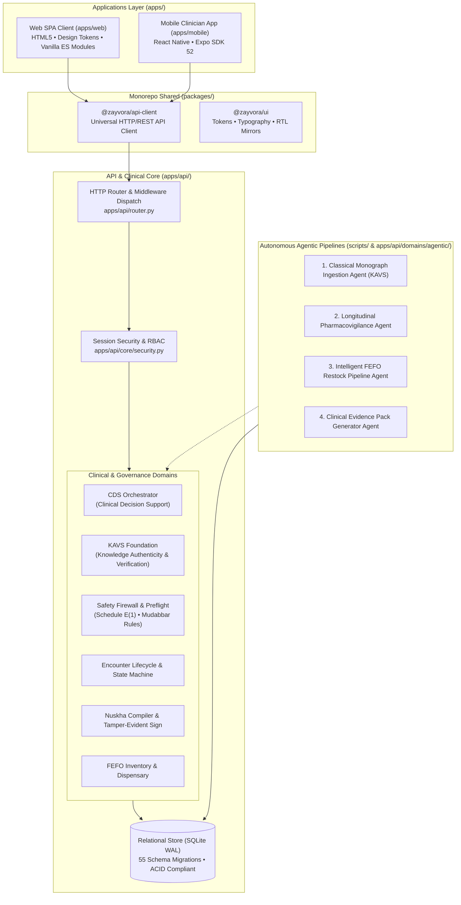

# ZAYVORA MATAB OS (Version 2.0)

> **Unani-first clinical operating system, supported by modern clinical workflows and autonomous agentic safety pipelines.**  
> *Simple for an individual Hakeem. Complete for a clinic. Enterprise-grade for a multi-facility hospital.*

[](#)
[](#)
[](#)
[](#)
[](#)

---

## 1. System Architecture

ZAYVORA MATAB OS is structured as a clean, modular monorepo separating runtime layers, client applications, shared libraries, and autonomous agentic pipelines.



---

## 2. Directory Layout

```
zayvora-matab-os/
├── apps/
│   ├── api/                     # Single Python Backend Truth (Standard Library + Zero 3P Runtime Deps)
│   │   ├── config.py            # Environment, profiles, and runtime configuration
│   │   ├── core/                # Errors, security, audit hashing, and session management
│   │   ├── database/            # Connection manager and 55 SQL schema migrations
│   │   ├── domains/             # 45+ enterprise clinical and governance domain services
│   │   ├── engines/             # Unani Mizaj assessor, organ axis, and dosing engines
│   │   ├── routes/              # Modular route handlers (73+ REST endpoints)
│   │   ├── router.py            # Route dispatch table and request correlation
│   │   └── main.py              # Server entry point & static file handler
│   ├── web/                     # Single Web Frontend Truth (Zero Build Step SPA)
│   │   ├── index.html           # Main Single Page Application shell
│   │   ├── science_and_research.html # Whitepaper, clinical trials & research portal
│   │   └── static/              # CSS tokens, views, and Vanilla JS ES Modules
│   └── mobile/                  # React Native / Expo Clinician Companion App
├── packages/                    # Monorepo Shared Libraries
│   ├── api-client/              # Universal JavaScript/TypeScript client
│   └── ui/                      # Design system tokens and styles
├── scripts/                     # Operational Tools & Agentic Pipelines
│   ├── run_agentic_pipeline.py  # Autonomous agentic workflow CLI runner
│   ├── backup_db.py             # Hot zero-downtime SQLite WAL snapshot & SHA-256 backup
│   ├── ingest_classical_monographs.py # KAVS classical botanical monograph ingestion
│   └── generate_formulary_pdf.py# Master Clinical Formulary PDF/HTML generator
├── docs/                        # Formal Engineering & Clinical Documentation
│   ├── adr/                     # Architectural Decision Records (ADR-001 to ADR-070)
│   ├── clinical/                # Master Clinical Formulary & protocol compendia
│   └── audit/                   # Security, compliance, and gap audit reports
├── infra/                       # Deployment Manifests (Docker, Systemd, Nginx)
├── dist/                        # Build artifacts and sanitized release packages
├── tests/                       # Comprehensive Test Automation Suite
│   ├── unit/                    # 400+ domain unit tests
│   ├── integration/             # 100+ end-to-end API integration tests
│   └── e2e/                     # Smoke tests and workflow simulation
├── Makefile                     # Standard developer commands
├── start_matab.sh               # 1-Click launcher for macOS / Linux
└── ZAYVORA_Matab_OS.command     # macOS Finder double-click application launcher
```

---

## 3. Autonomous Agentic Pipelines

ZAYVORA MATAB OS incorporates 4 autonomous background agentic pipelines designed to eliminate tedious research and manual clinic overhead:

1. **Classical Monograph Ingestion Pipeline (KAVS):** Ingests raw classical texts (Ibn Sina, Razi, Azam Khan, Kabiruddin), maps classical botanical aliases to binomial nomenclature, validates toxicity against statutory Schedule E(1) rules, and persists verifiable citations with cryptographic SHA-256 fingerprints.
2. **Longitudinal Pharmacovigilance Surveillance Agent:** Continuously scans patient follow-ups, adverse event reports, and post-encounter notes to detect adverse reactions or batch contamination clusters before they become safety hazards.
3. **Intelligent FEFO Restock Pipeline Agent:** Predicts dispensary herb consumption from real-time prescription velocity and clinical seasonality, cross-references First-Expired, First-Out (FEFO) batch inventory, and auto-generates supplier purchase drafts.
4. **Clinical Evidence Pack Generator Agent:** On-demand synthesis engine that cross-references classical Unani compendia with modern PubMed/AYUSH clinical evidence to produce instant, verified evidence briefs for complex cases.

To run the full autonomous agentic pipeline suite:
```bash
python3 scripts/run_agentic_pipeline.py
```

---

## 4. Governed Classical Sources & Safety Rules

All botanical monographs, formulation recipes, and clinical heuristics cite verified statutory sources:
- **NFUM (National Formulary of Unani Medicine):** Parts I-VI.
- **UPI (Unani Pharmacopoeia of India):** Parts I-II.
- **Al-Qanun fi al-Tibb (Avicenna):** Theoretical Mizaj and Afaal organ principles.
- **Bayaz-e-Kabir (Hakeem Kabiruddin):** Formulation recipes and corrective adjuvants (*Badal / Musleh*).
- **Schedule E(1) & Mudabbar Rules:** Mandatory verification of statutory detoxification protocols for toxic botanicals (e.g. *Kuchla / Strychnos nux-vomica*).

---

## 5. Developer Quickstart & Commands

### Prerequisites
- Python 3.9+ (Python Standard Library only; zero external runtime dependencies)
- Modern Web Browser (Chrome, Firefox, Safari, Edge)

### Standard Commands (`make`)
```bash
# Run complete test suite (524 tests)
make test

# Run unit tests only
make test-unit

# Run integration tests only
make test-integration

# Apply schema migrations (55 SQL migrations)
make migrate

# Seed synthetic development dataset
make seed

# Start the standalone server on http://localhost:8080
make run

# Clean temporary files, pycache, and test artifacts
make clean

# Build clean, secret-free release ZIP distribution
make package
```

### Manual Launch
```bash
# Recommended 1-Click Launch (auto-frees port and opens browser)
./start_matab.sh

# Or start directly
python3 apps/api/main.py
```

---

## 6. Seed Accounts & Roles

| Role | Username | Password | Purpose |
|---|---|---|---|
| Organization Admin | `admin` | `matab123` | Multi-facility administration, RBAC, and audit inspection |
| Practitioner (Hakeem) | `hakeem` | `matab123` | BUMS clinical consultation canvas & prescription signing |
| Front Desk / Reception | `reception` | `matab123` | Patient registration, token queue, and check-in |
| Pharmacist | `pharmacy` | `matab123` | Dispensary inventory & FEFO batch dispensation |
| Compliance Auditor | `auditor` | `matab123` | Read-only tamper-evident audit ledger inspection |

---

## 7. Security & Compliance Invariants

- **Fail-Closed Clinical Safety:** No prescription can be finalized if safety preflight returns `BLOCK` or `UNKNOWN`.
- **Clinician-in-the-Loop:** AI assistants never sign prescriptions; electronic signing requires practitioner PIN verification.
- **Tamper-Evident Ledger:** Prescriptions and audit events are cryptographically sealed with SHA-256 forward-hash chaining.
- **Zero Secrets / Zero External Calls:** Designed to function entirely offline on local premises without exposing patient protected health information (PHI) to third-party cloud services.
