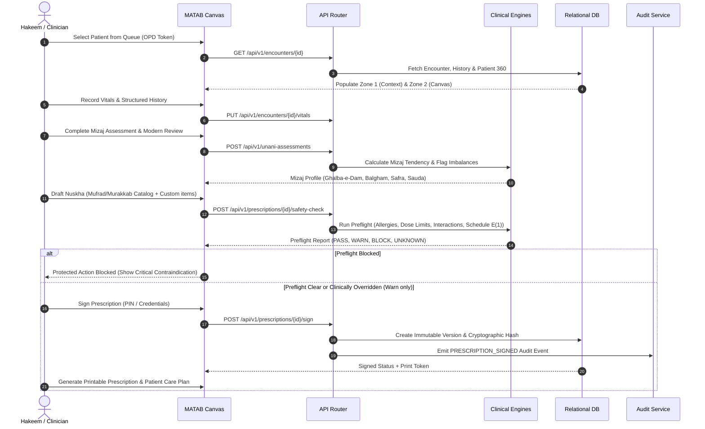

# ZAYVORA MATAB OS — System Architecture Blueprint

**Version:** 1.1  
**Classification:** Standalone Clinical Operating System  
**Deployment Target:** On-premise Clinic Server / Cloud Managed Tenancy / Hybrid Edge  

---

## 1. Architectural Philosophy & Hard Independence Boundary

ZAYVORA MATAB OS is an independent, Unani-first clinical operating system designed for solo practicing Hakeems, multi-practitioner clinics, and institutional hospitals. It is explicitly engineered with **zero runtime dependency** on the legacy ZAYVORA Health OS codebase, databases, microservices, or private APIs.

### 1.1 Invariant Architecture Principles

1. **Standalone Sovereignty:** MATAB OS owns its own repository, relational schema, application runtime, domain engines, audit logs, authentication, and deployment lifecycle. If external systems are offline or destroyed, MATAB OS continues normal clinical operations unimpeded.
2. **Simple Front of House / Powerful Back of House:** The practicing Hakeem experiences a calm, low-cognitive-load, 5-destination interface with a unified 3-Zone Consultation Canvas. Complex clinical safety engines, dose checkers, ontology mappers, and audit listeners execute contextually behind the scenes without cluttering navigation.
3. **Relational Truth Before Indexes:** The primary source of truth for patient identity, clinical observations, signed prescriptions, care plans, inventory, and audit events is an ACID-compliant relational store. Graph/vector representations are auxiliary read-only indexes for evidence retrieval.
4. **Deterministic Safety Preflight:** Prescription safety is enforced server-side before electronic signing. Safety evaluations yield four deterministic states: `PASS`, `WARN`, `BLOCK`, and `UNKNOWN`. High-risk `BLOCK` rules prohibit signing; unverified safety conditions trigger a fail-closed policy (`UNKNOWN` requires explicit clinical review).
5. **No Autonomous AI Signing:** Generative assistants and clinical AI agents (e.g., Scribe, Socratic guidance) act strictly as advisory drafts. They cannot sign prescriptions, finalize encounters, order medications, or dispense items.
6. **Immutable Clinical History:** Signed consultation notes and prescriptions are append-only. Corrections require superseding amendments referencing the parent record with full practitioner audit trails.

---

## 2. Multi-Profile Topology (Three Modes, One Platform)

MATAB OS operates as a unified codebase configured dynamically via tenant profiles:

```
┌────────────────────────────────────────────────────────────────────────┐
│                        ZAYVORA MATAB OS RUNTIME                        │
├────────────────────────────────┬───────────────────────────────────────┤
│ Profile A: MATAB (Solo Hakeem) │ - Single-room queue & walk-in OPD     │
│                                │ - Fast 5-minute Consultation Canvas   │
│                                │ - Unani assessment & Nuskha compiler  │
│                                │ - Thermal/PDF prescription printing   │
├────────────────────────────────┼───────────────────────────────────────┤
│ Profile B: CLINIC (Multi-Doc)  │ + Multi-practitioner appointment slots│
│                                │ + Dispensary & FEFO batch inventory   │
│                                │ + Patient billing, receipts & ledger  │
│                                │ + Role-scoped access (Hakeem, Attendant)│
├────────────────────────────────┼───────────────────────────────────────┤
│ Profile C: HOSPITAL (Inst.)    │ + Multi-department facility topology  │
│                                │ + Enterprise RBAC & Break-glass audit │
│                                │ + Standard FHIR / ABDM connector stubs│
│                                │ + Batch recall & multi-store pharmacy │
└────────────────────────────────┴───────────────────────────────────────┘
```

---

## 3. Modular Monolith Domain Boundaries

The application is structured into decoupled domain services communicating via well-defined in-process contracts and transactional boundaries:

```
                               ┌─────────────────────────┐
                               │       Client Shell      │
                               │  (Web / Canvas / PWA)   │
                               └────────────┬────────────┘
                                            │ HTTP / JSON REST
                               ┌────────────▼────────────┐
                               │  API Gateway & Router   │
                               │  Tenant & Auth Context  │
                               └────────────┬────────────┘
                                            │
        ┌───────────────────────────────────┼──────────────────────────────────┐
        │                                   │                                  │
┌───────▼────────┐                 ┌────────▼───────┐                 ┌────────▼───────┐
│    IDENTITY    │                 │    PATIENTS    │                 │   ENCOUNTERS   │
│  Tenants, Org, │                 │  MPI, Demogr,  │                 │ Queue, Canvas, │
│  Roles, Auth   │                 │  Duplicates    │                 │ Notes, Vitals  │
└───────┬────────┘                 └────────┬───────┘                 └────────┬───────┘
        │                                   │                                  │
        ├───────────────────────────────────┼──────────────────────────────────┤
        │                                   │                                  │
┌───────▼────────┐                 ┌────────▼───────┐                 ┌────────▼───────┐
│     UNANI      │                 │CLINICAL SUPPORT│                 │ KNOWLEDGE/EVID │
│ Ajnas, Mizaj,  │                 │ Modern Red Flag│                 │ Monograph, ZKB,│
│ Afaal, Asbab   │                 │ Differentials  │                 │ Provenance     │
└───────┬────────┘                 └────────┬───────┘                 └────────┬───────┘
        │                                   │                                  │
        ├───────────────────────────────────┼──────────────────────────────────┤
        │                                   │                                  │
┌───────▼────────┐                 ┌────────▼───────┐                 ┌────────▼───────┐
│ PRESCRIPTIONS  │                 │   OPERATIONS   │                 │   GOVERNANCE   │
│ Nuskha Builder,│                 │ Appointments,  │                 │ Registry, Audit│
│ Preflight Check│                 │ FEFO Inventory │                 │ Tamper Log     │
└───────┬────────┘                 └────────┬───────┘                 └────────┬───────┘
        │                                   │                                  │
        └───────────────────────────────────┼──────────────────────────────────┘
                                            │
                               ┌────────────▼────────────┐
                               │ Relational Persistence │
                               │  (SQLite / PostgreSQL)  │
                               └─────────────────────────┘
```

---

## 4. End-to-End Clinical Flow



---

## 5. Technology Stack Selection Rationale

- **Runtime:** Python 3.9+ standard modular engine. Zero build step, zero fragile external node runtime requirements on local clinic hardware, instant startup (<50ms), and 100% deterministic test execution.
- **Database:** SQLite 3 with Write-Ahead Logging (WAL), `foreign_keys = ON`, strict parameterization, and zero-configuration embedded deployment for small Matabs; clean migration path to PostgreSQL for enterprise hospitals.
- **Frontend:** Semantic HTML5, CSS custom properties with responsive token architecture, vanilla modern ES modules. Accessible keyboard navigation, high-contrast Unani palette (emerald/sage/gold), touch-first controls for mobile/tablet bedside visits, and zero npm supply-chain vulnerabilities.
- **Security:** Argon2id / PBKDF2 password hashing, secure HTTP-only session tokens, strict tenant isolation via organization/facility query filters, and SHA-256 tamper-evident chaining on the clinical audit log.
