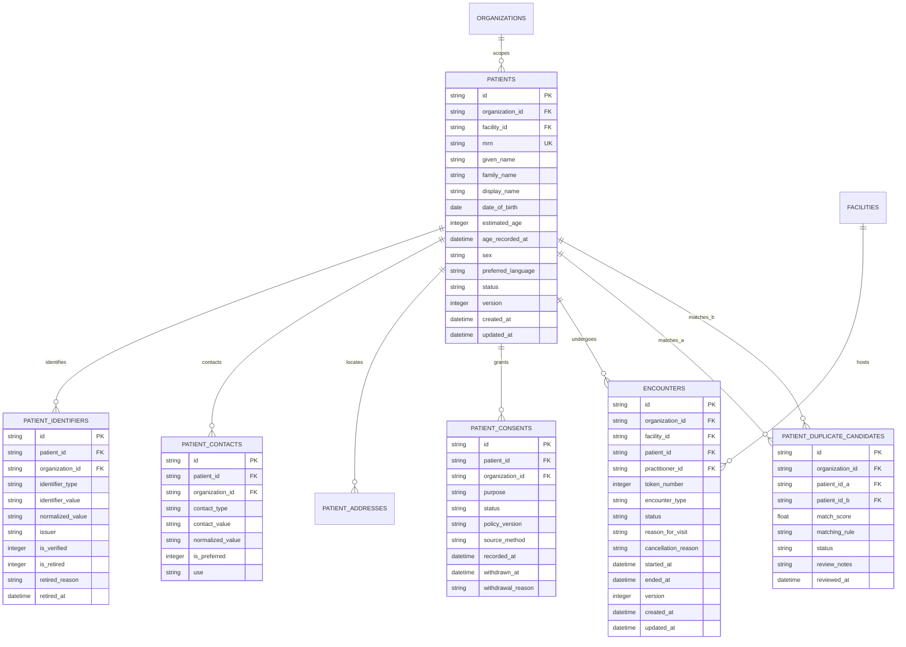

# ZAYVORA MATAB OS — Data Model: Patient Registry & Encounter Architecture

**Phase:** Phase 1 — Core Clinical Workflow (Prompt 02)  
**Schema Migration:** `002_patient_encounter_schema.sql`  
**Status:** Internal development vertical slice; not clinically validated or production-approved.

---

## 1. Relational Entity Overview

---

## 2. Table Specifications

### 2.1 `patients`
- Primary patient demographic record.
- Every record is strictly scoped by `organization_id`.
- `mrn` (Medical Record Number) is sequentially assigned per tenant: `MRN-{YYYY}-{seq:05d}`.
- Concurrency protection: `version` integer increments on every update; dirty writes are rejected with HTTP 409 Conflict.
- Indices: `idx_patients_org_mrn`, `idx_patients_org_name`, `idx_patients_org_dob`.

### 2.2 `patient_identifiers`
- Stores national, regional, or insurance identifiers (e.g. `ABHA`, `AADHAAR_LAST4`, `PASSPORT`).
- Unique active constraint: only one active (`is_retired=0`) identifier per type/normalized value per organization.
- Soft retirement: retiring an identifier sets `is_retired=1`, `retired_reason`, and `retired_at` without deleting audit history.

### 2.3 `patient_contacts`
- Channels of communication: `PHONE`, `EMAIL`, `WHATSAPP`.
- `normalized_value`: stripped national format enabling deterministic matching across varied input formats.
- `is_preferred`: marks default phone/email for clinic notices.

### 2.4 `patient_consents`
- Explicit, auditable consent records per patient and purpose.
- Valid purposes: `GENERAL_CARE`, `COMMUNICATION_SMS`, `COMMUNICATION_WHATSAPP`, `DATA_SHARING_RESEARCH`, `EXTERNAL_REFERRAL`.
- Valid states: `GRANTED`, `REFUSED`, `WITHDRAWN`.
- Withdrawal captures `withdrawn_at` and `withdrawal_reason`.

### 2.5 `patient_duplicate_candidates`
- Stores detected candidate pairs between existing patients or upon registration conflicts.
- Records matching score (e.g. 0.90 for phone match, 0.98 for identifier match, 0.85 for name+DOB match).
- Human resolution status: `PENDING_REVIEW`, `CONFIRMED_DIFFERENT`, `DEFERRED`.

### 2.6 `encounters`
- Clinical consultation sessions.
- Automatically assigns a sequential daily `token_number` per facility (`date(created_at) = date('now')`).
- Enforces state machine: `DRAFT` -> `IN_PROGRESS` -> `COMPLETED` / `CANCELLED`.
- Versioned concurrency on drafts.
