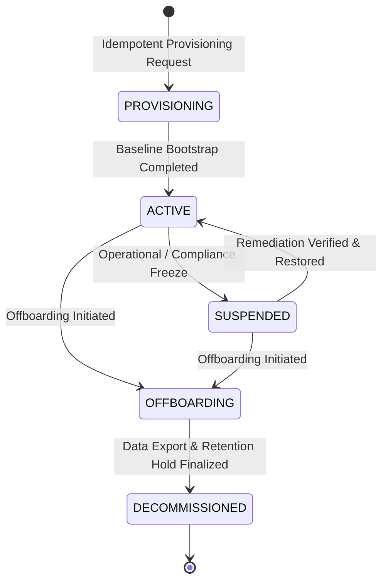

# ZAYVORA MATAB OS — SaaS Tenant Lifecycle State Machine & Policy

**Document ID:** ARCH-LIFECYCLE-TENANT-001  
**Phase:** 4 — Tenant and Membership Lifecycle  
**Date:** 2026-10-15  
**Author:** Principal SaaS Architect & Clinical Safety Officer  
**Status:** Approved  

---

## 1. Lifecycle State Machine

---

## 2. State Definitions & Operational Boundaries

| Lifecycle State | Clinical Writes Permitted | Clinical Reads Permitted | API & Integrations | Admin / Billing Access | Description |
|---|---|---|---|---|---|
| `PROVISIONING` | No | No | No | Provisioning Only | Initial tenant database setup, facility seeding, default admin invitation. |
| `ACTIVE` | **Yes** | **Yes** | **Yes** | Full Access | Normal production operations across all clinics and branches. |
| `SUSPENDED` | **BLOCKED** | Limited (Remediation) | **BLOCKED** | Read-Only Admin | Clinical intake, prescriptions, and external syncs blocked fail-closed. |
| `OFFBOARDING` | **BLOCKED** | Export Only | **BLOCKED** | Export & Retention Admin | Active clinical care terminated; preparing tenant archive. |
| `DECOMMISSIONED`| **BLOCKED** | **BLOCKED** | **BLOCKED** | Audit-Only | Permanent archival state; read/write access denied. |

---

## 3. Permitted State Transitions

| From State | To State | Initiator / Role Required | Validation & Side Effects |
|---|---|---|---|
| `PROVISIONING` | `ACTIVE` | `SYSTEM` or `PLATFORM_ADMIN` | Verifies default facility exists, admin membership active, baseline plan assigned. |
| `ACTIVE` | `SUSPENDED` | `PLATFORM_ADMIN` or `ORG_ADMIN` | Requires explicit reason code (`BILLING_OVERDUE`, `SECURITY_BREACH`, `CLINICAL_SAFETY_HOLD`). Revokes active sessions. |
| `SUSPENDED` | `ACTIVE` | `PLATFORM_ADMIN` | Requires remediation justification. Re-enables operational write access. |
| `ACTIVE` | `OFFBOARDING` | `ORG_ADMIN` (dual-signoff) | Generates dry-run impact summary; checks for open clinical encounters. |
| `SUSPENDED` | `OFFBOARDING` | `PLATFORM_ADMIN` | Allows tenant to be offboarded directly from suspended state. |
| `OFFBOARDING` | `DECOMMISSIONED` | `PLATFORM_ADMIN` | Requires completion of tenant-scoped clinical export and confirmation of retention holds. |

---

## 4. Clinical Safety Invariant During Suspension

> **Fail-Closed Clinical Safety Rule:**
> When an organization is in `SUSPENDED` status, no new encounters can be started, no prescriptions can be signed or amended, and no lab/ABDM data can be ingested. 
> To prevent abandonment of patients already under active treatment, clinicians can view existing historical records in read-only mode with an emergency banner, but cannot mutate records until the suspension is resolved.

---

## 5. Offboarding & Retention Policy

1. **Dry-Run Impact Summary:** Before any destructive offboarding occurs, a dry-run calculation must be performed, reporting:
   - Total registered patients
   - Total clinical encounters
   - Total prescriptions and formulations
   - Total billing records and outstanding balances
   - Open appointments requiring rescheduling
   - Unresolved pharmacovigilance or clinical safety incidents
2. **Tenant-Scoped Data Export:**
   - Complete export generated in machine-readable JSON format.
   - Text fields scrubbed for CSV formula injection mitigation (`=`, `+`, `-`, `@`, `\t`, `\r`).
3. **Statutory Retention Holds:**
   - Medical records are held for the legally required period (minimum 10 years for adult records, age 21 for pediatric records under Indian AYUSH/NMC guidelines).
   - Decommissioned status archives the data securely in place without dropping historical audit trails.
