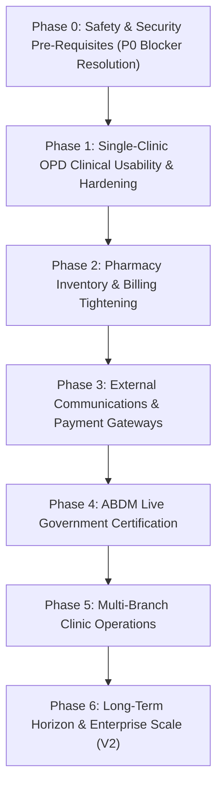

# ZAYVORA MATAB OS — Prioritized V1 Execution Roadmap (Phases 0–6)

**Audit Version:** 1.0.0 (Prompt 50 Repository-Wide Baseline)  
**Methodology:** Dependency-ordered, ticket-ready execution plan to transition the verified codebase into a production-releasable V1 single-facility Matab operating system.

---

## Roadmap Overview & Phase Sequence

---

## Phase 0: Safety & Security Pre-Requisites (P0 Blocker Resolution)
*Objective: Eliminate all release-blocking safety, security, and data integrity risks prior to live patient data entry.*

### Ticket P0-T1: Clinical Monograph Formal Digital Sign-Off (`GAP-P0-01`)
- **Action:** Convene an AYUSH-accredited Tabib panel to review and cryptographically sign top 100 core Unani single herbs and compound formulations in `unani_monographs`.
- **Affected Files:** `apps/api/domains/clinical_safety_case_service.py`, `apps/api/domains/knowledge_governance_service.py`.
- **Acceptance Criteria:** `clinical_rule_proposals` and `clinical_safety_cases` record the Tabib's registration number and digital signature hash; safety gate requires valid sign-off.
- **Verification:** `tests/integration/test_clinical_safety_api.py`.

### Ticket P0-T2: Production Secret Key Fail-Closed Enforcement (`GAP-P0-02`)
- **Action:** Add startup validation in `apps/api/core/config.py` that halts application boot if `ENVIRONMENT=production` and `JWT_SECRET` is unset, default, or fewer than 32 characters.
- **Affected Files:** `apps/api/core/config.py`, `apps/api/core/auth.py`.
- **Acceptance Criteria:** Fast boot failure with explicit log message if default keys are detected in production mode.
- **Verification:** `tests/unit/test_security_core.py`.

### Ticket P0-T3: Mudabbar Batch Attestation at Pharmacy Dispensary (`GAP-P0-03`)
- **Action:** Update dispensary dispensing endpoint to require the pharmacist to enter and verify the physical Mudabbar batch certificate number when dispensing Schedule E(1) formulations.
- **Affected Files:** `apps/api/domains/dispensing_engine.py`, `apps/api/routes/inventory.py`.
- **Acceptance Criteria:** Dispensing Schedule E(1) items without batch verification returns `HTTP 400 Bad Request` with `MUDABBAR_CERTIFICATE_REQUIRED`.
- **Verification:** `tests/integration/test_inventory_api.py`.

### Ticket P0-T4: SQLite WAL Periodic Checkpointing & Integrity Verification (`GAP-P0-04`)
- **Action:** Implement a background maintenance worker that executes `PRAGMA wal_checkpoint(TRUNCATE)` every 60 minutes and validates database integrity with `PRAGMA integrity_check`.
- **Affected Files:** `apps/api/domains/disaster_recovery_service.py`, `apps/api/core/database.py`.
- **Acceptance Criteria:** Checkpoint logs emitted; corrupted database file triggers instant alert and failover to latest snapshot.
- **Verification:** `tests/unit/test_disaster_recovery.py`.

---

## Phase 1: Single-Clinic OPD Clinical Usability & Hardening
*Objective: Maximize Tabib ergonomics, consultation speed, and prescription print fidelity.*

### Ticket P1-T1: Bilingual Urdu/English Prescription PDF Font Bundling (`GAP-P1-05`)
- **Action:** Package open-source Noto Nastaliq Urdu and Roboto fonts directly into the application distribution image to ensure 100% consistent prescription PDF rendering across all OS platforms.
- **Affected Files:** `apps/api/domains/prescription_pdf_service.py`, `Dockerfile`.
- **Acceptance Criteria:** Prescription PDFs render authentic Urdu Nastaliq typography without system font dependencies.
- **Verification:** `tests/unit/test_prescription_pdf.py`.

### Ticket P1-T2: High-Speed Consultation Keyboard Navigation
- **Action:** Refine frontend keyboard hotkeys (`Ctrl+Enter` to sign, `Alt+N` for new prescription item, `Esc` to close modals) in the consultation stepper.
- **Affected Files:** `apps/web/static/js/views/knowledge_admin.js`.
- **Acceptance Criteria:** Full consultation workflow navigable without mouse interaction.
- **Verification:** Manual UI walkthrough and E2E smoke tests.

---

## Phase 2: Pharmacy Inventory & Billing Tightening
*Objective: Ensure 100% financial reconciliation and accurate stock level tracking.*

### Ticket P2-T1: Dispensary Barcode Scanner Support
- **Action:** Verify standard HID USB/Bluetooth barcode scanner wedge support in the pharmacy dispensing interface for rapid medicine selection.
- **Affected Files:** `apps/web/static/js/views/knowledge_admin.js`.
- **Acceptance Criteria:** Scanning a medicine barcode instantly adds the item to the dispensing batch queue.
- **Verification:** Unit test for barcode string event parsing.

### Ticket P2-T2: Daily Cashier Financial Reconciliation Report
- **Action:** Provide an automated end-of-day cashier closing report reconciling cash in drawer, UPI transfers, and card receipts against issued invoices.
- **Affected Files:** `apps/api/domains/billing_service.py`, `apps/api/routes/billing.py`.
- **Acceptance Criteria:** Daily summary endpoint produces verifiable balance report linked to `clinical_audit_ledger`.
- **Verification:** `tests/integration/test_billing_api.py`.

---

## Phase 3: External Communications & Payment Gateways
*Objective: Activate real outbound SMS/WhatsApp channels and live payment gateway callbacks.*

### Ticket P3-T1: Outbound SMS & WhatsApp Provider Integration (`GAP-P1-01`)
- **Action:** Configure live Twilio / Meta Cloud WhatsApp API credentials in the deployment secrets vault; replace synthetic mock adapter in production environment.
- **Affected Files:** `apps/api/domains/communication_gateway.py`.
- **Acceptance Criteria:** Live SMS sent to patient phone with appointment confirmation; delivery receipt logged in `patient_communications`.
- **Verification:** `tests/integration/test_continuity_api.py`.

### Ticket P3-T2: Razorpay / Stripe Live Webhook Signature Verification (`GAP-P1-03`)
- **Action:** Enable cryptographic HMAC-SHA256 signature verification for inbound payment webhooks.
- **Affected Files:** `apps/api/routes/billing.py`, `apps/api/domains/billing_service.py`.
- **Acceptance Criteria:** Reject unsigned or tampered payment callbacks; credit invoices upon verified payment capture.
- **Verification:** `tests/integration/test_billing_api.py`.

---

## Phase 4: ABDM Live Government Certification
*Objective: Transition ABDM from synthetic sandbox to live National Health Authority network.*

### Ticket P4-T1: ABDM Production Sandbox Exit & Certification (`GAP-P1-02`)
- **Action:** Submit synthetic test execution logs to NHA for formal M1 (ABHA creation), M2 (health record discovery), and M3 (FHIR bundle exchange) clearance.
- **Affected Files:** `apps/api/domains/abdm_gateway.py`.
- **Acceptance Criteria:** Receive production client ID and cryptographic bridge keys from NHA.
- **Verification:** `tests/integration/test_abdm_api.py`.

---

## Phase 5: Multi-Branch Clinic Operations
*Objective: Support multi-facility clinic chains with centralized administration.*

### Ticket P5-T1: Multi-Branch Inventory Transfers & Stock Pooling
- **Action:** Enable inter-branch stock requisition, transit tracking, and receiving workflows in `apps/api/domains/branch_service.py`.
- **Affected Files:** `apps/api/domains/branch_service.py`, `apps/api/routes/branches.py`.
- **Acceptance Criteria:** Stock deducted from transferring branch and credited to receiving branch upon physical receipt confirmation.
- **Verification:** `tests/integration/test_tenancy_api.py`.

---

## Phase 6: Long-Term Horizon & Enterprise Scale (V2)
*Objective: Expand into inpatient hospital operations, advanced chaos engineering, and external IoT bio-sensors.*

- **V2-T1:** Inpatient ward management, bed census allocation, and nurse medication administration records (eMAR).
- **V2-T2:** Cloud database migration from embedded SQLite to managed PostgreSQL 16+ with read replicas.
- **V2-T3:** Hardware IoT pulse sensor driver integration for automated classical Nabz waveform capture.
