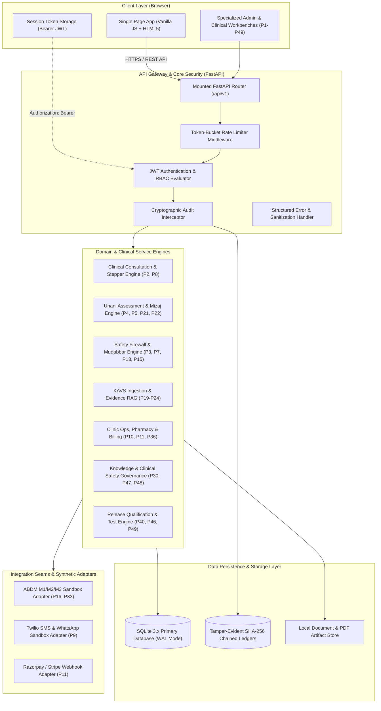

# ZAYVORA MATAB OS — Repository Architecture Map & System Topology

**Audit Version:** 1.0.0 (Prompt 50 Repository-Wide Baseline)  
**Primary Architecture Type:** Monolithic Clean Architecture with Domain-Driven Services and Single-Page Application Client  
**Primary Storage Engine:** SQLite 3.x with Write-Ahead Logging (WAL) Mode  
**Security Model:** Role-Based & Attribute-Based Access Control (RBAC/ABAC) with Tenant Isolation and Cryptographic Audit Chaining  

---

## 1. System Topology & Component Layout



---

## 2. Layer-by-Layer Architectural Breakdown

### 2.1. Client Layer (`apps/web/`)
- **Technology:** Modern vanilla ES6+ JavaScript, CSS3 flexbox/grid, HTML5 responsive semantic layout without bloated Node.js client bundles.
- **Single Page Application:** Mounted in `apps/web/static/js/views/knowledge_admin.js` (~11,500 lines) providing dedicated operational tabs for all 49 functional areas:
  - Clinical Consultation & Stepper
  - Prescription Writer & Posology Calculator
  - Classical Unani Mizaj & Pulse Radar
  - KAVS Source Ingestion & Claim Verification
  - Evidence-Aware Clinical RAG Assistant
  - CDS Recommendations & Override Logger
  - Security Posture & Vulnerability Scanner
  - Threat Modeling & STRIDE Matrix
  - Clinical Safety Cases (GSN) & Hazard Log
  - Release Qualification & Flakiness Quarantine
- **State Management:**
  - Strictly distinguishes volatile client-side view state (active tab, search filter inputs, draft form state) from canonical server-persisted domain records.
  - Form submissions trigger optimistic validation with authoritative server-side validation and database persistence confirmation before advancing workflow stages.

### 2.2. API Gateway & Middleware Layer (`apps/api/core/`)
- **FastAPI Router:** Mounted in `apps/api/router.py`, registering over 130 endpoints grouped by domain prefix (e.g., `/api/v1/auth`, `/api/v1/patients`, `/api/v1/prescriptions`, `/api/v1/safety`, `/api/v1/clinical-safety`, `/api/v1/test-qualification`).
- **Security Middleware (`apps/api/core/middleware.py`):**
  - Enforces HTTP security headers (`Content-Security-Policy`, `X-Content-Type-Options: nosniff`, `X-Frame-Options: DENY`, `Strict-Transport-Security`).
  - Rate Limiting: Sliding-window token bucket preventing brute-force credential stuffing and DoS attacks. Configured with a test seam (`MATAB_AUTH_RATE_LIMIT=10000`).
  - Strict Sanitization: Automated redaction of sensitive credentials, API keys, and stack traces from public error responses.

### 2.3. Domain Engines Layer (`apps/api/domains/`)
- **Separation of Concerns:** Business logic is encapsulated in discrete domain services and engines with zero coupling to HTTP request/response parsing.
- **Key Subsystems:**
  1. **Clinical Core:** `patient_service.py`, `encounter_service.py`, `consultation_orchestrator.py`
  2. **Unani Medicine:** `unani_assessment_engine.py`, `mizaj_service.py`, `unani_ontology_service.py`, `knowledge_mapping_service.py`
  3. **Prescribing & Safety:** `prescription_engine.py`, `posology_service.py`, `safety_firewall_engine.py`, `mudabbar_checker.py`
  4. **KAVS & Evidence:** `kavs_foundation_service.py`, `kavs_ingestion_service.py`, `evidence_verification_service.py`, `clinical_rag_service.py`
  5. **Clinical Decision Support:** `cds_orchestrator_service.py`, `pharmacovigilance_service.py`
  6. **Operations & Finance:** `inventory_service.py`, `dispensing_engine.py`, `billing_service.py`, `command_center_service.py`
  7. **Security & Risk Governance:** `enterprise_security_posture_engine.py`, `enterprise_threat_modeling_sdlc_service.py`, `clinical_safety_case_service.py`, `test_automation_release_qualification_engine.py`

### 2.4. Data Persistence & Ledger Layer (`apps/api/database/`)
- **Database Engine:** SQLite 3.x operating with `PRAGMA journal_mode = WAL` (Write-Ahead Logging), `PRAGMA synchronous = NORMAL`, and `PRAGMA foreign_keys = ON`.
- **Schema Migrations:** 48 deterministic SQL files executed sequentially via `apps/api/database/migrator.py`.
- **Tamper-Evident Chained Ledgers:**
  - Audit records maintain a `previous_hash` pointing to the SHA-256 digest of the immediately preceding record block.
  - Any out-of-band row mutation or record deletion immediately breaks the cryptographic hash chain, detected by automated integrity verification probes.

---

## 3. Trust Boundaries & Actor Personas

The system establishes five distinct trust boundaries:

```
[ External Internet / Public Network ]
       │  (TLS Termination & WAF)
       ▼
[ Trust Boundary 1: Authentication Boundary ]
       │  (JWT Verification, Rate Limiting, IP Whitelisting)
       ▼
[ Trust Boundary 2: Tenant & Role Authorization (RBAC/ABAC) ]
       │  (tenant_id enforcement, permission checks)
       ├── Clinician Persona (Doctor / Tabib / Hakeem)
       ├── Pharmacist / Dispensary Officer
       ├── Cashier / Billing Staff
       └── Compliance & Security Officer
       │
[ Trust Boundary 3: Clinical Safety & Prescribing Firewalls ]
       │  (Mudabbar check, Posology ceiling, Clinician PIN attestation)
       ▼
[ Trust Boundary 4: Data Persistence & Cryptographic Ledger ]
       │  (Parameterized SQL, DB permissions, SHA-256 chain)
       ▼
[ Trust Boundary 5: Third-Party External Gateways ]
       │  (Isolated Sandbox Adapters: ABDM, SMS, Payment)
```

---

## 4. In-Memory Seams vs Production Cloud Architecture

| Subsystem Component | Local / Test Implementation | Production Target Architecture | Rationale for Separation |
| :--- | :--- | :--- | :--- |
| **Primary Database** | Local SQLite 3.x (WAL mode) | PostgreSQL 16+ or Managed Cloud SQL | Local zero-dependency execution for clinic offline resilience; PostgreSQL for multi-region scale. |
| **Rate Limiting** | In-memory sliding-window token bucket | Redis cluster backed rate limiter | In-memory is bounded per process; Redis shares token state across load-balanced application nodes. |
| **Document / PDF Storage** | Local filesystem (`docs/`, `static/`) | AWS S3 or Google Cloud Storage with KMS | Local storage suffices for single-facility OPD; cloud object storage with WORM retention for enterprise. |
| **ABDM Gateway** | Synthetic hermetic sandbox adapter | Live National Health Authority (NHA) Bridge | Compliance with government sandbox security; live ABDM requires certified production keys. |
| **Patient Communications** | Synthetic log-based mock gateway | Twilio / Meta Cloud WhatsApp API | Prevents accidental live SMS/WhatsApp dispatch during local development and testing. |
| **Payment Gateway** | Synthetic webhook callback simulator | Razorpay / Stripe Live Webhook Engine | PCI-DSS compliance isolation; financial sandbox isolation during test suites. |
