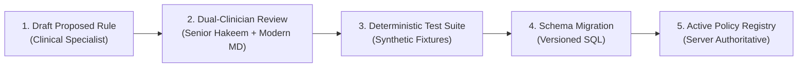

# CDS Policy Registry Governance & Rule Authoring Lifecycle

**Document ID:** CDS-POL-REG-2026-01  
**Project:** ZAYVORA MATAB OS  
**Phase:** 23 — Clinical Decision Support Orchestrator & Clinician Approval Workflow  
**Status:** Approved & Enforced

---

## 1. Governance Principle: Zero LLM Rule Authoring

In ZAYVORA MATAB OS, **no Large Language Model or autonomous agent is permitted to author, modify, activate, or reclassify clinical decision-support rules or safety policies**.

All decision-support rules stored in `cds_policy_registry` must:
1. Originate from validated clinical guidelines (AYUSH Pharmacopoeia, WHO, unani classical texts, or medical council protocols).
2. Pass peer review by an accredited Clinical Governance Committee.
3. Be committed as versioned relational database migrations.
4. Carry explicit triggering conditions, data prerequisites, severity levels, and clinical rationales.

---

## 2. Policy Schema & Attributes (`cds_policy_registry`)

Each policy row in `cds_policy_registry` defines:

| Field | Type | Description |
|---|---|---|
| `policy_code` | TEXT (Unique) | Canonical human-readable rule identifier (e.g. `POL_UNANI_MIZAJ_CHECK`, `POL_DRUG_ALLERGY_CHECK`). |
| `policy_name` | TEXT | Clear title displayed in governance audit consoles. |
| `policy_category` | TEXT | Classification: `SAFETY_INTERACTION`, `MISSING_DATA`, `EVIDENCE_GROUNDING`, `DOSAGE_CEILING`, `CONTRAINDICATION`. |
| `triggering_event` | TEXT | Encounter event that evaluates the rule: `ENCOUNTER_START`, `ASSESSMENT_SUBMIT`, `PRESCRIPTION_DRAFT`, `PRE_SIGNOFF`. |
| `severity` | TEXT | Discrete level: `INFO`, `WARNING_OVERRIDABLE`, `BLOCKING_HARD_STOP`. Models cannot alter this. |
| `evaluation_rule_sql` | TEXT | Deterministic predicate or logic definition. |
| `clinical_rationale` | TEXT | Authoritative medical rationale and literature basis. |
| `version` | TEXT | Semantic version (e.g. `2026.1.0`). |
| `is_active` | INTEGER | Active status (1 = active, 0 = disabled). |
| `reviewed_by` | TEXT | Attributed clinical reviewer ID. |
| `reviewed_at` | TIMESTAMP | Timestamp of clinical governance sign-off. |

---

## 3. Seeded Core Policies

| Policy Code | Category | Severity | Triggering Event | Summary Rule |
|---|---|---|---|---|
| `POL_PREG_CONTRAINDICATION` | `CONTRAINDICATION` | `BLOCKING_HARD_STOP` | `PRESCRIPTION_DRAFT` | Blocks abortifacient botanicals or Schedule E(1) toxic herbs if patient pregnancy status is positive or unconfirmed in females of reproductive age. |
| `POL_ALLERGY_CROSS_REACT` | `SAFETY_INTERACTION` | `BLOCKING_HARD_STOP` | `PRESCRIPTION_DRAFT` | Blocks ingredients sharing known immunological cross-reactivity with recorded patient allergies. |
| `POL_HERB_DRUG_INTERACTION`| `SAFETY_INTERACTION` | `WARNING_OVERRIDABLE` | `PRESCRIPTION_DRAFT` | Warns clinician when co-prescribing known CYP450 modulators with modern pharmaceuticals (e.g. Asgandh with Sedatives). Requires documented clinician rationale to proceed. |
| `POL_DOSE_CEILING_CHECK` | `DOSAGE_CEILING` | `BLOCKING_HARD_STOP` | `PRESCRIPTION_DRAFT` | Blocks single or daily dosage exceeding classical Unani pharmacopoeial ceiling (e.g. Afyoon > 60mg). |
| `POL_MISSING_VITALS_ALERT` | `MISSING_DATA` | `WARNING_OVERRIDABLE` | `PRE_SIGNOFF` | Prompts clinician if blood pressure, pulse, or body temperature were not recorded during consultation. |
| `POL_UNANI_MIZAJ_REQUIRED` | `EVIDENCE_GROUNDING`| `WARNING_OVERRIDABLE` | `ASSESSMENT_SUBMIT` | Verifies that a primary Mizaj determination has been documented before finalizing Usul-e-Ilaj treatment plan. |

---

## 4. Policy Change Control Workflow

1. **Rule Invalidation / Emergency Rollback:** If a rule produces false-positive blockers or a source is retracted, an administrator can toggle `is_active = 0` via the administrative console, instantly disabling the rule without taking the EHR offline.
