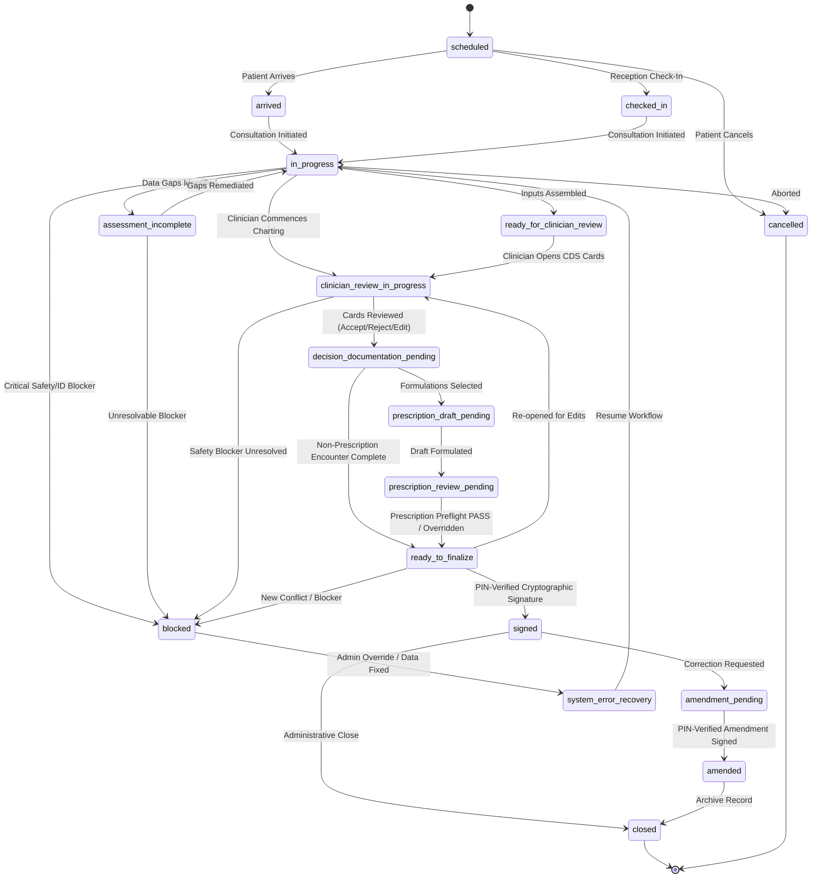

# CDS State Transitions Policy & Encounter Lifecycle Specification

**Document ID:** CDS-ST-POL-2026-01  
**Project:** ZAYVORA MATAB OS  
**Phase:** 23 — Clinical Decision Support Orchestrator & Clinician Approval Workflow  
**Status:** Approved & Enforced

---

## 1. Overview & Core Tenet

The Clinical Decision Support (CDS) Orchestrator coordinates the lifecycle of clinical consultations. It enforces deterministic, server-side state transitions that prevent skipped safety checks, unreviewed decision-support cards, unverified prescription drafts, and unsigned clinical actions.

**Core Non-Negotiable:** Under no circumstances does the system advance an encounter to `signed` or `closed` automatically, or permit client-side state manipulation to bypass mandatory gates.

---

## 2. Encounter State Transition Diagram

---

## 3. Transition Policy Matrix

| From State | Allowed Destination | Initiating Role | Prerequisite Checks & Enforcements | Side Effects |
|---|---|---|---|---|
| `scheduled` | `arrived`, `checked_in` | RECEPTIONIST, CLINICIAN, ADMIN | Patient identity resolved in `patients` table. | Sets arrival timestamp; emits `PATIENT_ARRIVED`. |
| `arrived` / `checked_in` | `in_progress` | CLINICIAN, ATTENDING_HAKEEM | Valid session, encounter lock acquired. | Initializes `encounter_version = 1`; emits `ENCOUNTER_STARTED`. |
| `in_progress` | `ready_for_clinician_review` | CLINICIAN | Minimum assessment fields entered (Chief Complaint, Vitals or Mizaj). | Triggers background CDS card synthesis; evaluates Prompt 07 safety preflight. |
| `in_progress` | `assessment_incomplete` | CLINICIAN, CDS_ENGINE | Critical fields missing (e.g. pregnancy status for Schedule E herb, unresolved weight/age). | Emits `MISSING_DATA_CARD`; sets alert banner in Zone 3 rail. |
| `ready_for_clinician_review` | `clinician_review_in_progress` | CLINICIAN | Active clinician assigned to encounter. | Locks CDS run snapshot; updates run status to `running`. |
| `clinician_review_in_progress` | `decision_documentation_pending` | CLINICIAN | All `BLOCKING` cards reviewed (`ACCEPTED`, `REJECTED`, or `DISMISSED_WITH_REASON`). | Records clinician rationale in `cds_reviews`; computes review payload hash. |
| `decision_documentation_pending` | `prescription_draft_pending` | CLINICIAN | Formulation selected from canonical catalog; dose/units specified. | Creates draft in `prescriptions` with `status = 'DRAFT'`. Zero automated prescribing. |
| `prescription_draft_pending` | `prescription_review_pending` | CLINICIAN | Draft formulation completed. | Invokes Prompt 07 Safety Firewall on exact draft items. |
| `prescription_review_pending` | `ready_to_finalize` | CLINICIAN | Safety evaluation status is `PASS`, or `WARN` with clinician documented override. No unresolved `BLOCK`. | Evaluates 6-dimension readiness gate. |
| `ready_to_finalize` | `signed` | CLINICIAN | 1. 6-Dimension Readiness Gate PASS. 2. Exact encounter/prescription version matches. 3. Correct PIN verified server-side. 4. Signer has active clinical credential. | Generates SHA-256 signature hash; freezes encounter snapshot; emits `CLINICAL_SIGNOFF`. |
| `signed` | `amendment_pending` | CLINICIAN | Explicit amendment justification provided. Original signed version remains immutable. | Creates pending row in `encounter_amendments`. |
| `amendment_pending` | `amended` | CLINICIAN | PIN-verified signature on amendment delta. | Attaches amendment hash; links to parent signed encounter. |
| Any active state | `blocked` | SYSTEM / SAFETY_FIREWALL | Unresolved severe contraindication, allergy shock risk, or corrupted audit log. | Halts forward progress; displays mandatory remediation path. |

---

## 4. Concurrency & Version Invalidation

1. **Optimistic Locking:** Every encounter transaction checks `encounter_version`. If a concurrent edit modifies the encounter, any in-flight CDS evaluation run is marked `superseded` or `stale`.
2. **Version Pinning:** A clinician signs version $N$. If the encounter advances to $N+1$ before signature confirmation, the sign action fails closed with `ConflictError: Encounter was modified concurrently`.
3. **Draft Preservation:** Transition failures or server errors NEVER delete user-entered chart notes or draft prescriptions.
