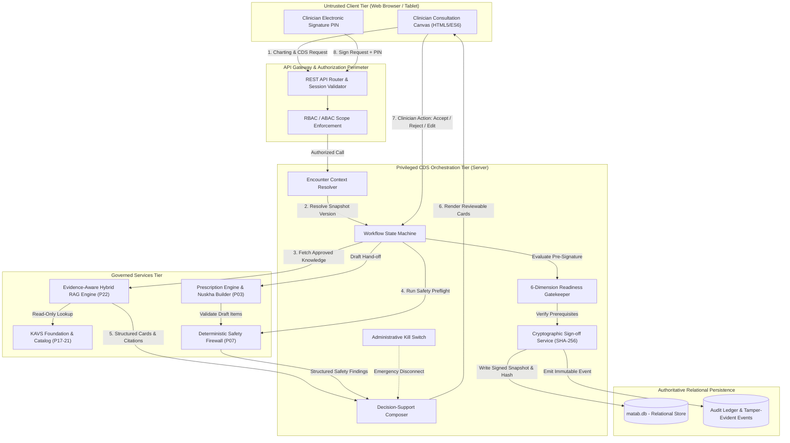

# CDS Trust Boundary & Clinical Data-Flow Architecture

**Document ID:** CDS-TB-DF-2026-01  
**Project:** ZAYVORA MATAB OS  
**Phase:** 23 — Clinical Decision Support Orchestrator & Clinician Approval Workflow  
**Status:** Approved & Enforced

---

## 1. Architectural Philosophy & Zero-Trust Perimeter

In ZAYVORA MATAB OS, AI models, knowledge embeddings, external FHIR transfers, and client browsers operate strictly **outside** the privileged clinical authority boundary. 

1. **Client UI is Untrusted:** The frontend cannot assert that safety checks passed, that an identity is verified, or that an encounter is signed.
2. **AI / RAG Layer is Advisory Only:** The Hybrid RAG engine (Prompt 22) synthesizes cited information; it cannot execute database writes, change encounter status, or approve its own draft suggestions.
3. **Deterministic Safety Firewall is Independent:** Prompt 07 safety checks run on server-side relational tables; their findings cannot be silenced or bypassed by language models.
4. **Relational Database is Authoritative:** SQLite in WAL mode guarantees ACID persistence, foreign-key referential integrity, and verifiable immutability.

---

## 2. Trust Boundary Diagram

---

## 3. Data Flow Steps & Invariants

| Step | Action | Trust Boundary Crossing | Security & Clinical Guarantees |
|---|---|---|---|
| **1. Request** | Clinician opens encounter and triggers CDS run. | Untrusted Client $\rightarrow$ API Gateway | Enforces tenant isolation, session freshness, and `cds:run` permission. |
| **2. Snapshot** | Context Resolver pulls patient vitals, allergies, active meds, and diagnosis. | API Gateway $\rightarrow$ Orchestration Tier | Locks encounter snapshot version ($N$). Conflicting data flagged explicitly. |
| **3. Knowledge** | Retrieval Adapter requests cited literature. | Orchestrator $\rightarrow$ Hybrid RAG (P22) | Minimum necessary patient context passed. Zero patient data leakage into global index. |
| **4. Safety** | Safety Evaluation Adapter invokes Prompt 07 firewall. | Orchestrator $\rightarrow$ Safety Firewall | Deterministic rule execution against canonical substances. Distinguishes `completed_within_scope` from absolute safety. |
| **5. Synthesis** | Decision-Support Composer formats typed cards. | Governed Services $\rightarrow$ Composer | Cards bind triggering inputs, evidence IDs, limitations, and severities. |
| **6. Review** | Cards rendered on Zone 3 guidance rail. | Composer $\rightarrow$ Clinician UI | No card defaults to accepted. Strong alerts reserved for blockers. |
| **7. Decision** | Clinician records accept, reject, edit, or defer action with mandatory rationale for blockers. | Clinician UI $\rightarrow$ Orchestrator | Attributed to clinician ID, timestamp, and review hash. Stored in `cds_reviews`. |
| **8. Sign-off** | Clinician enters signature PIN to finalize encounter. | Clinician UI $\rightarrow$ Readiness Gate | Evaluates all 6 readiness dimensions. Computes canonical SHA-256 digital fingerprint. |
| **9. Commit** | Encounter marked `signed`; immutable audit event emitted. | Orchestrator $\rightarrow$ Relational DB | Record becomes write-protected. Subsequent modifications require versioned amendment. |
