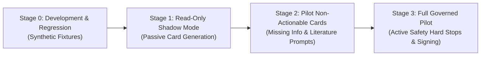

# Clinical Governance Review Checklist & Controlled Rollout Plan

**Document ID:** CDS-GOV-CHK-2026-01  
**Project:** ZAYVORA MATAB OS  
**Phase:** 23 — Clinical Decision Support Orchestrator & Clinician Approval Workflow  
**Status:** Approved & Enforced

---

## 1. Clinical Governance Review Checklist

Before enabling Clinical Decision Support (CDS) orchestration features for live patient encounters, the Clinical Governance Committee must audit and verify each item below:

### 1.1 Non-Autonomous Decision Perimeter
- [x] **No Autonomous Prescribing:** Verify that the system never generates or signs an active prescription without explicit clinician action.
- [x] **No Auto-Diagnosis:** Verify that AI cannot independently assign a diagnosis, disease cause, or treatment plan.
- [x] **No Self-Approval:** Confirm that AI and automated test runners cannot approve cards or mark safety checks as passed.
- [x] **No Default Acceptance:** Ensure that zero decision-support cards default to `ACCEPTED` in the user interface.

### 1.2 Data Integrity & Provenance
- [x] **Origin Attribution:** Confirm that every patient datum (vital, lab, allergy, medication) clearly indicates its origin (`patient_reported`, `clinician_observed`, `laboratory_result`, `approved_rule_result`).
- [x] **Unani / Modern Separation:** Verify that Unani Mizaj and modern ICD-10 diagnoses remain distinct and cannot be coerced into false equivalence without an approved crosswalk.
- [x] **Organ-Axis Caution:** Confirm that Organ-Axis framework groups are used solely for navigation and catalog structure, never as diagnostic assertions.
- [x] **Uncertainty Transparency:** Verify that missing data, ambiguous substance identity, and stale results are explicitly labeled as `UNKNOWN`, `INCOMPLETE`, or `STALE`.

### 1.3 Safety Firewall & Hard Stops
- [x] **Independent Firewall:** Confirm that Prompt 07 safety checks execute server-side and cannot be bypassed or silenced by the UI or RAG answer generator.
- [x] **Non-Overridable Blockers:** Ensure that absolute contraindications (e.g. fatal drug interactions, lethal dosage ceilings) prevent encounter signature without exception.
- [x] **Governed Warning Overrides:** Verify that overridable warnings require attributed clinician identity, written rationale, and PIN re-entry.

### 1.4 Legal Accountability & Non-Repudiation
- [x] **PIN Verification:** Confirm that finalizing an encounter requires server-side PIN authentication.
- [x] **Cryptographic Hash:** Ensure that the final signed encounter snapshot is fingerprinted with SHA-256.
- [x] **Append-Only Amendments:** Confirm that signed records are immutable and corrections are preserved as auditable `encounter_amendments`.
- [x] **Audit Trail Immutability:** Verify that every state transition, card review, override, and signature emits an immutable event to the clinical audit ledger.

---

## 2. Controlled Staged Rollout Plan

To ensure patient safety and clinical workflow ergonomics, CDS Orchestrator capabilities are deployed in four controlled phases:

### Stage 0: Synthetic Test Verification (Completed)
- 100% pass rate across unit and integration suites (`test_cds_orchestrator.py`, `test_cds_orchestrator_api.py`).
- Zero regressions across the entire platform (509 total tests passing).

### Stage 1: Read-Only Shadow Mode
- System runs CDS card synthesis in the background for select clinics.
- Output is logged to audit stores for clinical panel review; cards are NOT surfaced to practicing clinicians.
- Assesses alert frequency, relevance, and false-positive rates.

### Stage 2: Controlled Pilot — Non-Actionable Cards
- Surfaces informative and missing-information cards only (e.g. unrecorded vitals, relevant unani classical literature passages).
- Evaluates clinician cognitive load and charting efficiency.
- Safety hard stops operate in passive warning mode.

### Stage 3: Full Production Release — Governed Clinical Gates
- Active enforcement of the 6-dimension readiness gate.
- Hard stops block signature for unresolved safety contraindications.
- Full cryptographic attestation and amendment ledger enabled.
- Emergency Kill Switch remains permanently accessible in the administrative console to disable AI decision-support instantaneously if needed.
