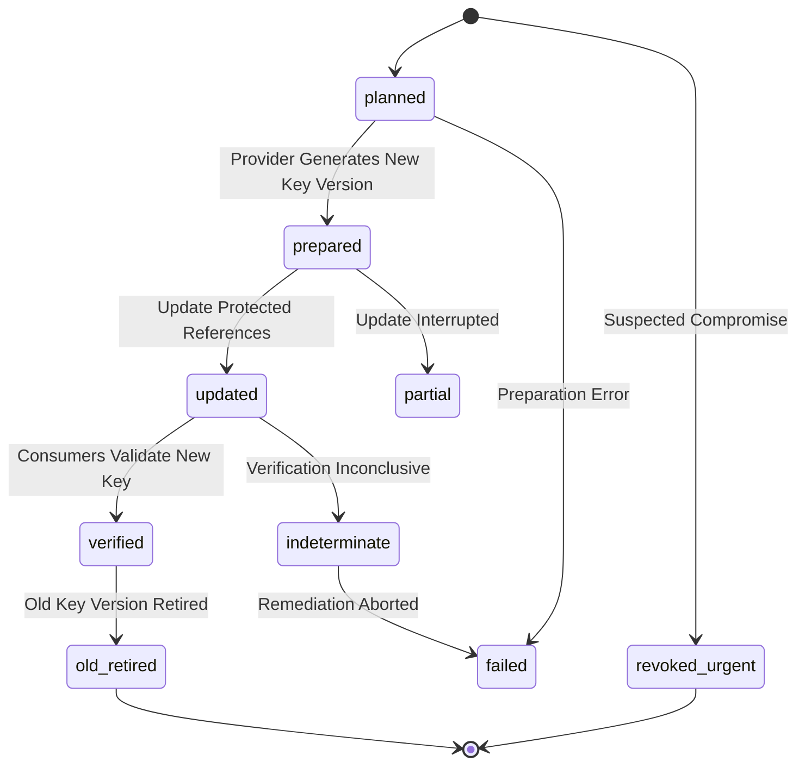

# ZAYVORA MATAB OS — CONFIGURATION, SECRETS & ENVIRONMENT GOVERNANCE SPECIFICATION
**Module:** Enterprise Configuration, Secrets & Environment Governance Engine  
**Document ID:** P44-SPEC-001  
**Status:** APPROVED ARCHITECTURAL SPECIFICATION  
**Target Migration:** `043_enterprise_config_secrets_environment_governance_schema.sql`  
**Target ADR:** `ADR-063`

---

## 1. Architectural Scope & Objectives

The Configuration, Secrets & Environment Governance Engine provides continuous, cryptographically verified, and auditable control over application runtime configuration, credential lifecycles, and environment isolation boundaries across ZAYVORA MATAB OS.

It enforces five non-negotiable architectural mandates:
1. **Zero Secret Exposure:** Secret values are never stored in source code, committed files, client bundles, database catalog tables, log outputs, or error traces. Only metadata, key versions, provider references, and cryptographic fingerprints are persisted.
2. **Deterministic Startup Preflight:** Production deployment fails closed if any required configuration is missing, malformed, or using default development fallbacks.
3. **Environment Isolation Invariants:** Derives environment identity from trusted deployment metadata; strictly enforces that test, fixture, simulation, or restore drill processes cannot connect to production databases or trigger live external side effects.
4. **Governed Secret Rotation:** Manages secret rotation as a provider-aware, multi-phase, idempotent lifecycle (`planned`, `prepared`, `updated`, `verified`, `old_retired`) with automated consumer validation.
5. **Config Drift & Change Proposals:** Detects unmanaged settings, missing parameters, wrong-environment secret references, and expired credentials through scheduled or on-demand drift scans.

---

## 2. Core Entities & Relational Schema (Migration 043)

### 2.1 `config_settings_catalog`
Canonical inventory of governed settings.
- `id`: TEXT PRIMARY KEY
- `organization_id`: TEXT NOT NULL
- `config_key`: TEXT NOT NULL UNIQUE
- `description`: TEXT NOT NULL
- `category`: TEXT NOT NULL CHECK(category IN ('PUBLIC_CLIENT', 'SERVER_RUNTIME', 'SECRET_CREDENTIAL', 'SECURITY_POLICY', 'CLINICAL_WORKFLOW_POLICY', 'FEATURE_FLAG_POLICY', 'DERIVED'))
- `data_type`: TEXT NOT NULL CHECK(data_type IN ('string', 'integer', 'boolean', 'json', 'url', 'enum', 'secret_ref'))
- `owner_team`: TEXT NOT NULL
- `environment_scope`: TEXT NOT NULL DEFAULT 'all' CHECK(environment_scope IN ('all', 'development', 'staging', 'production', 'test'))
- `tenant_scope`: TEXT NOT NULL DEFAULT 'global' CHECK(tenant_scope IN ('global', 'tenant', 'facility'))
- `precedence_order`: TEXT NOT NULL DEFAULT 'ENV_OVER_DB' CHECK(precedence_order IN ('ENV_OVER_DB', 'DB_OVER_ENV', 'SECRET_STORE_ONLY', 'IMMUTABLE_FILE'))
- `is_required`: INTEGER NOT NULL DEFAULT 1 CHECK(is_required IN (0, 1))
- `default_value_json`: TEXT NOT NULL DEFAULT 'null'
- `validation_rules_json`: TEXT NOT NULL DEFAULT '{}'
- `is_runtime_refreshable`: INTEGER NOT NULL DEFAULT 0 CHECK(is_runtime_refreshable IN (0, 1))
- `change_risk_level`: TEXT NOT NULL DEFAULT 'low' CHECK(change_risk_level IN ('low', 'medium', 'high', 'critical'))
- `required_approver_role`: TEXT NOT NULL DEFAULT 'PLATFORM_ADMIN'
- `consumers_json`: TEXT NOT NULL DEFAULT '[]'
- `created_at`, `updated_at`: TEXT NOT NULL

### 2.2 `config_environments_registry`
Environment definitions and security perimeter controls.
- `id`: TEXT PRIMARY KEY
- `environment_code`: TEXT NOT NULL UNIQUE CHECK(environment_code IN ('local_dev', 'shared_dev', 'test_ci', 'staging_synthetic', 'production'))
- `name`: TEXT NOT NULL
- `purpose`: TEXT NOT NULL
- `owner`: TEXT NOT NULL
- `database_resource_type`: TEXT NOT NULL
- `database_resource_ref`: TEXT NOT NULL
- `secret_store_namespace`: TEXT NOT NULL
- `service_identity`: TEXT NOT NULL
- `ingress_policy`: TEXT NOT NULL
- `egress_policy`: TEXT NOT NULL
- `external_api_classification`: TEXT NOT NULL CHECK(external_api_classification IN ('SANDBOX', 'PRODUCTION', 'MOCK_ONLY'))
- `synthetic_data_only`: INTEGER NOT NULL DEFAULT 1 CHECK(synthetic_data_only IN (0, 1))
- `destructive_actions_allowed`: INTEGER NOT NULL DEFAULT 0 CHECK(destructive_actions_allowed IN (0, 1))
- `live_messaging_allowed`: INTEGER NOT NULL DEFAULT 0 CHECK(live_messaging_allowed IN (0, 1))
- `live_payments_allowed`: INTEGER NOT NULL DEFAULT 0 CHECK(live_payments_allowed IN (0, 1))
- `active_config_version`: TEXT NOT NULL DEFAULT '1.0.0'
- `verification_status`: TEXT NOT NULL DEFAULT 'verified' CHECK(verification_status IN ('verified', 'unverified', 'mismatch', 'degraded'))
- `last_verified_at`: TEXT
- `created_at`, `updated_at`: TEXT NOT NULL

### 2.3 `config_secret_references`
Metadata catalog of credentials (strictly no raw secret text).
- `id`: TEXT PRIMARY KEY
- `organization_id`: TEXT NOT NULL
- `secret_name`: TEXT NOT NULL UNIQUE
- `secret_type`: TEXT NOT NULL CHECK(secret_type IN ('DATABASE_CREDENTIAL', 'API_KEY', 'WEBHOOK_SIGNING_SECRET', 'ENCRYPTION_KEY', 'SESSION_KEY', 'NOTIFICATION_GATEWAY_CREDENTIAL', 'ABDM_BRIDGE_CREDENTIAL', 'PAYMENT_GATEWAY_KEY', 'BACKUP_ENCRYPTION_KEY'))
- `provider_type`: TEXT NOT NULL CHECK(provider_type IN ('VAULT', 'AWS_SECRETS_MANAGER', 'GCP_SECRET_MANAGER', 'AZURE_KEY_VAULT', 'KUBERNETES_SECRET', 'ENV_VARIABLE'))
- `provider_secret_ref`: TEXT NOT NULL
- `environment_code`: TEXT NOT NULL REFERENCES config_environments_registry(environment_code)
- `owner_team`: TEXT NOT NULL
- `authorized_consumers_json`: TEXT NOT NULL DEFAULT '[]'
- `key_version`: TEXT NOT NULL DEFAULT 'v1'
- `status`: TEXT NOT NULL DEFAULT 'active' CHECK(status IN ('active', 'rotation_in_progress', 'retired', 'revoked', 'compromised'))
- `created_at`, `rotated_at`, `expires_at`: TEXT
- `last_verified_at`: TEXT
- `incident_id`: TEXT

### 2.4 `config_secret_rotations`
Traceable execution records for secret rotation and urgent revocation.
- `id`: TEXT PRIMARY KEY
- `secret_ref_id`: TEXT NOT NULL REFERENCES config_secret_references(id)
- `organization_id`: TEXT NOT NULL
- `rotation_reason`: TEXT NOT NULL CHECK(rotation_reason IN ('SCHEDULED_EXPIRY', 'ROUTINE_SECURITY_POLICY', 'STAFF_TURNOVER', 'SUSPECTED_COMPROMISE', 'SYSTEM_UPGRADE'))
- `initiated_by`: TEXT NOT NULL
- `old_key_version`: TEXT NOT NULL
- `new_key_version`: TEXT NOT NULL
- `state`: TEXT NOT NULL CHECK(state IN ('planned', 'prepared', 'updated', 'verified', 'old_retired', 'partial', 'failed', 'indeterminate', 'revoked_urgent'))
- `consumer_validation_json`: TEXT NOT NULL DEFAULT '{}'
- `sanitized_evidence_json`: TEXT NOT NULL DEFAULT '{}'
- `failure_reason`: TEXT
- `initiated_at`, `completed_at`: TEXT

### 2.5 `config_change_proposals`
Governed change requests with separation of duties.
- `id`: TEXT PRIMARY KEY
- `organization_id`: TEXT NOT NULL
- `title`: TEXT NOT NULL
- `environment_code`: TEXT NOT NULL REFERENCES config_environments_registry(environment_code)
- `requester_id`: TEXT NOT NULL
- `change_category`: TEXT NOT NULL CHECK(change_category IN ('RUNTIME_SETTING', 'SECURITY_POLICY', 'CLINICAL_WORKFLOW', 'ENDPOINT_UPDATE'))
- `diff_metadata_json`: TEXT NOT NULL DEFAULT '{}'
- `impact_assessment_json`: TEXT NOT NULL DEFAULT '{}'
- `rollback_plan`: TEXT NOT NULL
- `status`: TEXT NOT NULL DEFAULT 'draft' CHECK(status IN ('draft', 'review_pending', 'approved', 'rejected', 'applied', 'rolled_back'))
- `approved_by`: TEXT
- `approved_at`: TEXT
- `applied_at`: TEXT
- `created_at`, `updated_at`: TEXT NOT NULL

### 2.6 `config_drift_scans` & `config_drift_findings`
Automated drift detection ledger.
- Detects `UNMANAGED_SETTING`, `VALUE_MISMATCH`, `WRONG_ENVIRONMENT_SECRET`, `DISABLED_SECURITY_CONTROL`, `EXPIRED_CREDENTIAL`, `STALE_FLAG`, `UNEXPECTED_ENDPOINT`, `MOCK_IN_PRODUCTION`.
- Categorizes findings by severity: `info`, `warning`, `critical`.

### 2.7 `config_audit_ledger`
Append-only tamper-evident audit ledger capturing actor, action, environment, key reference, and sanitized metadata.

---

## 3. Preflight & Rotation Workflows

### 3.1 Startup Preflight Check
- Validates all `is_required=1` catalog keys against runtime configuration.
- Verifies format, URL scheme allowlists, integer bounds, and enum sets.
- If `environment_code == 'production'`:
  - Rejects development default keys (`DEFAULT_INSECURE_KEYS`).
  - Rejects `MOCK_ONLY` external service adapters.
  - Enforces minimum secret key length ($\ge 32$ characters).
  - Enforces explicit non-wildcard CORS origins.

### 3.2 Rotation State Machine

