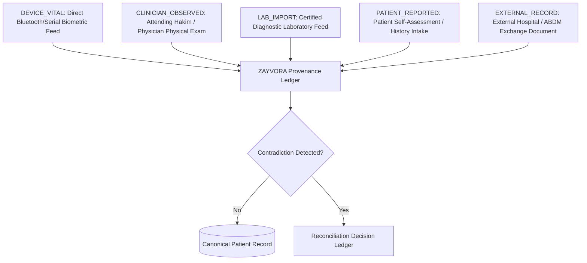

# ZAYVORA MATAB OS — Clinical Field Provenance Contract & Data Dictionary

**Document Type:** Data Architecture Contract & Field Provenance Specification  
**Phase:** 24 — Clinical Workflow Intelligence, Missing-Information Detection & Data-Quality Engine  
**System:** ZAYVORA MATAB OS (Standalone Matab/Clinic Operating System)  
**Status:** Active / Governed  
**Date:** October 2026  

---

## 1. Provenance Architecture Overview

In an integrative clinical environment where traditional Unani diagnostic observations (Nabz, Baul, Baraz, Mizaj) coexist with contemporary biometrics (systolic/diastolic blood pressure, SpO2, blood glucose) and external health records (ABDM, scanned discharge summaries), **field-level provenance is essential for clinical safety, legal accountability, and diagnostic credibility**.

The ZAYVORA Clinical Field Provenance Engine guarantees:
1. **Source Stream Attribution:** Every clinical value is linked to its verified source stream (`PATIENT_REPORTED`, `CLINICIAN_OBSERVED`, `DEVICE_VITAL`, `EXTERNAL_RECORD`, `LAB_IMPORT`).
2. **Dual-Representation Retention:** Both the raw, unedited input (`original_value`) and the validated, canonicalized representation (`normalized_value`) are immutably preserved.
3. **Explicit Units of Measurement:** Observation values are invalid without explicit, validated units (e.g., `mmHg`, `bpm`, `°C`, `°F`, `mg/dL`, `g/dL`, `Mizaj Degree 1-4`).
4. **Prohibition of Silent Overwrites:** If a new observation conflicts with an established baseline, both values are preserved in history, and a reconciliation event is created.

---

## 2. Source Stream Hierarchy & Trust Profiles

| Source Stream | Trust Tier | Primary Use Case | Overwrite Behavior |
|---|---|---|---|
| **`CLINICIAN_OBSERVED`** | Tier 1 (Gold Standard) | Physical examination, Nabz palpation, classical inspection, differential diagnosis. | Cannot be overwritten by patient self-report or automated feeds without explicit clinician reconciliation. |
| **`LAB_IMPORT`** | Tier 1 (Analytical) | Formal clinical biochemistry, pathology, imaging reports from accredited diagnostic labs. | Updates existing lab panels; discrepancies trigger review finding. |
| **`DEVICE_VITAL`** | Tier 2 (Direct Instrument) | Automated sphygmomanometer, pulse oximeter, digital thermometry. | Captures raw reading and calibration metadata. Flagged if deviating >20% from clinician baseline. |
| **`PATIENT_REPORTED`** | Tier 3 (Subjective Intake) | Chief complaint, historical allergies, self-reported medication adherence, family pedigree. | Never accepted as definitive clinical refutation of past documented allergies or conditions. |
| **`EXTERNAL_RECORD`** | Tier 3 (Interoperability) | ABDM FHIR summaries, third-party clinic discharge summaries. | Ingested with external provenance tags; requires clinician attestation before merging into active problem list. |

---

## 3. Data Dictionary & Field-Level Validation Contracts

### 3.1 Patient Demographics & Identification (Front Desk Domain)

| Field Key | Data Type | Canonical Unit | Permissible Values / Constraints | Required Context | Validation Rule ID |
|---|---|---|---|---|---|
| `patient_name` | String | N/A | Non-empty, UTF-8, min length 2, regex `^[\p{L}\s.'-]+$` | All Patients | `R-PAT-001` |
| `date_of_birth` | Date | ISO 8601 | $1900-01-01 \le DOB \le CurrentDate$ | All Patients | `R-PAT-002` |
| `gender` | Enum | N/A | `MALE`, `FEMALE`, `OTHER`, `UNKNOWN` | All Patients | `R-PAT-003` |
| `phone_number` | String | E.164 | Valid international or national telephone schema | All Patients | `R-PAT-004` |
| `national_id` | String | N/A | Valid National ID / Aadhaar / Passport hash | Multi-Branch / Insurance | `R-PAT-005` |
| `emergency_contact`| Object | N/A | Contains `name`, `relationship`, `phone_number` | Pediatric & Geriatric | `R-PAT-006` |

### 3.2 Clinical Vitals & Biometrics (Triage & Nursing Domain)

| Field Key | Data Type | Canonical Unit | Physiological Plausibility Range | Critical Boundary Range | Validation Rule ID |
|---|---|---|---|---|---|
| `systolic_bp` | Integer | `mmHg` | $50 \le Value \le 260$ | Value $< 70$ or $> 190$ | `R-VIT-001` |
| `diastolic_bp` | Integer | `mmHg` | $30 \le Value \le 160$ (Must be $< Systolic$) | Value $< 40$ or $> 120$ | `R-VIT-002` |
| `heart_rate` | Integer | `bpm` | $30 \le Value \le 220$ | Value $< 45$ or $> 140$ | `R-VIT-003` |
| `respiratory_rate`| Integer | `breaths/min` | $8 \le Value \le 60$ | Value $< 10$ or $> 32$ | `R-VIT-004` |
| `temperature` | Decimal | `°C` or `°F` | $32.0 \le °C \le 43.0$ / $89.6 \le °F \le 109.4$ | Value $> 39.5°C$ ($103.1°F$) | `R-VIT-005` |
| `oxygen_sat` | Integer | `%` | $50 \le Value \le 100$ | Value $< 90\%$ | `R-VIT-006` |
| `weight` | Decimal | `kg` | $1.0 \le Value \le 350.0$ | N/A | `R-VIT-007` |
| `height` | Decimal | `cm` | $30.0 \le Value \le 250.0$ | N/A | `R-VIT-008` |

### 3.3 Classical Unani Examination & Assessment (Clinician Domain)

| Field Key | Data Type | Canonical Classification | Permissible Values | Required Context | Validation Rule ID |
|---|---|---|---|---|---|
| `mizaj_primary` | Enum | Classical Temperament | `DAMWI` (Sanguineous), `BALGHAMI` (Phlegmatic), `SAFRAWI` (Bilious), `SAUDAWI` (Melancholic), `MUTADIL` (Equable) | Unani Consultation | `R-UNA-001` |
| `mizaj_degree` | Integer | Maratib (Degrees) | $1, 2, 3, 4$ | Su-e-Mizaj assessment | `R-UNA-002` |
| `nabz_miqdar` | Enum | Pulse Quantity (Length/Breadth/Depth) | `TAWEEL`, `QASEER`, `AREEZ`, `ZAYYIQ`, `AZEEM`, `SAGHEER` | Nabz Examination | `R-UNA-003` |
| `nabz_qawwat` | Enum | Pulse Strength | `QAWI` (Strong), `DAEEF` (Weak), `MUTAWASSIT` (Medium) | Nabz Examination | `R-UNA-004` |
| `nabz_surat` | Enum | Pulse Velocity | `SAREE` (Rapid), `BATEE` (Slow), `MUTAWASSIT` | Nabz Examination | `R-UNA-005` |
| `nabz_tawatur` | Enum | Pulse Frequency | `MUTAWATIR` (Frequent), `MUTATAWAFIQ` (Infrequent) | Nabz Examination | `R-UNA-006` |
| `baul_qawam` | Enum | Urine Consistency | `RAQEEQ` (Thin), `GHAREEZ` (Thick), `MUTAWASSIT` | Baul Examination | `R-UNA-007` |
| `baraz_lawn` | Enum | Stool Color | `ABYAZ` (White), `ASWAD` (Black), `AHMAR` (Red), `ASFAR` (Yellow) | Baraz Examination | `R-UNA-008` |
| `usul_e_ilaj` | Text | Clinical Treatment Plan | Mandatory rationale, target humors, regimen steps | Completed Encounter | `R-UNA-009` |

### 3.4 Prescription & Pharmacotherapy (Clinician & Pharmacist Domain)

| Field Key | Data Type | Canonical Schema | Validation Constraints | Severity on Failure | Validation Rule ID |
|---|---|---|---|---|---|
| `item_name` | String | Canonical Formula / Herb | Must resolve to active KAVS catalog entry | `BLOCKER` | `R-RX-001` |
| `dosage_quantity`| Decimal | Posology | Must be $> 0$; within catalog safe daily boundaries | `BLOCKER` | `R-RX-002` |
| `dosage_unit` | Enum | Canonical Weight/Vol | `g`, `mg`, `ml`, `qurs`, `habb`, `khamira`, `tola`, `masha` | `BLOCKER` | `R-RX-003` |
| `dosage_frequency`| String | Sig Frequency | Valid frequency code (`QD`, `BID`, `TID`, `QID`, `PRN`, `HS`) | `BLOCKER` | `R-RX-004` |
| `instructions` | String | Patient Guidance | Non-empty administration guidance (e.g., "After meals with Arq Badiyan") | `BLOCKER` | `R-RX-005` |
| `duration_days` | Integer | Posology Timeline | Must be $\ge 1$ and $\le 180$ | `WARNING` | `R-RX-006` |

---

## 4. Conflict Detection and Reconciliation Ledger

### 4.1 Contradiction Scenarios
When the Data Quality Engine inspects clinical records, it identifies three classes of contradictions:
1. **Intra-Encounter Logic Violation:** Directly contradictory entries submitted in a single encounter (e.g., Systolic BP: 80, Diastolic BP: 120; or Pregnant: YES in a Male patient).
2. **Temporal Discrepancy:** A freshly recorded observation directly contradicts a verified historical permanent record (e.g., Historical Penicillin Anaphylaxis vs new entry "No Known Allergies").
3. **Multi-Source Disparity:** A device feed reports Heart Rate 145 bpm while nurse triage note records 72 bpm taken at the same minute.

### 4.2 The Reconciliation Decision Ledger (`dq_reconciliation_decisions`)
Every conflict must be resolved through a formal reconciliation decision authored by an authorized clinician. The schema enforces:
- `finding_id`: Foreign key linking to the generated data quality finding.
- `chosen_value`: The authoritative value selected by the clinician.
- `rejected_values`: JSON array preserving all superseded values with their respective sources and timestamps.
- `clinical_rationale`: Mandatory natural language explanation justifying the decision.
- `reconciled_by`: User ID of the licensed clinician.
- `reconciled_at`: UTC timestamp of the resolution.

Automatic overrides by heuristic scripts, AI models, or background daemons are architecturally blocked.

---

## 5. Security and Immutability Safeguards

1. **Audit Ledger Immutability:** Entries in `dq_field_provenance` and `dq_reconciliation_decisions` are append-only. Modification and deletion queries are disabled at the SQLite trigger level.
2. **Tenant Isolation:** All field keys and patient identifiers are scoped strictly to the local tenant instance.
3. **Clinician Attestation Signature:** Resolving a `BLOCKER` data-quality finding requires the session's authenticated JWT to possess the `data_quality:reconcile` permission.
