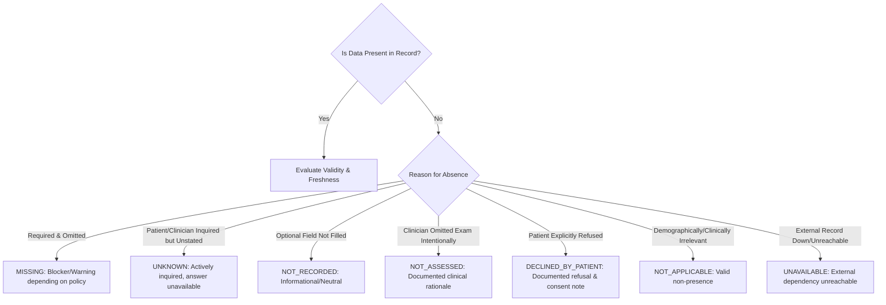

# ZAYVORA MATAB OS — Data Quality Dimensions & Missingness State Registry

**Document Type:** Clinical Governance Specification & Dimension Registry  
**Phase:** 24 — Clinical Workflow Intelligence, Missing-Information Detection & Data-Quality Engine  
**System:** ZAYVORA MATAB OS (Standalone Matab/Clinic Operating System)  
**Status:** Active / Governed  
**Date:** October 2026  

---

## 1. Executive Summary & Clinical Governance Foundations

In clinical medicine—and particularly within an integrative Matab setting combining classical Unani Tibb and modern evidence-based practice—**the absence of documented data must never be equated with the absence of disease or pathology**. Treating unrecorded clinical variables as "normal", "negative", or "zero" is a primary cause of diagnostic misclassification, adverse drug events, and compromised patient safety.

Furthermore, aggregate numerical completeness percentages (e.g., "Encounter 92% Complete") can dangerously conceal fatal single-point contradictions, such as an unrecorded allergy history or an inverted blood pressure measurement.

The ZAYVORA Data Quality Engine establishes:
1. **Eight Explicit Dimensions of Clinical Data Quality**, each independently audited.
2. **Seven Canonical Missingness States**, rejecting binary null/empty interpretations.
3. **Deterministic Severity Classification** (`INFO`, `WARNING`, `CRITICAL`, `BLOCKER`).
4. **Transparent Role-Routed Remediation** assigning actionable tasks directly to qualified personnel (`FRONT_DESK`, `TRIAGE_NURSE`, `CLINICIAN`, `PHARMACIST`, `ADMIN`).
5. **Fail-Closed Clinical Workflow Gating**, ensuring no consultation with an unresolved `BLOCKER` finding can be signed off.

---

## 2. The Eight Clinical Data Quality Dimensions

| # | Dimension | Code | Definition | Scope | Clinical Risk of Failure |
|---|---|---|---|---|---|
| 1 | **Completeness / Presence** | `PRESENCE` | Verification that all clinically or administratively required attributes exist within the record. | Patient, Encounter, Vitals, Assessment, Prescription | Overlooked red flags, omitted chief complaints, incomplete identity. |
| 2 | **Validity / Plausibility** | `VALIDITY` | Verification that observation values conform to physiological boundaries, valid units of measurement, and permissible lexical schemas. | Vitals, Lab values, Age, Dosages | Absurd calculations, overdosing, erroneous unit conversions (°C vs °F). |
| 3 | **Consistency / Concordance** | `CONSISTENCY` | Verification that distinct observations within or across encounters do not contradict each other logically or physiologically. | Encounter vitals, Diagnoses, Regimen | Systolic BP < Diastolic BP, contradictory allergy declarations, conflicting Mizaj assessments. |
| 4 | **Timeliness / Freshness** | `FRESHNESS` | Evaluation of observation elapsed age against domain-governed maximum permissible validity windows. | Vitals, Pregnancy status, Medication review, Lab results | Acting upon outdated vital signs, administering contraindicated herbs in changed physiological states. |
| 5 | **Provenance / Attribution** | `PROVENANCE` | Verification that every clinical data element has an immutable source stream, capture timestamp, author ID, and origin integrity marker. | All entities and fields | Inability to audit source, loss of legal accountability, confusion between patient self-report and clinician exam. |
| 6 | **Identity / Uniqueness** | `IDENTITY` | Identification of potential duplicate patient records, unverified demographics, or conflated identifiers. | Patient Registry, MRN, National ID | Split records, fragmented longitudinal history, erroneous treatment delivery to wrong patient. |
| 7 | **Review / Attestation** | `REVIEW` | Verification that required clinical reviews, acknowledgments, or clinician signatures have been formally completed. | Encounters, CDS recommendations, Triage notes | Unauthorized orders, unreviewed critical lab values, unvetted AI/CDS outputs. |
| 8 | **Workflow Readiness** | `WORKFLOW_PREREQUISITE` | Verification that an encounter or clinical order satisfies all prerequisite criteria required to advance to the next operational phase. | Triage-to-Consultation, Draft-to-Signoff, Dispense | Incomplete handoffs, premature encounter sign-off, dispensing unverified prescriptions. |

---

## 3. Canonical Missingness States

ZAYVORA MATAB OS strictly outlaws the coercion of missing data into implicit defaults (e.g., converting empty allergy lists into `NIL_KNOWN_ALLERGIES` or absent fever records into `Apyrexial`). Every absent field must resolve to one of the following canonical missingness states:

### 3.1 State Definitions and Clinical Semantics

#### 1. `MISSING`
- **Definition:** The clinical or administrative data element is mandatory for safe clinical decision-making or workflow progression, but is completely absent from the record.
- **CDS & Gating Impact:** Generates a `WARNING` or `BLOCKER` finding. Blocks encounter sign-off if designated as a safety prerequisite.
- **Example:** Blood pressure omitted during adult hypertension consultation, or absent dosage in an active Nuskha prescription.

#### 2. `UNKNOWN`
- **Definition:** The clinician or triage nurse actively inquired regarding the data element, but the patient, attendant, or historical record could not provide the information.
- **CDS & Gating Impact:** Accepted as an explicit state. CDS flags the unknown status and does not assume a negative/safe state (e.g., unknown allergy status triggers conservative prescribing warnings).
- **Example:** Patient adopted and unaware of family history of coronary artery disease.

#### 3. `NOT_RECORDED`
- **Definition:** An optional, secondary, or auxiliary field was left unpopulated during routine clinical documentation.
- **CDS & Gating Impact:** Treated as neutral / `INFO`. No negative or affirmative inference is permitted.
- **Example:** Tongue coating sub-classification in a minor orthopedic consultation.

#### 4. `NOT_ASSESSED`
- **Definition:** The clinician consciously and deliberately chose not to perform the examination, procedure, or assessment at this encounter, typically due to acute contraindications, patient distress, or deferral to a specialist.
- **CDS & Gating Impact:** Satisfies documentation presence requirements if accompanied by clinical justification; cannot be treated as a normal finding.
- **Example:** Abdominal palpation deferred due to acute severe burn on the abdominal wall.

#### 5. `DECLINED_BY_PATIENT`
- **Definition:** The patient or authorized surrogate was offered the examination, inquiry, or screening, but explicitly exercised their right of refusal.
- **CDS & Gating Impact:** Clears presence blocker, records mandatory patient refusal entry in compliance ledger, and triggers informed refusal warnings for high-risk protocols.
- **Example:** Patient declines rectal examination or weight measurement.

#### 6. `NOT_APPLICABLE`
- **Definition:** The field is clinically, anatomically, or demographically irrelevant to the patient's biological profile or consultation context.
- **CDS & Gating Impact:** Valid state. Completely exempt from missingness penalties.
- **Example:** Last Menstrual Period (LMP) in a male patient or prostate screening in a female patient.

#### 7. `UNAVAILABLE`
- **Definition:** The information is known to exist within an external system (e.g., hospital PACS, ABDM health repository, external laboratory), but is currently inaccessible due to network, technical, or interoperability barriers.
- **CDS & Gating Impact:** Prompts retry / manual document upload workflow. CDS issues a cautionary advisory.
- **Example:** ABDM consent granted but gateway reports external hospital repository timeout.

---

## 4. Severity Classification Schema

Findings generated across all eight dimensions are categorized into four discrete, immutable severity tiers:

| Severity Tier | Definition | Workflow Impact | Deferral Permitted? | Clinician Action Required |
|---|---|---|---|---|
| **`INFO`** | Optimization suggestions, minor formatting notices, or secondary missing attributes. | None. Logged to encounter audit trail. | Yes (auto-cleared or noted) | Optional review |
| **`WARNING`** | Non-critical omission, moderately stale observation, or minor non-fatal discrepancy. | Advisory banner in Consultation Workspace; CDS flags elevated vigilance. | Yes (requires brief rationale) | Acknowledge or rectify |
| **`CRITICAL`** | Serious clinical omission, severe unit abnormality, or significant data freshness expiration (e.g., stale vitals in acute triage). | High-visibility alert; highlighted in CDS evaluation; requires formal acknowledgement. | Yes (requires explicit clinical justification) | Mandatory review with justification |
| **`BLOCKER`** | Fatal safety hazard, missing critical allergy status, inverted blood pressure, absent prescription dosage, or unresolved high-confidence identity collision. | **Hard Stop.** Fail-closed gate blocks encounter sign-off and prescription transmission. | **NO.** Deferral strictly prohibited. | Must resolve finding or execute authorized clinician reconciliation |

---

## 5. Role-Routed Remediation Matrix

Unlike generic alerting systems that broadcast alerts indiscriminately, ZAYVORA routes data quality findings directly to the exact role accountable for the domain:

| Operational Role | Primary Finding Categories | Typical Remediations | UI Destination |
|---|---|---|---|
| **`FRONT_DESK`** | Identity collisions, missing contact numbers, missing address, unassigned primary caregiver. | Merge review request, contact detail capture, patient identity card verification. | Registration / Check-In Queue |
| **`TRIAGE_NURSE`** | Stale vitals, missing pulse/respiration, unrecorded chief complaint, invalid vitals units. | Vital re-measurement, red-flag screening, standardized triage note entry. | Triage Station / Pre-Consult Lane |
| **`CLINICIAN`** | Contradictory diagnoses, inverted systolic/diastolic BP, missing Mizaj assessment, incomplete Usul-e-Ilaj, stale pregnancy test. | Clinical reconciliation, physical exam completion, diagnosis rectification, justification recording. | Consultation Workspace (CDS Gate) |
| **`PHARMACIST`** | Missing drug instructions/sig, unrecorded route, duration mismatch, dispense unit discrepancies. | Prescription verification, dosage clarification with clinician. | Pharmacy Dispensing Console |
| **`ADMIN`** | Rule registry updates, freshness policy configuration, unresolved multi-branch identity collisions. | Policy tuning, master patient index reconciliation. | Knowledge & Governance Console |

---

## 6. Freshness Policy Specification

The engine evaluates temporal validity windows per clinical field. Any observation exceeding its window is flagged with governed severity:

| Field Key | Entity | Freshness Window | Unit | Stale Severity | Clinical Rationale |
|---|---|---|---|---|---|
| `blood_pressure` | Vitals | 24 | Hours | `WARNING` | Hemodynamic status changes rapidly; historical BP cannot inform acute prescription. |
| `heart_rate` | Vitals | 12 | Hours | `WARNING` | Acute tachy/bradycardia indicators expire within a half-day cycle. |
| `temperature` | Vitals | 12 | Hours | `WARNING` | Febrile status is dynamic; anti-pyretic effects mask underlying pathology. |
| `respiratory_rate` | Vitals | 12 | Hours | `WARNING` | Respiratory compensation shifts rapidly in acute decompensation. |
| `weight` | Vitals | 30 | Days | `INFO` | Pediatric and geriatric dosing requires current weight; 30d window balances burden. |
| `pregnancy_status` | Assessment | 72 | Hours | `BLOCKER` | Classical emmenagogues and potent Mufradat (e.g., Abhal, Murr) are abortifacient. |
| `allergy_review` | Patient | 30 | Days | `WARNING` | Formal allergy attestation must be reconfirmed at least monthly. |
| `blood_glucose` | Labs | 24 | Hours | `WARNING` | Glycemic control fluctuates with meals and acute stress response. |
| `mizaj_assessment` | Assessment | 90 | Days | `INFO` | Constitutional Mizaj is stable; transient Su-e-Mizaj requires seasonal reassessment. |

---

## 7. Compliance and Audit Invariants

1. **Deterministic Execution:** The same entity snapshot evaluated against the same versioned rule registry will always yield identical findings.
2. **Immutable Finding Ledger:** Findings are permanently recorded with their original evaluation ID, preventing retroactive erasure of detected discrepancies.
3. **No Automatic Overwrites:** Under no circumstances will the system silently update conflicting demographic or clinical records based on external feeds or AI inferences.
4. **Permanent Rationale Capture:** Every acknowledgment or override of a `WARNING` or `CRITICAL` finding is immutably linked to the authenticated user ID and timestamp.
