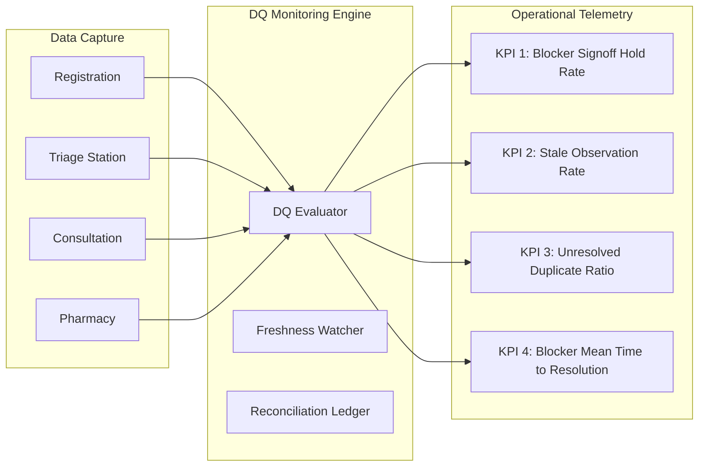

# ZAYVORA MATAB OS — Operational Monitoring & Remediation Runbook

**Document Type:** Operational Engineering & Clinical Governance Runbook  
**Phase:** 24 — Clinical Workflow Intelligence, Missing-Information Detection & Data-Quality Engine  
**System:** ZAYVORA MATAB OS (Standalone Matab/Clinic Operating System)  
**Status:** Active / Governed  
**Date:** October 2026  

---

## 1. Scope & Purpose

This runbook defines the operational monitoring, telemetry metrics, alert thresholds, and standard operating procedures (SOPs) for the **ZAYVORA Data Quality Engine**.

It serves as the definitive reference for Clinic Administrators, Lead Hakims, Triage Supervisors, and DevOps Engineers managing the integrity of clinical data across patient registration, triage, consultation, pharmacy dispensing, and longitudinal care.

---

## 2. Operational Health Metrics & KPIs

| KPI Identifier | Metric Name | Target SLA | Warning Threshold | Critical Incident Threshold | Clinical Significance |
|---|---|---|---|---|---|
| **`DQ-KPI-01`** | **Blocker Signoff Hold Rate** | $< 2.0\%$ of encounters | $> 5.0\%$ of encounters | $> 10.0\%$ of encounters | Measures frequency of clinicians attempting to sign off ungrounded or incomplete records. |
| **`DQ-KPI-02`** | **Stale Vitals Rate** | $< 1.0\%$ at consultation start | $> 4.0\%$ | $> 8.0\%$ | Indicates breakdown in triage handoff or delay between check-in and doctor exam. |
| **`DQ-KPI-03`** | **Unresolved Duplicate Queue Depth** | $< 10$ candidates total | $> 25$ candidates | $> 50$ candidates | Risk of split clinical charts and lost longitudinal allergy/treatment history. |
| **`DQ-KPI-04`** | **Blocker Resolution MTTR** | $< 3$ minutes | $> 8$ minutes | $> 15$ minutes | High MTTR indicates complex contradictions or unfamiliarity with reconciliation UI. |
| **`DQ-KPI-05`** | **Clinician Deferral Ratio** | $< 5.0\%$ of warnings | $> 12.0\%$ of warnings | $> 25.0\%$ of warnings | High deferral rates indicate alert fatigue or overly aggressive non-clinical rules. |

---

## 3. Alert Rules & Incident Severity Matrix

| Alert Code | Severity | Trigger Condition | Notification Channel | Assigned Response Team |
|---|---|---|---|---|
| **`DQ-ALERT-P1-01`** | **P1 (Critical)** | Consultation sign-off blocked by data-quality blocker with clinician override attempt failure. | Real-time UI Modal + Clinical Director pager | Lead Clinician / Attending Hakim |
| **`DQ-ALERT-P1-02`** | **P1 (Critical)** | Contradictory anaphylaxis/allergy entry detected during active Nuskha prescribing. | Immediate UI Hard Stop + Pharmacy alert | Prescribing Clinician & Pharmacist |
| **`DQ-ALERT-P2-01`** | **P2 (Elevated)** | Stale vitals rate exceeds 8% across triage lanes in a rolling 60-minute window. | Triage Station Dashboard notification | Triage Supervisor / Head Nurse |
| **`DQ-ALERT-P2-02`** | **P2 (Elevated)** | Patient duplicate candidates exceed 50 records in unmerged state. | Admin Console banner | Medical Records Supervisor / Front Desk Lead |
| **`DQ-ALERT-P3-01`** | **P3 (Normal)** | Missing demographic fields (`address`, `emergency_contact`) exceeding 15% of daily intake. | Daily Evening Summary Digest | Front Desk Operations Lead |

---

## 4. Standard Incident Response Runbooks

### 4.1 Runbook 1: Clinician Encounter Sign-Off Blocked by DQ Finding
- **Symptom:** Clinician clicks "Sign & Finalize Encounter" in the Consultation Workspace, but the system displays:
  > *"Cannot finalize encounter: 1 unresolved BLOCKER finding exists. Data quality readiness failed."*
- **Root Cause:** A safety-critical rule (e.g., `R-VIT-002` Inverted BP, `R-RX-005` Missing prescription instructions, or `R-UNA-001` Missing Mizaj evaluation) was flagged.
- **Remediation Procedure:**
  1. Open the **"Data Quality & Safety Findings"** drawer on the right side of the Consultation Workspace.
  2. Locate the row with the red `BLOCKER` badge.
  3. If the data is **missing**:
     - Complete the required clinical examination or entry (e.g., enter administration instructions for the Nuskha).
  4. If the data is **physiologically contradictory** (e.g., systolic was entered as 80 and diastolic as 120):
     - Correct the inverted numbers in the vitals entry form.
  5. If the conflict represents **two competing records** (e.g., nurse vitals vs device vitals):
     - Click **"Reconcile Conflict"**.
     - Select the authoritative value (`CLINICIAN_OBSERVED` or re-measured reading).
     - Enter mandatory clinical justification (e.g., *"Re-measured on right arm using manual sphygmomanometer; verified reading 120/80"*).
     - Click **"Submit Clinician Reconciliation"**.
  6. Re-evaluate readiness. The `BLOCKER` will resolve to `RESOLVED`, and encounter sign-off will unlock immediately.

### 4.2 Runbook 2: Mass Stale Observation Alert During Peak Clinic Hours
- **Symptom:** Clinicians report that patient vitals are constantly flagged as stale (`WARNING: Blood pressure observation is older than 24h` or `WARNING: Heart rate is older than 12h`).
- **Root Cause:** High patient volume causing long wait times between triage capture and doctor consultation, or front desk recycling old triage records from previous visits.
- **Remediation Procedure:**
  1. Triage supervisor inspects the **Triage Queue** in `knowledge_admin.js` / Clinical Workspace.
  2. Verify timestamp of the last recorded vitals for queued patients.
  3. If elapsed time exceeds policy window:
     - Route patients exceeding the window through the **Secondary Re-Check Lane** to obtain current biometrics.
  4. Never disable or artificially extend freshness policies in the database without Clinical Governance Committee sign-off.

### 4.3 Runbook 3: Resolving Duplicate Patient Candidate Collisions
- **Symptom:** Front desk registers a patient, and the system flags a duplicate candidate warning (`MATCH_CONFIDENCE >= 85%`).
- **Root Cause:** Patient visited previously under a nickname, alternate phone number, or slightly different name spelling.
- **Remediation Procedure:**
  1. Front desk clerk opens the **Identity & Duplicate Review Queue**.
  2. Review the two candidate profiles side-by-side:
     - Compare Date of Birth, National ID hash, phone number history, and recent consultation dates.
  3. If **Confirmed Same Patient**:
     - Trigger **Governed Patient Merge**.
     - Document authorization and reason (e.g., *"Patient confirmed change of mobile number from +91... to +91..."*).
     - Master patient record is consolidated; longitudinal timelines are linked.
  4. If **Confirmed Distinct Patients** (e.g., twins or common names):
     - Select **"Mark Distinct Individuals"**.
     - Record distinction rationale (e.g., *"Verified separate National IDs; distinct family heads"*).
     - Both records remain independent; warning is cleared.

---

## 5. Daily, Weekly & Monthly Operational Checklists

### 5.1 Daily Evening Operational Sweep (Clinic Administrator)
- [ ] Review total encounters completed vs blocked.
- [ ] Confirm zero unresolved `BLOCKER` findings remain in open drafts older than 24 hours.
- [ ] Check duplicate candidate queue; resolve all pending merges before clinic close.
- [ ] Export daily Data Quality Summary log for compliance archive.

### 5.2 Weekly Governance Audit (Clinical Lead & Lead Hakim)
- [ ] Audit all Clinician Reconciliations in `dq_reconciliation_decisions`.
- [ ] Verify clinical rationality of all overrides and acknowledgments with reason.
- [ ] Identify recurring documentation omissions to provide targeted clinical staff coaching.
- [ ] Review freshness policies against current seasonal clinic workflows.

### 5.3 Monthly Policy Review (Governance Board)
- [ ] Review rule registry version history in `dq_rule_registry`.
- [ ] Evaluate proposals for new specialty-specific validation rules (e.g., Ilaj-bit-Tadbeer procedural preconditions).
- [ ] Sign off on official ADR updates.
