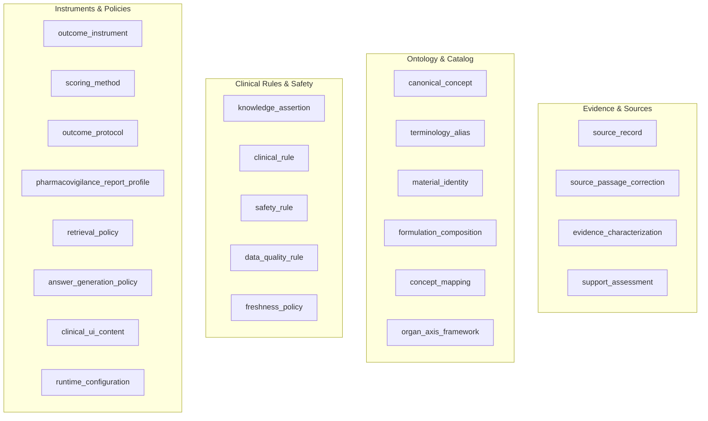
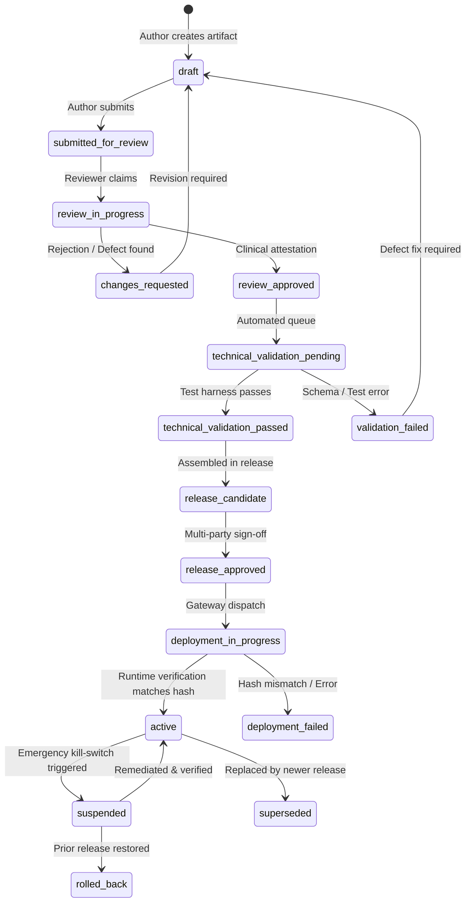

# ZAYVORA MATAB OS — Clinical Knowledge Governance Lifecycle Policy

**Document Type:** Clinical Governance & Safety Engineering Specification  
**Phase:** 28 — Governance Lifecycle for Clinical Knowledge, Safety Rules, Evidence Updates, Approvals, Release, Monitoring, and Rollback  
**Product:** ZAYVORA MATAB OS (Standalone Clinic/Hospital Operating System)  
**Status:** Active / Governed  
**Date:** October 2026  

---

## 1. Governance Foundation & Scope

In clinical healthcare systems—and especially within integrative environments combining classical Unani Tibb and modern evidence-based pharmacotherapy—**clinical knowledge content cannot be updated through unverified database mutations or direct code merges**. Modifying a herb-drug contraindication, posology boundary, Mizaji diagnosis rule, or outcome scoring instrument directly impacts patient lives.

The ZAYVORA Clinical Knowledge Governance Engine guarantees:
1. **Zero Direct-to-Production Clinical Changes:** Every artifact advances through a strict, server-enforced state machine with independent review gates.
2. **Strict Prohibition of AI Self-Approval:** AI systems may assist in drafting, summarization, and diff generation, but cannot approve, sign, activate, or roll back clinical artifacts.
3. **Decoupled Technical and Clinical Validity:** Schema validity and passing unit tests verify software execution; they do not establish clinical accuracy. Explicit clinical domain attestation is mandatory.
4. **Cryptographic Manifest Integrity:** Approvals are cryptographically bound to immutable SHA-256 content hashes. Any subsequent modification invalidates prior approvals.
5. **Runtime Version Pinning & Historical Reproducibility:** Completed clinical encounters and signed prescriptions immutably pin the exact knowledge and rule release active at the moment of signing. Historical records are never retroactively rewritten.

---

## 2. Controlled Artifact Registry & Criticality Classes

### 2.1 The 23 Governed Artifact Types



### 2.2 Criticality Classification Matrix

| Criticality Class | Artifact Types | Mandatory Reviewers | Staging Requirement | Rollback SLA |
|---|---|---|---|---|
| **`CRITICAL_SAFETY`** | `safety_rule`, `freshness_policy`, Schedule E-1 posology, Mudabbar detoxification rules | Senior Clinician + Safety Lead + Clinical Director (Independent from author) | Shadow Mode $\ge 72$ hours | Immediate ($< 5$ min) via kill-switch |
| **`CLINICAL_BEHAVIOR`** | `clinical_rule`, `knowledge_assertion`, `organ_axis_framework`, `outcome_protocol` | Clinical Domain Reviewer + Technical Validator | Shadow Mode $\ge 24$ hours | $< 15$ min |
| **`REGULATORY_POLICY`** | `pharmacovigilance_report_profile`, privacy/consent configuration | Compliance Officer + Medical Records Lead | Staging Verification | $< 30$ min |
| **`TERMINOLOGY_CATALOG`** | `canonical_concept`, `terminology_alias`, `material_identity` | Unani Ontologist / Medical Terminologist | Automated Validation Suite | $< 60$ min |
| **`EDITORIAL_METADATA`** | `source_record`, `clinical_ui_content` | Source Curator / Editor | Standard Automated CI | Next maintenance release |

---

## 3. Server-Enforced Lifecycle State Machine



### Transition Governance Rules:
1. **Self-Approval Prohibition:** An author (`created_by`) cannot execute `review_approved` or `release_approved` for artifacts classified as `CRITICAL_SAFETY` or `CLINICAL_BEHAVIOR`.
2. **Payload Hash Invalidation:** If an artifact payload is amended after `review_approved`, the approval is automatically invalidated, and the version resets to `draft`.
3. **Fail-Closed on Tampering:** During deployment, the runtime recomputes the SHA-256 payload manifest hash. If the deployed byte hash does not match `payload_manifest_hash`, deployment aborts immediately with `HASH_MISMATCH` and status transitions to `deployment_failed`.

---

## 4. Declarative Rule Grammar & Sandboxed Execution

To protect system integrity, **no executable code, dynamic `eval()`, or unvetted scripts** may be deployed as clinical rules. Rules must be defined using the typed declarative schema:

```json
{
  "rule_type": "SAFETY_CONTRAINDICATION",
  "condition_schema": {
    "field": "patient.conditions",
    "operator": "CONTAINS",
    "target_value": "PREGNANCY"
  },
  "action_schema": {
    "output_state": "TRIGGERED",
    "severity": "BLOCKER",
    "message": "Contraindicated in pregnancy: emmenagogue action risks fetal loss."
  }
}
```

### Standard Output States:
- `TRIGGERED`: Condition matched; alert/action emitted.
- `NOT_TRIGGERED_WITHIN_SCOPE`: Evaluated successfully; condition not met. (Does not imply universal patient safety).
- `INCOMPLETE_INPUT`: Required input attributes missing; fallback conservative warning emitted.
- `IDENTITY_UNRESOLVED`: Formulation or diagnosis identity ambiguous.
- `RULE_UNAVAILABLE`: Rule engine unreachable; fail-closed safety policy enforced.
- `EVALUATION_ERROR`: Parsing error; logged to security audit ledger.

---

## 5. Multi-Party Approval & Release Manifest Binding

Releases in ZAYVORA are immutable packages of explicitly versioned artifacts. A release manifest records:
- `release_number`: Sequential identifier (e.g., `REL-2026-0001`).
- `manifest_hash`: SHA-256 hash across all included artifact version IDs and their content hashes.
- `target_environment`: `LOCAL`, `STAGING`, `SHADOW`, or `PRODUCTION`.
- `approvals`: Multi-party attestation records containing reviewer ID, reviewer role, digital signature timestamp, and approval rationale.

Any modification to a release manifest invalidates all prior approvals.
