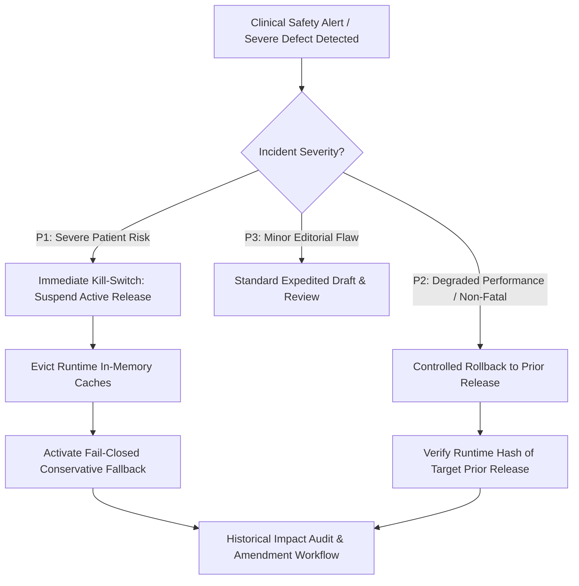

# ZAYVORA MATAB OS — Knowledge Governance Suspension, Rollback & Kill-Switch Runbook

**Document Type:** Operational Incident Response & Emergency Procedures Runbook  
**Phase:** 28 — Clinical Knowledge Governance, Rule Versioning & Controlled Safety-Rule Release Engine  
**Product:** ZAYVORA MATAB OS (Standalone Clinic/Hospital Operating System)  
**Status:** Active / Governed  
**Date:** October 2026  

---

## 1. Scope & Incident Severity Matrix

This runbook defines the emergency procedures, operational kill-switches, and rollback protocols for active clinical knowledge releases in ZAYVORA MATAB OS.

When a deployed clinical rule, interaction check, or diagnostic mapping exhibits defects or introduces patient risk, immediate, unambiguous containment is required.



| Incident Severity | Definition | Target Response SLA | Authorized Action | Required Approvers |
|---|---|---|---|---|
| **`P1 - Critical Safety`** | Rule produces false negatives for severe toxicities (e.g., missed Schedule E-1 contraindication) or causes systemic workflow paralysis. | $< 5$ minutes | **Emergency Kill-Switch (Suspend All / Revert to Fail-Closed)** | Clinical Director, Safety Lead, or System Admin |
| **`P2 - High Clinical`** | Erroneous warning blocking valid prescriptions; incorrect dosage calculation for non-toxic formulation. | $< 30$ minutes | **Controlled Rollback to Verified Target Release** | Lead Hakeem + Technical Validator |
| **`P3 - Moderate`** | Minor wording defect, typo in source citation, or secondary classification discrepancy. | $< 4$ hours | **Standard Expedited Release Cycle** | Standard Reviewers |

---

## 2. Standard Operating Procedures (SOPs)

### SOP-GOV-01: Executing the Emergency Production Kill-Switch
- **Objective:** Immediately suspend an active release causing acute safety concerns.
- **Authorized Call:** `POST /api/v1/governance/releases/{id}/suspend`
- **Execution Steps:**
  1. Authenticate with a user possessing the `governance:release` or `governance:manage` permission.
  2. Send payload:
     ```json
     {
       "suspension_reason": "Acute false negative detected in herb-drug interaction rule R-SAF-098; risk of unflagged bleeding events."
     }
     ```
  3. **Immediate System Reaction:**
     - The database commits `release_status = 'SUSPENDED'` within a single transaction.
     - Runtime memory caches for active rules are purged.
     - The Safety Firewall and CDS Orchestrator enter **Conservative Fallback Mode**: any rule whose evaluation depended on the suspended release fails closed (returns `RULE_UNAVAILABLE` advisory warning, requiring manual clinician verification).
     - An immutable incident audit event is logged to the tamper-evident ledger.
  4. Clinical users currently drafting encounters receive an immediate notification:
     > *"Clinical knowledge release suspended by governance emergency switch. Prescriptions require manual pharmacological attestation."*

### SOP-GOV-02: Executing a Controlled Rollback
- **Objective:** Restore a previously verified, stable release without disrupting historical records.
- **Authorized Call:** `POST /api/v1/governance/releases/{current_id}/rollback`
- **Execution Steps:**
  1. Identify the target prior release (e.g., `REL-2026-0001`).
  2. Confirm that the target release has a state of `DEPLOYED` or `SUPERSEDED` and was never suspended for safety violations.
  3. Send rollback request:
     ```json
     {
       "target_release_id": "rel-2026-0001",
       "rollback_reason": "Reverting from REL-2026-0002 due to interaction rule defect; restoring known-good baseline."
     }
     ```
  4. **System Transition:**
     - Current release `REL-2026-0002` transitions to `ROLLED_BACK`.
     - Target release `REL-2026-0001` reactivates as `DEPLOYED` / `ACTIVE`.
     - System executes runtime verification verifying that the loaded rules match the target release manifest hash.
  5. The Governance Console displays a green confirmation badge with the active release number.

### SOP-GOV-03: Historical Record Preservation and Impact Audit
- **Critical Invariant:** A rollback or suspension **never rewrites signed historical encounters**.
- **Post-Rollback Audit Steps:**
  1. Query `governance_runtime_resolutions` for all clinical encounters finalized while the suspended release was active:
     ```sql
     SELECT encounter_id, action_name, resolved_at 
     FROM governance_runtime_resolutions 
     WHERE release_id = 'rel-suspended-id';
     ```
  2. Compile a list of affected patients and prescriptions.
  3. Clinical Quality Committee reviews the identified encounters:
     - If patient received a potentially contraindicated medicine: Initiate Pharmacovigilance Outreach (Phase 27).
     - If clinical note requires clarification: Author an explicit, attributed clinical amendment (preserving the original record version).

### SOP-GOV-04: Post-Mortem and Root-Cause Remediation
1. **Quarantine the Defective Rule:** The artifact version responsible for the defect is moved to `withdrawn` state with documented rationale.
2. **Defect Fixture Creation:** Write a deterministic unit test fixture capturing the failing edge case in `tests/unit/test_governance.py`.
3. **Remediation & Re-Verification:** Author a new draft version, submit for independent clinical review, execute the full regression suite, assemble a new release candidate, and deploy through standard governance gates.
4. **Publish Governance Incident Report:** Record root cause, timeline, affected encounters, and preventive actions in the compliance archive.
