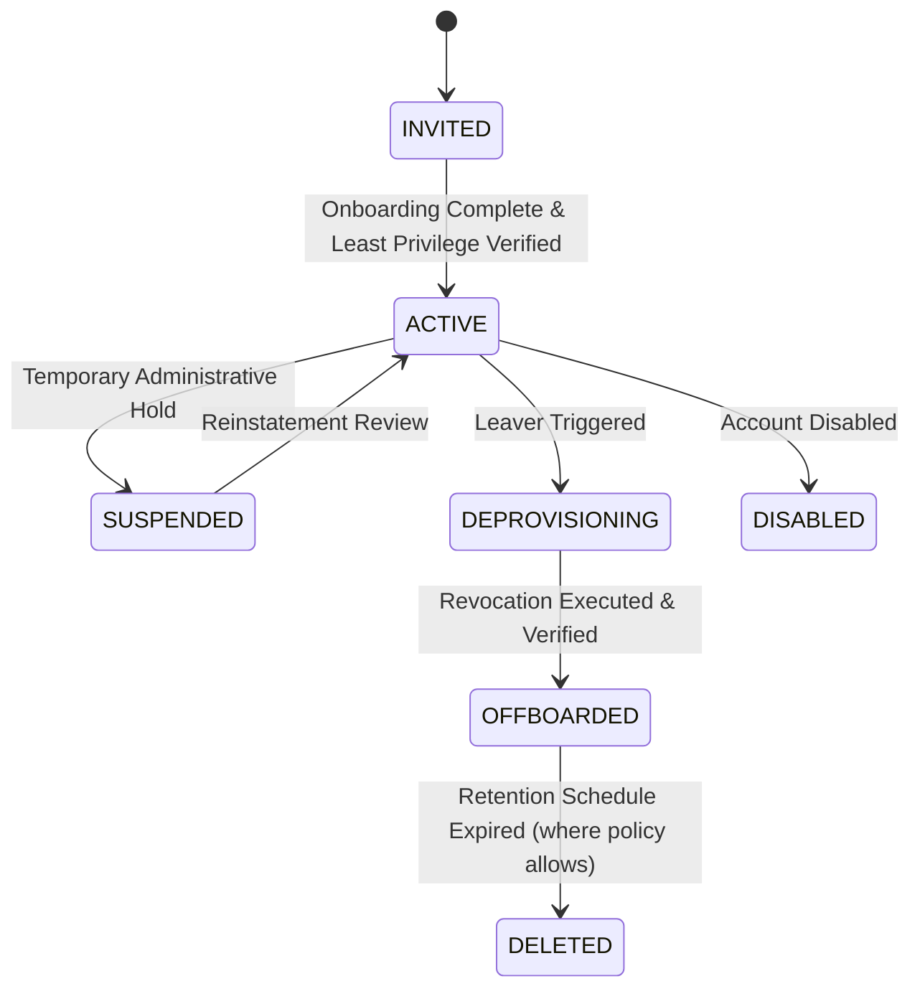
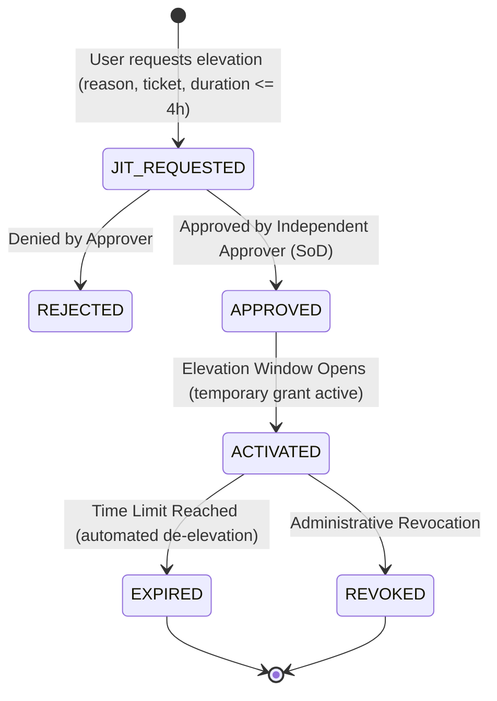

# ZAYVORA MATAB OS — IDENTITY GOVERNANCE, PAM & ACCESS CERTIFICATION SPECIFICATION
**Module:** Enterprise Identity Governance, Privileged Access Management & Access Certification Engine  
**Phase:** Phase 45  
**Status:** SPECIFICATION COMPLETE  
**Author:** Principal Software Architect, IAM Specialist & Application-Security Engineer

---

## 1. Architectural Foundations & Invariants

### 1.1 Non-Negotiable Invariants
1. **Authentication $\ne$ Authorization:** Valid credential verification establishes identity, not entitlement. All resource operations require explicit, server-side permission checks.
2. **Default Deny:** Endpoints, handlers, jobs, and exports deny access unless an explicit, active grant matches the requested action and tenant/facility scope.
3. **Least Privilege & Explicit Scope:** Permissions must be bounded by organization, facility, and record context. Never trust client-supplied headers or parameters.
4. **Administrative $\ne$ Clinical Authority:** An administrator or platform operator must NEVER gain clinical authority (e.g. prescribing, diagnosis, nuskha approval) merely by possessing administrative or privileged access. Clinical sign-off requires a verified professional clinical role and valid license credential.
5. **Break-Glass Emergency Guardrails:**
   - Emergency access provides temporary visibility during catastrophic operational scenarios.
   - **Critical Invariant:** Break-glass access can NEVER authorize diagnosis, prescription, dose calculation, nuskha approval, dispensing, or disable patient safety firewalls globally.
   - Retrospective review is mandatory and must be performed by an independent reviewer (actor $\ne$ reviewer).
6. **Separation of Duties (SoD):**
   - Requester cannot approve their own JIT elevation request.
   - Certifier cannot certify their own access.
   - Break-glass actor cannot conduct retrospective review of their own session.
   - Toxic role combinations (e.g. Billing Cashier + Billing Auditor) are strictly prevented.
7. **Two-Phase Revocation Verification:** Access removal is not complete upon decision. The system executes the revocation and then independently verifies that effective access is denied across all active tokens and paths (`PENDING` $\to$ `APPLIED` $\to$ `VERIFIED`).

---

## 2. Identity Lifecycle Architecture (Joiner, Mover, Leaver)

### 2.1 Identity Lifecycle States

### 2.2 Joiner Flow
- Create identity with unique ID and organization membership.
- Assign baseline approved role bundle.
- Evaluate against Toxic Combinations Matrix before commit.
- Record requester, approver, and effective date.
- Verify initial effective access.

### 2.3 Mover Flow
- Track changes in role, branch/facility, or organizational department.
- Automated cleanup: Obsolete facility memberships and roles from prior branch are marked inactive.
- Detect conflicting grants / toxic combinations before activating new role.
- Invalidate prior sessions to force refresh of token claims.
- Capture before-and-after role snapshots for audit.

### 2.4 Leaver Flow (with Verified Revocation)
- Set state to `DEPROVISIONING`.
- Revoke all active session tokens in `sessions` and `user_sessions`.
- Deactivate user organization memberships, facility memberships, and staff assignments.
- Reassign or transfer ownership of scheduled jobs, webhooks, and integrations.
- Execute automated verification check: confirm token rejection (401/403) and absence of active grants.
- Transition state to `OFFBOARDED` with tamper-evident audit record.

---

## 3. Privileged Access Management (PAM) & JIT Elevation

### 3.1 Privileged Operations Registry
Privileged actions carry high systemic risk:
- `users:manage`: User creation, role changes, privilege assignment.
- `config:manage`: Runtime configuration modifications.
- `config:rotate_secret`: Secret rotation and compromise revocation.
- `dr:execute_drill`: Disaster recovery restore drills.
- `lifecycle:execute`: Record archival or permanent deletion.
- `releases:manage`: Production release deployments and feature flags.

### 3.2 Just-In-Time (JIT) Elevation State Machine

---

## 4. Service Accounts & Machine Identities Governance

### 4.1 Governance Attributes
For every non-human identity:
- `identity_id`: Machine identity identifier (e.g. `svc-backup-worker`).
- `name`: Descriptive identity name.
- `owner_user_id`: Accountable human owner (must be an active user).
- `environment`: `production`, `staging_synthetic`, `local_dev`.
- `permitted_workloads`: JSON list of allowed service keys / tasks.
- `credential_type`: `API_KEY`, `WORKLOAD_IDENTITY`, `TOKEN_ROTATING`.
- `interactive_login_allowed`: Strictly `0` (False) by default.
- `last_used_at`: Timestamp of last verified usage.
- `dependency_checklist`: JSON list of critical dependencies (e.g. `["database_backup", "nightly_sync"]`).

### 4.2 Safe Deprovisioning
Before revoking or disabling a machine account, the system checks declared dependencies and warns or requires explicit administrative override.

---

## 5. Access Certification & Recertification Campaigns

### 5.1 Campaign Architecture
- Campaigns target specific populations: `CLINICAL_ROLES`, `PRIVILEGED_ADMINS`, `SERVICE_ACCOUNTS`, `FACILITY_MEMBERSHIPS`.
- Each campaign takes a point-in-time snapshot of active assignments.
- Reviewers evaluate each grant with one of 5 decisions:
  - `RETAIN`: Grant is verified and required.
  - `REDUCE`: Scope or permissions should be curtailed.
  - `REVOKE`: Access is obsolete or unauthorized.
  - `INVESTIGATE`: Access flagged for security inquiry.
  - `DEFER`: Decision deferred with documented justification.
- **Separation of Duties:** Reviewer ID cannot equal Subject User ID.
- **Two-Phase Revocation Execution:** When `REVOKE` is decided, a remediation action record is created (`PENDING`). The administrator triggers execution (`APPLIED`) and the system independently verifies that effective access is removed (`VERIFIED`).
- "No response" is never treated as approval.

---

## 6. Separation of Duties (SoD) & Toxic Combinations Matrix

| Toxic Rule ID | Conflicting Role / Permission A | Conflicting Role / Permission B | Risk Tier | Rationale |
| :--- | :--- | :--- | :--- | :--- |
| `SOD-001` | `billing:refund_void` (Cashier) | `audit:read` (Auditor) | `CRITICAL` | Financial operator cannot audit own voids |
| `SOD-002` | `users:manage` (Admin) | `access:certify` (Reviewer) | `HIGH` | Role assigner cannot certify own assignments |
| `SOD-003` | `prescriptions:sign` (Clinician) | `org:manage` (Infrastructure Admin) | `CRITICAL` | Administrative access must never grant clinical prescribing |
| `SOD-004` | `break_glass:actor` | `break_glass:reviewer` | `CRITICAL` | Break-glass actor cannot conduct retrospective review |
| `SOD-005` | `jit:requester` | `jit:approver` | `CRITICAL` | Requester cannot approve their own elevation |
