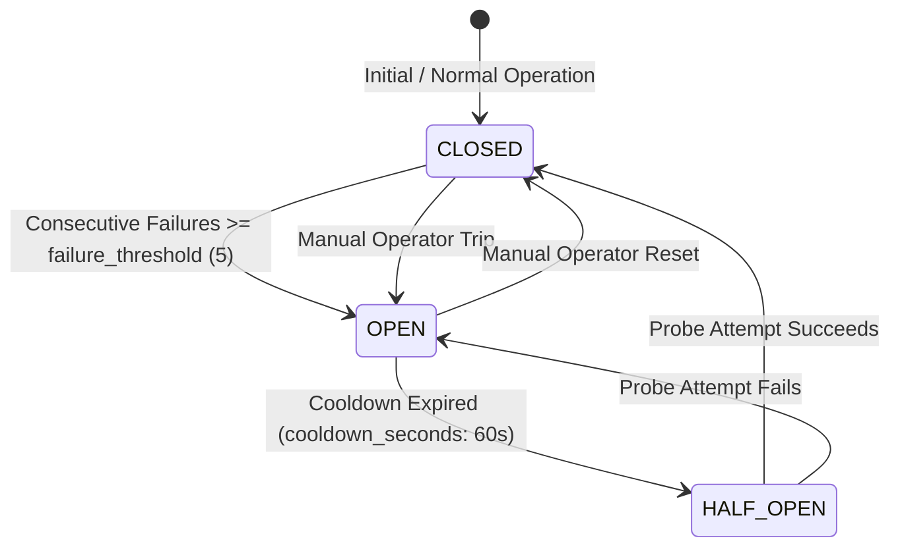

# Enterprise Connector Contracts, Idempotency & Retry Policies

**Product:** ZAYVORA MATAB OS  
**Phase:** 32 — Enterprise Integration Operations & Reliability  
**Classification:** Operational Governance Specification  
**Version:** 1.0.0 (Release-Ready)  

---

## 1. Executive Summary

Integration points in ZAYVORA MATAB OS connect Unani clinical care delivery to external healthcare ecosystems, including the Ayushman Bharat Digital Mission (ABDM) Gateway, external laboratory information systems (LIS), PACS imaging servers, hospital billing ERPs, and statutory public health reporting endpoints.

This document formally specifies:
1. **Connector Interface Contracts:** Pre-conditions, invariants, and data security boundaries for all external interactions.
2. **Idempotency Standards:** Contractual requirements for non-repudiation and duplicate suppression.
3. **Retry Classifications & Backoff Algorithms:** Mathematical formulations for bounded, jittered retries.
4. **Reconciliation Protocol:** Rigorous state transitions when delivery outcomes cannot be definitively determined.

---

## 2. Connector Interface Contracts

### 2.1 Connector Classification Matrix

| Connector Type | Protocol | Auth Boundary | Synchronicity | Idempotency Scope |
| :--- | :--- | :--- | :--- | :--- |
| `ABDM_ABHA` | HTTPS / REST | Bearer Token / Gateway Header | Async with Callback | Per Transaction / Verification |
| `FHIR_R4_ENDPOINT` | HTTPS / REST / JSON | Mutual TLS + OAuth2 Bearer | Synchronous Bundle Push | Per DocumentBundle Hash |
| `LIS_LAB` | HTTPS / MLLP | API Key / Client Cert | Dual (Order Push / Result Pull) | Per Diagnostic Order Number |
| `PACS_IMAGING` | DICOMweb / WADO-RS | Bearer Token | Synchronous Query | Per Study Instance UID |
| `PHARMACY_ERP` | HTTPS / Webhook | HMAC-SHA256 Signature | At-least-once with Dedup | Per Prescription UUID |
| `SMS_WHATSAPP_GATEWAY`| HTTPS / REST | API Key Header | Async with Delivery Receipt | Per Notification Message ID |

### 2.2 Strict Idempotency Contract

Every outbound write operation MUST submit an `idempotency_key` generated deterministically from the underlying clinical entity:
$$\text{idempotency\_key} = \text{SHA-256}(\text{org\_id} \parallel \text{operation\_type} \parallel \text{source\_entity\_id} \parallel \text{source\_entity\_version})$$

#### Invariants:
1. **Idempotent Retrieval:** If a job submission arrives with an `idempotency_key` matching an existing record in the database, the engine MUST return the existing job record without re-enqueuing or generating duplicate network requests.
2. **Side-Effect Safety:** A job in `completed` state MUST NOT be re-executed under any circumstances using the same key.
3. **Collision Detection:** If an identical key is presented with a disparate `payload_manifest_hash`, the engine MUST reject the submission with an `IdempotencyConflict` error to prevent unintended payload mutation.

---

## 3. Error Classification & Retry Policy

### 3.1 Taxonomy of Integration Errors

Every external network response or exception is mapped to one of four deterministic failure classes:

```
+-----------------------------------------------------------------------------------+
|                              OUTBOUND INTEGRATION ATTEMPT                         |
+-----------------------------------------------------------------------------------+
                                          |
                                          v
                         +----------------------------------+
                         |     HTTP / Network Response      |
                         +----------------------------------+
                                          |
         +-----------------+--------------+-----------------+------------------+
         |                 |                                |                  |
         v                 v                                v                  v
    [CLASS 1]         [CLASS 2]                        [CLASS 3]          [CLASS 4]
   SUCCESS (2xx)    TRANSIENT (5xx, 429)           PERMANENT (4xx, Schema) TIMEOUT (Socket/Drop)
         |                 |                                |                  |
         v                 v                                v                  v
     Job Marks       Exponential Backoff                Immediate          OUTCOME_UNKNOWN
     COMPLETED       with Jitter & Budget              DEAD_LETTER         Paused for Recon
```

1. **Class 1: Factual Success (200 OK, 201 Created, 202 Accepted)**
   - Marks current attempt as successful.
   - For synchronous APIs: advances job state to `completed`.
   - For asynchronous APIs: advances job state to `waiting_for_callback`.
2. **Class 2: Transient Failures (429 Too Many Requests, 502 Bad Gateway, 503 Service Unavailable, 504 Gateway Timeout before connect)**
   - Eligible for automatic retry within the configured `max_attempts` (default: 3) and `retry_budget`.
   - If attempts exceed budget, transitions to `dead_lettered`.
3. **Class 3: Permanent Failures (400 Bad Request, 401 Unauthorized, 403 Forbidden, 404 Not Found, 422 Unprocessable Entity)**
   - Non-retryable. Immediate transition to `failed_non_retryable` or `dead_lettered`.
   - Halts automatic retries immediately to prevent security lockouts or log flooding.
4. **Class 4: Ambiguous Outages (Socket Read Timeout, Network Reset during write, HTTP 504 after request payload dispatch)**
   - The server cannot determine whether the remote partner committed the transaction.
   - **MANDATORY POLICY:** Transitions job state to `outcome_unknown`. Automatic retry is strictly blocked until reconciliation completes.

### 3.2 Bounded Exponential Backoff Algorithm

Retry delays utilize decorrelated jittered exponential backoff:

$$t_{\text{backoff}} = \min(t_{\text{max\_backoff}}, t_{\text{base}} \times 2^{\text{attempt\_num} - 1}) \times (1 + \text{random}(-0.2, 0.2))$$

- **Base Delay ($t_{\text{base}}$):** 5 seconds
- **Max Delay ($t_{\text{max\_backoff}}$):** 300 seconds (5 minutes)
- **Jitter Range:** $\pm 20\%$ to prevent retry storms against recovering partner gateways.

---

## 4. Circuit Breaker Specification

Each external connector has an associated circuit breaker record (`integration_circuit_breakers`):



- **CLOSED:** Normal routing. Failure counter resets to zero on any successful dispatch.
- **OPEN:** Fast-fail circuit. All outbound jobs for this connector are immediately placed in `blocked_by_authorization` without generating outbound network traffic.
- **HALF_OPEN:** Allows single synthetic probe or single queued canary job to test partner responsiveness.

---

## 5. Unknown-Outcome Reconciliation Standard

When a job enters `outcome_unknown`, the following automated or operator-guided protocol is enforced:

1. **Step 1: Partner Status Query:** If the external connector supports a read-only query endpoint (e.g. `GET /transfers/{provider_tx_id}`), an automated status inquiry is executed.
2. **Step 2: External Callback Match:** Check `integration_inbox_events` to see if a delayed webhook arrived referencing the job's idempotency key or correlation ID.
3. **Step 3: Authorized Manual Review:** If automated checks cannot confirm receipt, an operator reviews partner logs, submits a formal determination (`confirmed_completed`, `confirmed_not_completed`, `partially_completed`, or `cannot_reconcile`), and records mandatory decision notes.
4. **Enforced Code Rule:** Code level validation (`apps/api/domains/integration_ops.py`) throws `ValidationError` if an attempt is made to transition a job from `outcome_unknown` to `completed` without an active reconciliation record.
