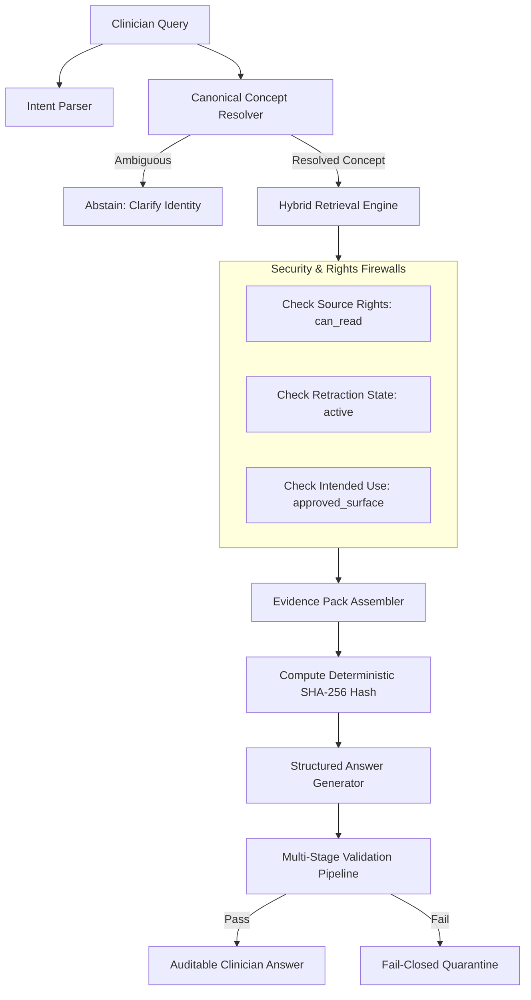

# Evidence-Aware Clinical Knowledge Retrieval (Hybrid RAG) & Answer Generation Specification
## ZAYVORA MATAB OS — Knowledge Authenticity, Verification & Safety (KAVS) Phase 22

**Status:** Production-Ready Specification  
**Authority:** ZAYVORA Clinical Governance & Medical Safety Board  
**Classification:** Internal Core Standard  

---

## 1. Executive Summary & Core Mandate

This specification governs the evidence-aware, permission-bounded retrieval and answer generation engine for ZAYVORA MATAB OS. The engine provides clinicians with auditable, source-grounded answers to medical knowledge queries while enforcing deterministic safety boundaries.

### 1.1 Non-Negotiable Knowledge & Safety Principles
1. **Zero Fabrication / Hallucination:** Under no circumstance may generative AI models, heuristic templates, or search pipelines invent clinical assertions, dosages, botanical identities, modern study findings, p-values, trial numbers, quotations, page numbers, or bibliographic citations.
2. **Retrieval is Not Verification:** Lexical match, graph proximity, or vector similarity indicates textual relevance only; it does not prove clinical truth, passage support, or safety approval.
3. **Absolute Prohibition of Autonomous Clinical Decisions:**
   - The engine must NEVER independently diagnose, select a formula, calculate or adjust dosages, sign orders, or dispense medications.
   - Any query attempting autonomous decision-making is classified as `restricted_clinical_action` and immediately refused with clinician-directed routing.
4. **Per-Claim Citation Binding:** Factual assertions must be represented as discrete atomic claim units bound directly to verified source passages with exact physical/digital locators and edition versions. Paragraph-level decorative citations are strictly banned.
5. **Fail-Closed Intended-Use Enforcement:** Content lacking active `intended_use_approvals` for the target clinician surface is filtered out server-side prior to answer generation.
6. **Epistemological Honesty:** Classical Unani documentation, in-vitro/preclinical assays, and randomized clinical trials are segregated into distinct categories with mandatory qualifiers.
7. **Patient Context Isolation:** Patient data (age, allergies, vitals) is accessed read-only for encounter safety context and is mathematically isolated from global retrieval indexes, caches, and shared telemetry.

---

## 2. Controlled Query-Intent Registry

Every incoming clinician query is parsed and classified against the governed `rag_query_intent_registry`.

### 2.1 Intent Taxonomy & Action Policies

| Intent Code | Intent Name | Description | Requires Safety Preflight | Allowed Autonomous Action |
|---|---|---|---|---|
| `general_knowledge` | General Clinical Knowledge | General Unani concepts, historical definitions, classical principles | No | False |
| `posology_inquiry` | Posology & Dosage Information | Historical Unani dose ranges, vehicle (Badraqah), Tadbeer processing | Yes | False |
| `traditional_indications` | Traditional Indications & Actions | Classical Afaal (actions), Khawas, and traditional therapeutic indications | No | False |
| `modern_evidence` | Modern Biomedical Evidence | Contemporary trials, systematic reviews, mechanistic pharmacology | No | False |
| `herb_safety_contraindication` | Safety, Toxicity & Contraindications | Adverse reactions, Schedule E(1) status, pediatric/pregnancy cautions | Yes | False |
| `formulation_composition` | Formulation Composition | Classical Murakkabat ingredient lists, proportions, classical references | Yes | False |
| `mizaj_assessment` | Mizaj & Temperament Assessment | Qualitative assessment of drug/food temperaments (Darajat) | No | False |
| `organ_axis_relationship` | Organ-Axis Clinical Relationship | Documented organ pathways, sympathetic relationships (Dimagh-Mida, etc.) | No | False |
| `restricted_clinical_action` | Restricted Autonomous Action | Direct requests to diagnose, prescribe, compute patient doses, or sign | Mandatory Refusal | **STRICTLY FORBIDDEN** |
| `unclassified_intent` | Unclassified Query Intent | Ambiguous or non-matching queries requiring clinician clarification | No | False |

### 2.2 Boundary Interception Rule
When a query contains imperative prescribing or diagnostic triggers (e.g., `diagnose`, `what nuskha should i prescribe`, `calculate dose for patient`), the intent engine assigns `restricted_clinical_action`. The response:
- Returns `answer_status: "restricted_clinical_action"`
- Sets `is_restricted_action: true`
- Refuses automated synthesis
- Provides a direct link to the clinician-controlled Consultation Canvas / Nuskha Builder.

---

## 3. Canonical Concept & Material Ambiguity Resolver

Queries are resolved against the canonical Unani concept catalog (`knowledge_concepts`, `concept_names`, `material_identity`) established in Prompt 19.

### 3.1 Multi-Script Normalization
- Queries are normalized across Arabic, Urdu, Persian, English, and Latin scientific names.
- Diacritics (Harakat/Tashkeel) are normalized without overwriting source records.
- Punctuation stripping prevents question marks from obstructing exact concept lookups.

### 3.2 Material Ambiguity Detection
If a queried term maps to multiple distinct botanical, mineral, or anatomical identities (e.g., *Kundur* referring to both *Boswellia carterii* and *Boswellia serrata*):
1. The resolver flags `ambiguity_detected = true`.
2. The engine refuses forced or arbitrary equivalence.
3. The response returns status `material_identity_ambiguous` with candidate options for clinician disambiguation.

---

## 4. Permission-Aware Multi-Channel Hybrid Retrieval

Retrieval combines structured catalog lookups, exact locator matches, and text-segment search.



### 4.1 Strict Retraction Cascading
During candidate selection, every source version is validated against `kavs_source_versions` and live `source_status_events`. If a source or version is marked `RETRACTED`, `SUPERSEDED`, or `WITHDRAWN`:
- The passage is excluded from the evidence pack.
- An exclusion record is logged in the pack's `exclusion_audit_log`.

---

## 5. Immutable Reproducible Evidence Pack

Before drafting any response, the engine constructs an immutable evidence pack (`rag_evidence_packs`).

### 5.1 Evidence Pack Structure
```json
{
  "pack_id": "EP-20261013-0001",
  "query_normalized": "what are the documented actions of asgandh",
  "resolved_concept_ids": ["CONC-ASGANDH-001"],
  "included_items": [
    {
      "item_id": "SEG-001",
      "source_record_id": "SRC-NFUM-V1",
      "version_id": "VER-2007",
      "locator_text": "Vol 1, p. 45",
      "text": "Asgandh possesses Muqawwi-e-Aam and Muhallil-e-Aram properties...",
      "claim_type": "traditional_use_documentation",
      "intended_use_state": "APPROVED"
    }
  ],
  "excluded_items": [],
  "reproducibility_hash": "e3b0c44298fc1c149afbf4c8996fb92427ae41e4649b934ca495991b7852b855"
}
```

The `reproducibility_hash` is computed as:
$$\text{SHA-256}(\text{CanonicalJSON}(\text{included\_items}))$$

---

## 6. Epistemologically-Bound Answer Generation

Answers are generated as structured composite objects consisting of discrete atomic claims (`rag_answer_claims`).

### 6.1 Epistemological Claim Templates
In accordance with Prompt 21 Section 9, each generated claim enforces epistemic boundaries:

1. **Traditional Unani Documentation:**
   > *"Documented in classical Unani literature as possessing [Action/Mizaj], based on historical clinical observation in [Source], without implied equivalence to modern randomized clinical trial efficacy."*

2. **Preclinical / In-Vitro Evidence:**
   > *"Demonstrated [biological effect] in preclinical laboratory models (in-vitro/animal). Human clinical efficacy, therapeutic dosage, and safety in clinical populations have not been established by these data alone."*

3. **Modern Clinical Trial Evidence:**
   > *"Evaluated in [Study Design] involving [Sample Size] participants, demonstrating [Outcome/Effect Size] (p = [value]). Clinical application must consider study population, formulation standardization, and study limitations."*

4. **Product Framework / Editorial:**
   > *"Organizational navigation model defined within ZAYVORA MATAB OS for clinical concept structuring, not representing an independent traditional doctrine or modern biomedical diagnosis."*

---

## 7. Mandatory Per-Claim Citation Binding

Every claim unit in `rag_answer_claims` is linked to one or more records in `rag_answer_citations`.

### 7.1 Required Citation Fields
- `claim_id`: Reference to parent answer claim.
- `source_record_id`: Valid registered source ID.
- `source_version_id`: Exact source edition/version.
- `locator_text`: Physical page number, volume, or digital section locator.
- `passage_checksum`: SHA-256 hash of the supporting text segment.
- `support_status`: Must be `SUPPORTED` or `CONDITIONALLY_SUPPORTED`.

---

## 8. Multi-Stage Post-Generation Validation Pipeline

Before delivery to the client, the generated answer run undergoes five deterministic validation checks:


1. **Schema Check:** Verifies all claims conform to required JSON schemas and discrete categories.
2. **Citation Existence Check:** Every claim must have $\ge 1$ resolvable citation link.
3. **Access Rights Check:** Sources must permit display on the requested clinician surface.
4. **Retraction Check:** Ensures no citation points to a retracted or superseded source version.
5. **Clinical Boundary Check:** Ensures no autonomous prescription or dosage adjustment statements exist.

---

## 9. Patient Context Isolation & Privacy Guardrails

When invoked within an active consultation encounter:
- Patient demographics (age, gender, pregnancy status) and recorded allergies are evaluated purely in memory to add safety warning qualifiers to answers.
- **Zero Ingestion:** Encounter notes, patient identifiers, and clinical findings are NEVER written to retrieval vector stores, lexical full-text indexes, or shared training caches.
- **Multi-Tenant Protection:** Feedback submissions and retrieval telemetry are strictly scrubbed of patient identifiers.

---

## 10. Feedback & Governance Lifecycle

Clinicians and reviewers can submit feedback against any retrieval run or answer claim:
- `rag_retrieval_feedback` stores issue categories (`irrelevant_retrieval`, `missing_qualifier`, `citation_mismatch`, `outdated_source`).
- Submissions create actionable review tasks in the Knowledge Governance queue.
- Engine modifications require clinical review sign-off; models do not self-update automatically.
