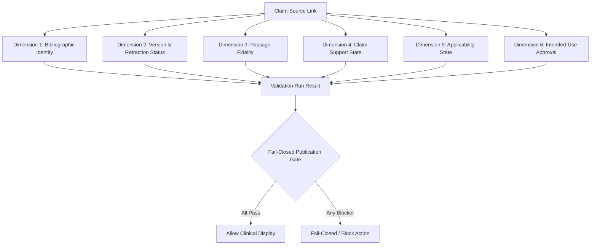

# Evidence Classification, Clinical Claim Verification & Citation Validation Specification
## ZAYVORA MATAB OS — Knowledge Authenticity, Verification & Safety (KAVS) Phase 21

**Status:** Production-Ready Specification  
**Authority:** ZAYVORA Clinical Governance & Medical Safety Board  
**Classification:** Internal Core Standard  

---

## 1. Executive Summary & Core Mandate

This specification governs the systematic appraisal, claim support verification, citation integrity validation, and controlled clinical publication of knowledge claims within ZAYVORA MATAB OS.

### 1.1 Non-Negotiable Knowledge Principles
1. **Zero Hallucination:** Under no circumstance may AI models, developers, seed scripts, or heuristic rules fabricate clinical claims, citations, DOIs, PMIDs, authors, effect sizes, p-values, sample sizes, page numbers, or verbatim quotations.
2. **Multi-Dimensional Independence:** A citation's validity is decomposed into six orthogonal, non-collapsible dimensions. A positive evaluation in one dimension (such as bibliographic identity) never implies validity in another (such as passage support or current non-retracted status).
3. **Strict Prohibition of Claim Laundering:**
   - Classical Unani documentation cannot be represented as proven modern clinical efficacy.
   - Preclinical in-vitro / in-vivo animal studies cannot be approved for general clinician context as proven human cures.
   - Observational associations cannot be framed as established causal relationships.
4. **Automated Retraction Cascading:** Retracted or withdrawn source publications automatically cascade suspension to all active intended-use approvals linked to that source edition.
5. **Fail-Closed Clinical Publication Gate:** Claims lacking active intended-use approval, backed by retracted sources, or exhibiting unresolved fidelity errors are strictly blocked from patient consultation screens.

---

## 2. 15 Controlled Claim Categories (Registry A–N, Z)

All knowledge assertions entering the system must map to exactly one of 15 controlled categories in `claim_type_registry`:

| Category Letter | Code | Category Name | Permitted Source Patterns | Required Reviewer Roles |
|---|---|---|---|---|
| A | `bibliographic_provenance` | Bibliographic & Provenance Claims | catalog_record, publisher_metadata | LIBRARIAN, SCHOLAR |
| B | `source_content` | Verbatim Source Content Claims | classical_manuscript, printed_edition | SCHOLAR, ARCHIVIST |
| C | `traditional_use_documentation` | Traditional-Use Documentation Claims | classical_text, pharmacopoeial_monograph | UNANI_SCHOLAR, CLINICAL_SPECIALIST |
| D | `terminology_identity` | Terminology & Identity Claims | medical_lexicon, botanical_index | TAXONOMIST, SCHOLAR |
| E | `regulatory_quality` | Regulatory & Quality Claims | statutory_notification, pharmacopoeial_standard | REGULATORY_OFFICER, ORG_ADMIN |
| F | `guideline_recommendation` | Guideline / Authoritative Recommendations | clinical_practice_guideline, official_advisory | CLINICAL_SPECIALIST, ORG_ADMIN |
| G | `evidence_synthesis` | Evidence-Synthesis Claims | systematic_review, meta_analysis | CLINICAL_SPECIALIST |
| H | `safety_information` | Safety & Adverse Effect Claims | pharmacovigilance_report, toxicology_study | CLINICAL_SPECIALIST, TOXICOLOGIST |
| I | `preclinical_evidence` | Preclinical Evidence Claims | in_vitro_assay, animal_in_vivo_study | RESEARCH_SCIENTIST, PHARMACOLOGIST |
| J | `observational_clinical` | Observational Clinical Claims | prospective_cohort, registry_study | CLINICAL_SPECIALIST, EPIDEMIOLOGIST |
| K | `interventional_clinical` | Interventional Clinical Claims | randomized_controlled_trial, clinical_trial | CLINICAL_SPECIALIST |
| L | `mechanistic_causal` | Mechanistic or Causal Claims | pharmacology_study, biochemical_pathway_assay | CLINICAL_SPECIALIST, PHARMACOLOGIST |
| M | `product_framework_editorial` | Product Framework / Editorial Claims | product_specification, navigation_model | ORG_ADMIN, SYSTEM_ADMIN |
| N | `clinical_outcome` | Clinical Outcome Claims | randomized_controlled_trial, clinical_study | CLINICAL_SPECIALIST |
| Z | `unclassified_needs_review` | Unclassified Claims (Needs Review) | unknown | CLINICAL_SPECIALIST, ORG_ADMIN |

---

## 3. The 6-Dimensional Citation Validation Matrix

Rather than collapsing verification into a single boolean `is_valid` flag, validation evaluates six discrete orthogonal dimensions:

### 3.1 Dimension States
- **Dimension 1 (Bibliographic Identity):** `verified`, `mismatch`, `unresolved`, `not_checked`.
- **Dimension 2 (Version & Retraction Status):** `current`, `superseded`, `retracted`, `expression_of_concern`, `withdrawn`, `unverified`.
- **Dimension 3 (Passage Fidelity):** `exact_match`, `minor_discrepancy`, `fidelity_unresolved`, `negation_mismatch`, `locator_not_found`, `not_checked`.
- **Dimension 4 (Claim Support State):** `direct_support`, `partial_support`, `context_only`, `contradicts_claim`, `does_not_address_claim`, `source_unavailable`, `citation_mismatch`, `passage_not_found`, `extraction_fidelity_unresolved`, `applicability_uncertain`, `reviewer_disagreement`, `not_assessed`.
- **Dimension 5 (Applicability State):** `direct`, `indirect_population`, `indirect_intervention`, `indirect_outcome`, `uncertain`, `not_applicable`.
- **Dimension 6 (Intended-Use State):** `approved`, `unapproved`, `restricted`, `suspended`, `expired`.

---

## 4. Question-Sensitive Evidence Characterization

Traditional numerical scoring (e.g., Jadad 4/5) obscures critical clinical limitations. MATAB OS mandates qualitative, question-sensitive characterization across six question types:
1. `intervention` (Efficacy / Comparative effect)
2. `etiology_harm` (Adverse events / Risk factors)
3. `diagnosis` (Diagnostic accuracy / Pulse-Urine sensitivity)
4. `prognosis` (Natural history / Disease progression)
5. `meaning_experience` (Patient qualitative experience)
6. `traditional_lore` (Classical medical compendium documentation)

### 4.1 Non-Reported Preservation Rule
Missing variables (e.g., sample size, blinding, p-value, exact botanical part) must be explicitly recorded as `not_reported` or `unclear`. They must never be estimated, imputed, or assumed.

---

## 5. Automated Retraction Cascading

When an authority publishes a retraction or withdrawal, the event is recorded in `source_status_events`. The system immediately executes an automated cascade:

$$\text{Source Retracted} \implies \forall c \in \text{Claims}(\text{Source}): \text{IntendedUseApprovals}(c) \leftarrow \text{SUSPENDED}$$

The suspension reason is appended to the audit ledger and persisted in the approval record. Clinician queries for the claim immediately switch to `FAIL_CLOSED` status with a prominent caution banner.

---

## 6. Standardized Epistemological Reporting Statements

Statements generated for clinician context panels follow strict semantic templates:

1. **Traditional Use Documentation:**
   > *"Documented in traditional Unani medical texts as [claim text]; formal modern clinical efficacy has not been established."*
2. **Preclinical Assays:**
   > *"Preclinical in-vitro / in-vivo studies indicate [claim text]; applicability to human clinical outcomes is not established by this result alone."*
3. **Observational Cohorts:**
   > *"Observational cohort evidence suggests an association with [claim text]; causal interpretation is limited by confounding and observational design."*
4. **Interventional Trials:**
   > *"Randomized interventional trial evidence indicates [claim text]; interpretation is limited by sample bounds and trial scope."*
5. **Guideline Recommendations:**
   > *"Guideline recommendation from [source]: [claim text], subject to current-status check."*
6. **Contradictory Evidence:**
   > *"Sources differ regarding: [claim text]. The relationship or conclusion remains under review."*

---

## 7. REST API Architecture

| Method | Endpoint | Description | Permission |
|---|---|---|---|
| GET | `/api/v1/evidence/claim-types` | List 15 controlled claim types | knowledge:read |
| POST | `/api/v1/evidence/claims` | Register atomic knowledge claim | knowledge:manage |
| GET | `/api/v1/evidence/claims` | List claims by type and approval state | knowledge:read |
| GET | `/api/v1/evidence/claims/{id}` | Get claim details, links, active approvals | knowledge:read |
| POST | `/api/v1/evidence/claims/{id}/source-links` | Link claim to source, version, passage | knowledge:manage |
| GET | `/api/v1/evidence/claims/{id}/source-links` | List source links for a claim | knowledge:read |
| POST | `/api/v1/evidence/citations/validate` | Execute multi-dimensional validation | knowledge:manage |
| GET | `/api/v1/evidence/citations/validation-runs/{id}` | Retrieve validation run result | knowledge:read |
| POST | `/api/v1/evidence/support-assessments` | Record passage support assessment | knowledge:manage |
| POST | `/api/v1/evidence/support-assessments/{id}/review` | Human expert review of assessment | knowledge:review |
| POST | `/api/v1/evidence/characterizations` | Question-sensitive evidence characterization | knowledge:manage |
| POST | `/api/v1/evidence/characterizations/{id}/review` | Review evidence characterization | knowledge:review |
| POST | `/api/v1/evidence/sources/{id}/status-events` | Record retraction/superseding event | knowledge:manage |
| GET | `/api/v1/evidence/sources/{id}/status-events` | List status events for source version | knowledge:read |
| POST | `/api/v1/evidence/intended-use-approvals` | Grant surface intended-use approval | knowledge:approve |
| POST | `/api/v1/evidence/intended-use-approvals/{id}/suspend` | Suspend active approval | knowledge:manage |
| POST | `/api/v1/evidence/conflicts` | Log evidence contradiction | knowledge:manage |
| GET | `/api/v1/evidence/conflicts` | List open/adjudicated conflicts | knowledge:read |
| POST | `/api/v1/evidence/conflicts/{id}/resolve` | Adjudicate evidence conflict | knowledge:review |
| GET | `/api/v1/evidence/clinician-context/{id}` | Fail-closed clinician publication gate | knowledge:read |
