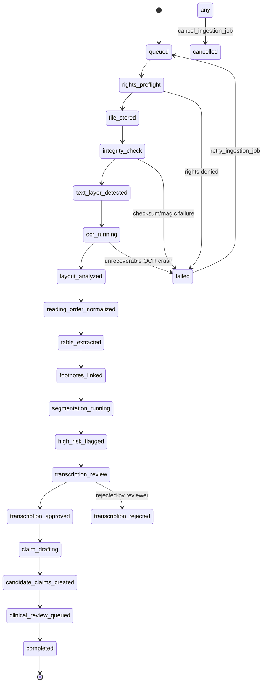

# KAVS Ingestion & Claim Extraction Workbench Specification
## ZAYVORA MATAB OS — Phase K2–K3 Architecture & Operation Guide

---

## 1. Executive Summary & Non-Negotiable Invariants

The Knowledge Authenticity, Verification & Clinical Safety Framework (KAVS) Phase K2–K3 establishes a deterministic, auditable pipeline for transforming classical Unani literature, statutory AYUSH pharmacopoeias, and modern clinical research into verified atomic clinical knowledge.

### Non-Negotiable Knowledge Rule
No clinical content—whether formulation constituents, posologies, preparation methods, therapeutic indications, or contraindications—may be invented, hallucinated, or silently inferred by application logic or AI assistants.

1. **Extraction Fidelity over Speed:** Low-confidence extractions must remain explicitly flagged and uncertain until qualified human review.
2. **Draft Segregation:** Machine-extracted candidate claims live exclusively in `kavs_claim_drafts` and are mathematically excluded from live clinical consultation retrieval until promoted and signed off by qualified Unani scholars and clinical leads.
3. **Physical vs. Printed Pagination:** Page indexing must never conflate the physical file offset (`pdf_page_index`) with the printed page numbering (`printed_page_label`), preventing page drift across prefatory front matter.
4. **Mandatory Rights Preflight:** No source file may be stored, parsed, indexed, or redistributed without explicit rights preflight clearance.

---

## 2. Rights Preflight Verification Engine

Prior to any ingestion activity, the system performs a rights preflight check against `kavs_rights_preflight_events` and the source's declared `rights_status`:

| Operation Code | Description | Preflight Criteria |
|---|---|---|
| `RETAIN_FILE` | Storing the raw binary in the vault | Permitted unless rights status is `METADATA_AND_EXCERPT_ONLY` or file retention is explicitly prohibited |
| `EXTRACT_TEXT` | Running OCR or layout analysis | Permitted for public domain, statutory AYUSH, or licensed sources with text-extraction authorization |
| `INDEX_VECTORS` | Generating embeddings for retrieval | Prohibited if license forbids derivative vector indexing |
| `EXPORT_REDISTRIBUTE` | Sharing raw text or files outside the facility | Strictly restricted to open-access statutory or CC-BY licenses |

If a preflight check fails, the job immediately terminates with an audited rights violation record and does not proceed to file storage or OCR.

---

## 3. Cryptographic File Vault & Integrity Scanning

Files uploaded to `POST /api/v1/kavs/sources/{id}/files` undergo immediate pre-processing:
- **Magic-Byte Inspection:** Validates actual binary file signatures:
  - PDF: `%PDF-` (`0x25 0x50 0x44 0x46 0x2D`)
  - DOCX: `PK\x03\x04` (`0x50 0x4B 0x03 0x04`)
  - PNG: `\x89PNG\r\n\x1a\n` (`0x89 0x50 0x4E 0x47 0x0D 0x0A 0x1A 0x0A`)
  - TIFF: `II*\x00` / `MM\x00*`
- **SHA-256 Digest Computation:** Produces a unique 64-character hexadecimal fingerprint stored in `kavs_source_files.sha256_hash`.
- **Integrity Verification:** Subsequent job steps verify that stored binary hashes match the recorded digest before processing commences.

---

## 4. Server-Authoritative 21-State Ingestion Lifecycle

Ingestion jobs progress through an explicit 21-state finite state machine:

### Complete State Registry:
1. `queued`: Ingestion job created, waiting in processing queue.
2. `rights_preflight`: Checking operational permissions against licensing policy.
3. `file_stored`: Source file persisted in secure local storage.
4. `integrity_check`: SHA-256 and magic byte verification in progress.
5. `text_layer_detected`: Assessing native text layer vs scanned bitmap.
6. `ocr_running`: Multilingual OCR pass executing.
7. `layout_analyzed`: Column, margin, and block bounding boxes identified.
8. `reading_order_normalized`: Complex classical multi-column reading order resolved.
9. `table_extracted`: Structured formulation/posology tables extracted.
10. `footnotes_linked`: Scholarly footnotes and commentary attached to main body.
11. `segmentation_running`: Splitting pages into semantic paragraphs and entries.
12. `high_risk_flagged`: Scanning for numerical ranges, posology, taxonomy, and contraindications.
13. `transcription_review`: Awaiting human review of flagged high-risk segments.
14. `transcription_approved`: Human checked and approved segment fidelity.
15. `claim_drafting`: Candidate atomic claim synthesis in progress.
16. `candidate_claims_created`: Draft claims recorded in candidate queue.
17. `clinical_review_queued`: Transferred to dual-scholar clinical review queue.
18. `completed`: Entire ingestion, extraction, and verification workflow concluded.
19. `stalled`: Inactive job exceeding watchdog threshold.
20. `cancelled`: Operator cancelled job.
21. `failed`: Unrecoverable execution error.

---

## 5. Physical vs. Printed Pagination Architecture

Classical Unani medical volumes frequently contain extensive front matter (prefaces, publisher notes, taqriz, muqaddimah, indexes) that misaligns PDF reader page numbers from the book's folio numbering.

In `kavs_extraction_pages`:
- `pdf_page_index` (INTEGER): Zero- or one-based sequential offset of the page in the digital PDF file (e.g., `24`).
- `printed_page_label` (TEXT): The actual printed page number appearing on the physical paper (e.g., `"10"` or `"v"` or `"iv"`).

This ensures that clinical citations referencing "Page 10" resolve to both the historical paper citation and the exact PDF index without ambiguity.

---

## 6. Automated High-Risk Clinical Scanner

Extracted page and segment text is processed by `_detect_high_risk_elements`:

| Flag Identifier | Detection Rule | Clinical Rationale |
|---|---|---|
| `NUMERIC_QUANTITY_OR_RANGE` | `\b\d+([.,/]\d+)?\b` | Dosage errors in medicinal preparations represent critical clinical safety hazards. |
| `HISTORICAL_POSOLOGY_UNIT` | `\b(masha\|tola\|dirham\|misqal\|ratti\|chhatak\|habba\|dam\|ser\|mithqal\|drachm)\b` | Historical Unani units require verified metric conversions (e.g., 1 masha ≈ 0.97g). |
| `BOTANICAL_TAXONOMY` | Latin genus + species + botanical author (e.g. `Piper nigrum L.`, `Terminalia chebula Retz.`) | Herb substitution or misidentification risks severe toxicity. |
| `SAFETY_CONTRAINDICATION_OR_NEGATION` | `\b(contraindicated\|do not use\|harmful in\|la yusta'mal\|mudir\|khata\|prohibited\|toxic in\|avoid in)\b` | Negation errors can convert a warning into an indication. |
| `ARABIC_URDU_SCRIPT` | Unicode ranges `0600-06FF` & `0750-077F` | RTL script ligature errors in OCR require scholar review. |
| `LOW_OCR_CONFIDENCE` | `ocr_confidence < 0.80` | Garbled or blurred scans must be manually transcribed. |

When any high-risk flag or low OCR confidence is detected, the page status is automatically set to `REQUIRES_MANUAL_TRANSCRIPTION`.

---

## 7. Human Transcription Correction Protocol

When OCR produces erroneous characters or numbers:
1. Operator navigates to the Extraction Inspector.
2. Selects "Correct Transcription".
3. Enters `corrected_text` and a **mandatory** `correction_reason`.
4. The system:
   - Records an immutable diff entry in `kavs_extraction_corrections` containing `original_machine_text`, `corrected_text`, `correction_reason`, `corrected_by`, and timestamp.
   - Updates `kavs_extraction_segments.human_corrected_text`.
   - Transitions segment `fidelity_status` from `machine_raw` to `human_checked`.
   - Increments the parent job's `reviewed_segments` counter.

---

## 8. Candidate Claim Drafts Segregation & Promotion Gate

### The Retrieval Isolation Gate
Candidate claim drafts created during Phase K2–K3 are stored in `kavs_claim_drafts`. They are:
- **Excluded from `knowledge_claims`**
- **Excluded from `POST /api/v1/kavs/retrieve`**
- **Excluded from Consultation Orchestrator & Safety Firewall**

### Promotion Preconditions
To promote a draft (`POST /api/v1/kavs/extraction/claim-drafts/{id}/promote`):
1. The draft must have an associated `segment_id`.
2. The associated extraction segment must have `fidelity_status == 'human_checked'`. If the segment is still `machine_raw` or `unreadable`, promotion is strictly blocked with a 400 Validation Error.
3. Upon promotion:
   - An atomic record is created in `knowledge_claims` in `UNDER_REVIEW` state.
   - The draft status updates to `PROMOTED` and stores `promoted_claim_id`.
   - The atomic claim must then complete KAVS Phase K1 dual-scholar review (`POST /api/v1/kavs/claims/{id}/approve`) before it can ever be retrieved by clinicians during active consultations.

---

## 9. Verification & Test Evidence

The entire KAVS Phase K2–K3 subsystem is backed by 100% passing tests:
- **Unit Suite:** `tests/unit/test_kavs_ingestion_workbench.py` (17 tests passing)
- **Integration Suite:** `tests/integration/test_kavs_ingestion_api.py` (6 tests passing)
- **Full System Regression Suite:** 276 tests passing across all 18 modules.
