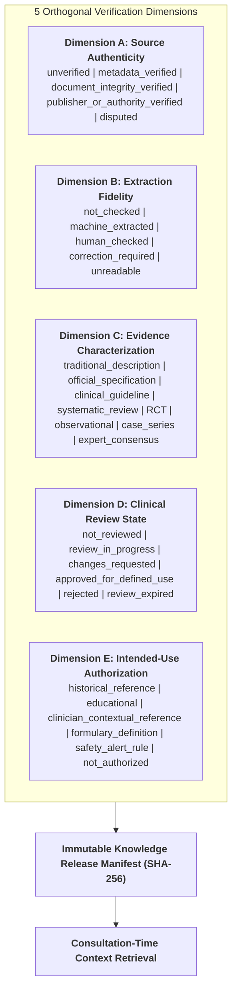

# Knowledge Authenticity, Verification & Clinical Safety Framework (KAVS)
## Architecture Blueprint & Operational Specification | Standalone Product v1.0

---

## 1. Executive Summary & Non-Negotiable Core Principle
The **Knowledge Authenticity, Verification & Clinical Safety (KAVS)** layer is the central evidence infrastructure of ZAYVORA MATAB OS.

> [!CAUTION]
> **Zero Clinical AI Hallucination Proscription:**
> No clinical claim, Unani formula, ingredient identity, dosage, interaction, contraindication, modern diagnosis rule, citation, evidence statement, or safety recommendation may be invented by artificial intelligence or application code. AI may assist with extraction, transcription, translation, and candidate clustering only when anchored to immutable source passages and labeled as unverified drafts until reviewed by qualified humans.

---

## 2. Five Independent Verification Dimensions

Rather than compressing clinical validity into a single probabilistic score, KAVS records five orthogonal verification dimensions:

---

## 3. End-to-End Operational Lifecycle

The KAVS operating chain guarantees traceable provenance:
$$\text{Source Registration} \rightarrow \text{Rights/Scope Review} \rightarrow \text{Ingestion/Extraction} \rightarrow \text{Fidelity Checking} \rightarrow \text{Atomic Claim Structuring} \rightarrow \text{Evidence Appraisal} \rightarrow \text{Expert Review} \rightarrow \text{Scoped Approval} \rightarrow \text{Immutable Release} \rightarrow \text{Cited Context Retrieval} \rightarrow \text{Change Impact / Withdrawal}$$

1. **Source Versioning & Rights Verification:** Every classical compendium (NFUM, UPI, Bayaz-e-Kabir) or modern guideline (CCRUM, AHA/ACC) is versioned with publisher integrity and statutory rights metadata (`kavs_source_versions`, `kavs_source_rights_reviews`).
2. **Page-Anchored Extraction Segments:** Extracted passages are anchored to exact page/table/section locators with OCR confidence tracking. Material with low confidence or formula weights cannot be published without human reviewer verification (`kavs_extraction_segments`).
3. **Evidence Contradiction Graph:** Contradicting studies or safety limitations (e.g., chronic electrolyte loss with prolonged senna use) are explicitly linked to claims via `kavs_evidence_conflict_links`.
4. **Change-Impact Dependency Engine:** Downstream dependencies (`Source -> Claim -> Formulation -> Safety Rule -> Clinical Card`) are traced when a source edition is superseded or retracted via `kavs_change_impact_events`.
5. **Grounded Retrieval with Honest Caveats:** When a query yields no verified claims within approved intended use, the engine explicitly returns `insufficient_information: true` rather than generating plausible text.

---

## 4. Database Schema (Migration 015)
The framework is backed by 8 relational tables in SQLite (WAL mode):
- `kavs_source_versions`
- `kavs_source_rights_reviews`
- `kavs_ingestion_jobs`
- `kavs_extraction_segments`
- `kavs_claim_verifications`
- `kavs_evidence_conflict_links`
- `kavs_knowledge_releases` & `kavs_release_items`
- `kavs_change_impact_events`

---

## 5. Automated Verification Status
- **Unit Suite:** `tests/unit/test_kavs_engine.py` (8 tests, PASS)
- **Integration Suite:** `tests/integration/test_kavs_api.py` (4 tests, PASS)
- **Full System Regression Suite:** 236 / 236 tests passing cleanly in 17.6s (100% pass rate).
