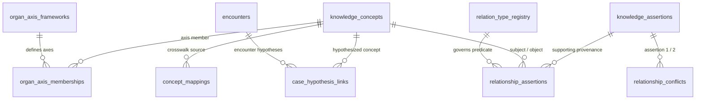

# Unani Clinical Knowledge Mapping & Organ-Axis Relationship Engine
## ZAYVORA MATAB OS — Phase 20 Technical Specification

---

## 1. Executive Summary & Epistemic Boundaries

The ZAYVORA MATAB OS Phase 20 Clinical Knowledge Mapping & Organ-Axis Relationship Engine provides a source-grounded, versioned, and strictly governed relationship layer connecting Unani concepts, clinical observations, organ systems, and product navigation structures.

### Non-Negotiable Invariants
1. **Zero Fabrication of Clinical Relationships:** No clinical relationship, organ sympathy, indication, contraindication, modern equivalence, or causal mechanism may be generated, hallucinated, or inferred by AI or application code.
2. **Provenance-Bound Relationships:** Every substantive clinical relationship must link directly to an approved, authentic source assertion (`knowledge_assertions`) referencing a verifiable textual locator.
3. **Graph Non-Inference Rule:** Adjacency in the knowledge graph does NOT prove clinical evidence. Multi-step graph reachability ($A \to B \to C$) **never implies or synthesizes an unverified direct relationship ($A \to C$)**.
4. **Organ-Axis Epistemic Isolation:** The Organ-Axis framework is a **versioned product navigation model** (`product_navigation_model`). It organizes clinical concepts for clinician consultation workspace navigation; it does NOT constitute biomedical proof of causality or clinical efficacy without formal clinical trials.
5. **Cross-Disciplinary Mapping Fidelity:** Crosswalks to modern biomedical classification systems (ICD-11, SNOMED-CT, POWO) preserve mapping types (`exact`, `broader_than`, `narrower_than`, `related_to`, `candidate_equivalence`, `no_safe_mapping`). Entries marked `candidate_equivalence` are strictly quarantined from automated clinical decision support.
6. **Patient Data Isolation:** Clinician case hypotheses recorded during patient consultations reside strictly in `case_hypothesis_links` within the encounter clinical record. They can NEVER mutate or pollute the global ontology graph.
7. **Adjudication of Disagreements:** Textual discrepancies and interpretation divergence between classical authorities enter a formal adjudication queue (`relationship_conflicts`) requiring explicit rationale and authorized signoff.

---

## 2. Entity Data Model (Migration 019)

### 2.1 Core Schema Entities
- **`relation_type_registry`**: Controlled registry for all relationship predicates (`code`, `label`, `relation_class`, `subject_type_constraints_json`, `object_type_constraints_json`, `directionality`, `is_clinically_actionable`, `requires_source_assertion`, `required_reviewer_roles_json`, `allowed_intended_uses_json`).
- **`relationship_assertions`**: Concrete typed relationship instances between concepts (`subject_concept_id`, `predicate_type_id`, `object_concept_id`, `assertion_id`, `relationship_level`, `polarity`, `review_state`, `intended_use_approval`).
- **`organ_axis_frameworks`**: Versioned product conceptual frameworks (`name`, `version`, `framework_type`, `description`, `purpose`, `limitations`, `source_basis_json`, `review_state`, `approved_use_scope`).
- **`organ_axis_memberships`**: Memberships linking concepts to functional axes (`framework_id`, `concept_id`, `axis_name`, `membership_type`, `assertion_id`, `display_order`).
- **`concept_mappings`**: Cross-disciplinary terminological crosswalks (`source_concept_id`, `target_system`, `target_identifier`, `target_label`, `mapping_type`, `limitations`, `review_state`, `approved_intended_use`).
- **`relationship_conflicts`**: Formal queue tracking discrepancies between assertions (`assertion_id`, `conflicting_assertion_id`, `conflict_type`, `resolution_state`, `resolution_rationale`).
- **`case_hypothesis_links`**: Encounter-scoped clinician hypotheses tied to `encounters(id)`. Isolated from the global ontology.

---

## 3. Relationship Predicate Registry

| Predicate Code | Relation Class | Allowed Subject Types | Allowed Object Types | Source Assertion Required | Clinical Actionable | Reviewer Roles |
|---|---|---|---|:---:|:---:|---|
| `classical_organ_association` | `unani_knowledge` | `unani_term`, `clinical_process`, `assessment_concept`, `organ_or_structure` | `organ_or_structure` | Yes | No | `UNANI_SCHOLAR` |
| `organ_axis_navigation_member` | `product_navigation` | `organ_or_structure`, `clinical_process`, `unani_term` | `organ_or_structure`, `clinical_process` | No | No | `UNANI_SCHOLAR`, `CLINICAL_SPECIALIST`, `ORG_ADMIN` |
| `indicated_for_mizaj_condition`| `unani_knowledge` | `material`, `ingredient`, `formulation` | `unani_term`, `clinical_process` | Yes | Yes | `UNANI_SCHOLAR`, `CLINICAL_SPECIALIST` |
| `contraindicated_in` | `unani_knowledge` | `material`, `ingredient`, `formulation` | `unani_term`, `clinical_process`, `organ_or_structure` | Yes | Yes | `UNANI_SCHOLAR`, `CLINICAL_SPECIALIST` |
| `botanical_identity_candidate` | `identity_crosswalk` | `material`, `ingredient` | `external_concept` | Yes | No | `UNANI_SCHOLAR` |
| `icd11_crosswalk` | `identity_crosswalk` | `unani_term`, `clinical_process`, `assessment_concept` | `external_concept` | No | No | `CLINICAL_SPECIALIST` |
| `snomed_crosswalk` | `identity_crosswalk` | `unani_term`, `clinical_process`, `assessment_concept`, `organ_or_structure` | `external_concept` | No | No | `CLINICAL_SPECIALIST` |
| `source_cites` | `source_documentation`| Any | Any | No | No | `UNANI_SCHOLAR` |
| `has_canonical_name` | `terminology` | Any | Any | No | No | `UNANI_SCHOLAR` |
| `clinical_hypothesis_linked_to`| `patient_specific` | Any | Any | No | Yes | `CLINICAL_SPECIALIST` |

---

## 4. Relationship Level Hierarchy

1. **`ui_navigation_grouping`**: Product-level visual grouping for consultation navigation. Strictly forbidden from `clinical_decision_support` approval.
2. **`classical_text`**: Classical Unani textual assertion referenced from verified literature passages. Approved for `clinician_contextual_reference` or `educational_reference`.
3. **`clinician_authored_case_hypothesis`**: Clinician consultation hypothesis recorded during encounter. Scoped strictly to patient encounter; excluded from global ontology.
4. **`reviewed_evidence_based`**: Contemporary empirical evidence assertion reviewed and verified by clinical scholars. Eligible for `clinical_decision_support` and `safety_firewall_rule`.
5. **`research_hypothesis`**: Academic hypothesis under active investigation; quarantined from live clinical decision support.

---

## 5. Bounded Graph Traversal & Non-Inference Rules

The graph traversal engine (`KnowledgeMappingEngine.traverse_knowledge_graph`):
1. **Hard Depth Limit:** Enforces `max_depth = min(max_depth, 3)`.
2. **Cycle Prevention:** Maintains visited node sets to prevent infinite loops in cyclic anatomical or sympathetic relationships.
3. **Clinical Mode Filtering:** When clinical mode is active, traverses only edges with `review_state == 'approved_for_defined_use'` and `polarity == 'supports'`, automatically filtering out drafts, rejected, disputed, withdrawn, or pure navigation groupings.
4. **Prohibition of Transitive Inference:** Traversal returns explicit nodes, edges, and paths. The system **never synthesizes a direct assertion ($A \to C$)** from an observed path ($A \to B \to C$). Every traversal response includes a mandatory warning:
   > *"Graph traversal represents individual asserted relationships only. Adjacency or multi-step path reachability does NOT prove transitive clinical causality, efficacy, or safety. Autonomous transitive inferences (A -> C) are prohibited."*

---

## 6. REST API Endpoints

### 6.1 Relation-Type Registry
- `GET /api/v1/knowledge/relations/types`: List controlled relation types with constraints and roles.
- `POST /api/v1/knowledge/relations/types`: Register new controlled relation type (admin/governance).
- `GET /api/v1/knowledge/relations/types/{id}`: Get relation type details.

### 6.2 Relationship Assertions
- `POST /api/v1/knowledge/relations`: Create provenance-bound relationship assertion.
- `GET /api/v1/knowledge/relations`: Query relations by subject, object, predicate, or review state.
- `GET /api/v1/knowledge/relations/candidates`: Query candidate draft relations.
- `GET /api/v1/knowledge/relations/{id}`: Get relation assertion details with joined citations.
- `POST /api/v1/knowledge/relations/{id}/review`: Review relation assertion (role-gated).
- `POST /api/v1/knowledge/relations/{id}/withdraw`: Withdraw relation assertion with mandatory rationale.

### 6.3 Versioned Organ-Axis Frameworks
- `GET /api/v1/organ-axis/frameworks`: List versioned Organ-Axis frameworks.
- `POST /api/v1/organ-axis/frameworks`: Register new versioned framework with limitations.
- `GET /api/v1/organ-axis/frameworks/{id}`: Get framework details.
- `POST /api/v1/organ-axis/frameworks/{id}/publish`: Publish/approve framework for defined scope.
- `GET /api/v1/organ-axis/frameworks/{id}/memberships`: List axis memberships for framework.
- `POST /api/v1/organ-axis/frameworks/{id}/memberships`: Add concept to axis with assertion link.

### 6.4 Cross-Disciplinary Concept Mappings
- `POST /api/v1/knowledge/mappings`: Create cross-system concept mapping.
- `GET /api/v1/knowledge/mappings`: List concept mappings.
- `GET /api/v1/knowledge/mappings/candidates`: List candidate mappings.
- `GET /api/v1/knowledge/mappings/{id}`: Get mapping details.
- `POST /api/v1/knowledge/mappings/{id}/review`: Review mapping (quarantines candidate equivalence).

### 6.5 Relationship Conflicts
- `POST /api/v1/knowledge/conflicts`: Report conflict between assertions.
- `GET /api/v1/knowledge/conflicts`: List conflicts by state or type.
- `GET /api/v1/knowledge/conflicts/{id}`: Get conflict details.
- `POST /api/v1/knowledge/conflicts/{id}/adjudicate`: Adjudicate conflict with mandatory rationale.

### 6.6 Encounter-Scoped Case Hypotheses
- `POST /api/v1/encounters/{encounter_id}/hypothesis-links`: Record encounter hypothesis.
- `GET /api/v1/encounters/{encounter_id}/hypothesis-links`: List encounter hypotheses.
- `PATCH /api/v1/encounters/{encounter_id}/hypothesis-links/{id}/status`: Update hypothesis status.

### 6.7 Bounded Knowledge Graph Traversal
- `GET /api/v1/knowledge/graph/traverse`: Bounded graph traversal with depth and non-inference checks.
