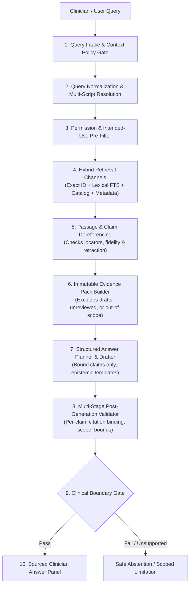

# ZAYVORA MATAB OS — PROMPT 22 REPOSITORY & PREREQUISITE AUDIT
## Evidence-Aware Clinical Knowledge Retrieval (Hybrid RAG) & Clinician Answer Generation Engine

**Date:** October 2026  
**Auditor:** Antigravity / ZAYVORA Clinical Governance Infrastructure  
**Target Repository:** Standalone `zayvora-matab-os`  

---

### 1. Executive Summary

This audit assesses the readiness of the repository to support Phase 22: Permission-Aware Hybrid RAG, Citation Binding, and Clinician Answer Generation.

All prerequisite phases (Prompts 17 through 21) are **operational, relational-first, and verified by 360 passing tests**. No external legacy dependencies on ZAYVORA Health OS exist.

---

### 2. Prerequisite Subsystem Inspection Matrix

| Subsystem / Requirement | Implementation Files & DB Tables | Audit Verdict | Evidence / Tests |
|---|---|---|---|
| **Source Registry & Versioning (Prompt 17)** | `knowledge_sources`, `kavs_source_versions`, `apps/api/domains/kavs.py` | `implemented_and_tested` | Tests pass in `test_kavs_foundation.py` and `test_kavs_foundation_api.py`. Cryptographic hashing (`document_hash`) and edition status verified. |
| **Ingestion & Passage Locators (Prompt 18)** | `kavs_extraction_pages`, `kavs_extraction_segments`, `apps/api/domains/kavs.py` | `implemented_and_tested` | Exact printed page vs. PDF page tracking, OCR confidence, human correction status (`human_checked`), regex risk scanner verified. |
| **Canonical Unani Catalog (Prompt 19)** | `knowledge_concepts`, `concept_names`, `material_identity`, `catalog_formulations`, `apps/api/domains/ontology.py` | `implemented_and_tested` | Identity separated from assertions; multi-script Arabic/Urdu normalization; explainable matching; 17 API endpoints active. |
| **Knowledge Mapping & Organ-Axis (Prompt 20)** | `relation_type_registry`, `relationship_assertions`, `organ_axis_frameworks`, `apps/api/domains/knowledge_mapping.py` | `implemented_and_tested` | Controlled predicates, Organ-Axis navigation model isolation, crosswalk candidate quarantining, bounded traversal (max depth 3). |
| **Claim Verification & Citations (Prompt 21)** | `claim_type_registry`, `claim_source_links`, `citation_validation_runs`, `support_assessments`, `intended_use_approvals`, `apps/api/domains/evidence_verification.py` | `implemented_and_tested` | 15 controlled claim categories (A–N, Z), 6-dimensional validation matrix, automated retraction cascading, fail-closed publication gate. |
| **Access Control & Permissions** | `apps/api/core/permissions.py`, `apps/api/core/auth.py` | `implemented_and_tested` | `knowledge:read`, `knowledge:manage`, `knowledge:review`, `knowledge:approve` enforced in server-side handlers. |
| **Clinical Safety Firewall & Patient Isolation** | `apps/api/domains/safety_firewall.py`, `apps/api/domains/consultation_orchestrator.py` | `implemented_and_tested` | Encounter-scoped patient data is isolated; never written to global ontology; deterministic preflight firewall active. |

---

### 3. Architecture & Trust Boundaries for Hybrid RAG

#### Trust Boundaries & Safety Guarantees
1. **Model Boundary:** Model generation is treated as an untrusted drafting step. Outputs are parsed into structured claim units and validated deterministically.
2. **Context Boundary:** Patient-specific consultation context (e.g., patient age, active drugs) is strictly read-only and never leaked into the global retrieval index, telemetry, or cache.
3. **Evidence Boundary:** Every answer claim must bind to a specific passage locator and an approved intended-use record. Unbound claims are rejected.
4. **Autonomous Prescription Ban:** Requests attempting to elicit an autonomous diagnosis, prescription, or dosage calculation are intercepted and routed to abstention or existing governed workflows.

---

### 4. Readiness Conclusion

The repository is fully prepared for Phase 22. Implementation proceeds to Migration 021, `ClinicalRAGEngine`, REST endpoints, admin UI integration, unit tests, and integration tests.
