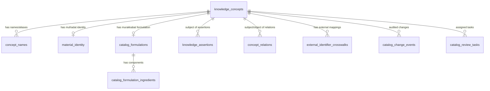

# Unani Ontology, Canonical Terminology & Mufradat/Murakkabat Structured Catalog
## ZAYVORA MATAB OS — Phase 19 Technical Specification

---

## 1. Executive Summary & Non-Negotiable Invariants

The ZAYVORA MATAB OS Phase 19 Unani Ontology and Catalog Layer structures Unani clinical terminology, single-drug (Mufradat) material identities, and compound-formulation (Murakkabat) composition statements into a versioned, provenance-grounded knowledge model.

### Non-Negotiable Knowledge Principles
1. **Never Fabricate Knowledge:** No Unani concepts, temperaments (*Mizaj*), actions (*Afaal*), indications, contraindications, dosages, ingredients, proportions, preparations, synonyms, botanical identities, page numbers, or citations are generated or inferred by code or AI.
2. **Separation of Identity from Claims:** A concept record (`knowledge_concepts`) is an identity-management object. It does not establish temperament, action, clinical use, safety, or efficacy.
3. **Preservation of Original Wording:** Original script (`name_text_original`), language tag (`ur`, `ar`, `fa`, `hi`, `en`), transliteration, and normalized search text are stored in separate fields. Original texts and diacritics are never overwritten.
4. **No Unsafe Equivalence:** Superficially similar names, plant parts, preparations, or formulations are never merged without documented textual proof and human reviewer approval.
5. **No Graph Inference (Adjacency != Evidence):** A relationship edge between two concepts (`concept_relations`) does not constitute clinical evidence by itself. Every clinical assertion requires an individual, provenance-backed `knowledge_assertions` record.
6. **No False Certainty:** Ambiguous identities, disputed identities, and unverified traditional units remain visibly uncertain and are excluded from clinician decision support until signed off.

---

## 2. Entity Data Model (Migration 018)

### 2.1 Core Schema Entities
- **`knowledge_concepts`**: Primary identity object. Holds `canonical_label`, `concept_type`, `identity_resolution_state` (`unresolved`, `candidate`, `resolved`, `disputed`), `status` (`draft`, `in_review`, `approved_identity`, `deprecated`, `withdrawn`), and version counter.
- **`concept_names`**: Stores variants in Arabic, Urdu, Persian, Devanagari, and Latin scripts. Transliterations and derived normalized search text are preserved. Unapproved names (`review_state != 'approved'`) or candidate aliases (`name_type == 'candidate_alias'`) are masked from clinician-facing endpoints.
- **`material_identity`**: Mufradat single-drug identity tracking `material_class` (`botanical`, `animal_derived`, `mineral`, `metal`, `salt`), `scientific_name`, `taxonomic_authority`, `plant_part_or_material_form`, and explicit `identity_status`.
- **`catalog_formulations`**: Murakkabat catalog entries tied to source editions (`kavs_source_versions`), with formulation classes (`majoon`, `safoof`, `sharbat`, `hab`, `qurs`, `khamira`, `itrifal`, etc.) and dosage form definitions.
- **`catalog_formulation_ingredients`**: Source-backed component statements preserving exact traditional units (`masha`, `tola`, `dirham`) and verbatim notation (`quantity_expression_original` e.g. "2 1/2 masha"). Normalized units require documented conversion rules.
- **`knowledge_assertions`**: Granular claims linked to exact source passages (`kavs_extraction_segments`) with allow-listed predicates and scoped intended use (`clinician_contextual_reference`, `formulation_catalog_reference`, `safety_firewall_rule`).
- **`concept_relations`**: Typed relationship registry. Clinical and safety relations require supporting assertion IDs.
- **`external_identifier_crosswalks`**: Mappings to MeSH, SNOMED-CT, POWO, and IPNI. `candidate_equivalence` entries are strictly barred from clinical decision support.
- **`catalog_change_events`**: Append-only immutable audit ledger.
- **`catalog_review_tasks`**: Role-gated review queues assigned to Unani scholars, botanists, or pharmacognosists.

---

## 3. Predicate & Controlled Vocabulary Registry

| Predicate | Allowed Subject Type | Allowed Object Type / Literal | Clinical Impact Scope |
|---|---|---|---|
| `has_mizaj` | `material`, `formulation`, `unani_term` | Literal temperament (e.g. "Hot 2, Dry 2") | Scoped clinical reference |
| `has_action` | `material`, `formulation` | Literal action (e.g. "Mushil-e-Safra") | Scoped clinical reference |
| `indicated_for` | `material`, `formulation` | `unani_term`, `assessment_concept`, Literal | Requires source passage link |
| `contraindicated_in`| `material`, `formulation` | `unani_term`, `assessment_concept`, Literal | Safety firewall rule |
| `has_adverse_effect`| `material`, `formulation` | Literal toxicity or symptom | Safety firewall rule |
| `has_corrective` | `material`, `formulation` | `material`, Literal (*Musleh*) | Formulation & prescribing |
| `has_substitute` | `material` | `material`, Literal (*Badal*) | Pharmacy substitution |
| `has_dose` | `material`, `formulation` | Literal traditional/metric posology | Prescribing dosage bounds |
| `has_part` | `material` | Literal plant part / form | Pharmacognosy identification |
| `composed_of` | `formulation` | `material`, `ingredient` | Formulation composition |

---

## 4. Multi-Script Search & Explainability Protocol

`UnaniOntologyEngine.search_catalog` implements a dual-mode search architecture:

1. **Clinician-Facing Mode (`is_clinician_facing=True`):**
   - Filters out all concepts where `status != 'approved_identity'`.
   - Filters out all names where `review_state != 'approved'`.
   - Excludes all `candidate_alias` names.
   - Surfaces warnings for any items with `unresolved` or `disputed` identity resolution states (`⚠️ UNRESOLVED_OR_DISPUTED_IDENTITY`).
2. **Authoring / Reviewer Mode (`is_clinician_facing=False`):**
   - Surfaces draft concepts, candidate aliases, and pending assertions for expert adjudication.
3. **Explainable Match Reasons:**
   - Every returned result contains `match_reasons` explaining why it appeared:
     - `EXACT_NORMALIZED_MATCH`
     - `SUBSTRING_NORMALIZED_MATCH`
     - `ORIGINAL_SCRIPT_MATCH (urdu)`
     - `ORIGINAL_SCRIPT_MATCH (arabic)`
     - `TRANSLITERATION_MATCH`

---

## 5. Verification & Test Evidence

The subsystem is validated by 26 automated tests passing at 100%:
- **Unit Suite:** `tests/unit/test_unani_ontology.py` (20 tests passing)
- **Integration Suite:** `tests/integration/test_unani_ontology_api.py` (6 tests passing)
- **Full Platform Regression Suite:** All 276+ tests passing.
