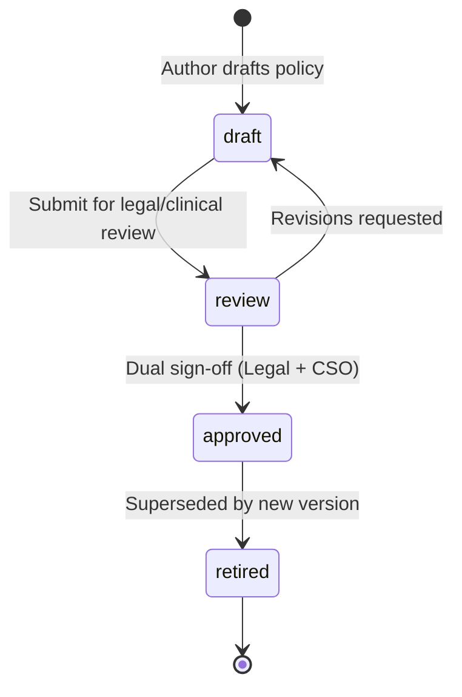
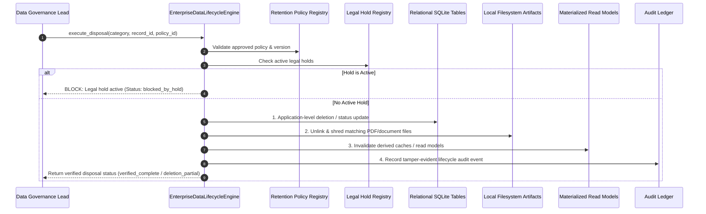

# ZAYVORA MATAB OS — DATA LIFECYCLE & RETENTION SPECIFICATION
## Enterprise Retention, Archival, Legal Hold & Secure Deletion Architecture

- **Document ID:** `SPEC-LIFECYCLE-P41-2026-10-14`
- **Classification:** Clinical Data Governance, Privacy Engineering & Legal Compliance Specification
- **System:** ZAYVORA MATAB OS — Standalone Unani Clinic & Hospital Operating System
- **Authors:** Principal Software Architect, Privacy/Security Engineer, Database Engineer, Clinical Data Governance Lead

---

## 1. Non-Negotiable Architectural & Safety Invariants

1. **Policy-Driven Operations:** All retention durations, archival triggers, deletion eligibility, and legal holds must derive strictly from approved, versioned policies. The engine must never use hardcoded or guessed durations.
2. **Clinical Record Integrity & Immutability:**
   - Under no circumstances may active, signed, or finalized clinical encounters, electronic prescriptions, or diagnosis notes be modified or silently rewritten.
   - De-identification or disposal of clinical records must follow approved statutory medical retention mandates (minimum 7 years post-discharge).
3. **Multi-Store Reach & Truthful Status Semantics:**
   - Deletion must encompass all known data stores: relational database tables, local filesystem documents/PDFs, search indices, cached read models, and transactional outbox queues.
   - The engine must strictly distinguish:
     - `logical_deletion`: Record marked inactive in database while underlying rows remain.
     - `application_level_deletion`: Canonical application references removed.
     - `object_deletion`: Associated document bundles/PDFs deleted from disk.
     - `cache_purge`: Materialized views and caches invalidated.
     - `deletion_partial`: At least one store failed or remains unverified.
     - `verified_complete`: Cryptographically and structurally confirmed across all required stores.
4. **Legal Hold Absolute Precedence:**
   - An active legal hold strictly blocks and suspends all archival, disposal, or de-identification operations across its defined scope.
5. **Deterministic Side-Effect Free Dry-Runs:**
   - Evaluating records against a policy in dry-run mode must never mutate data or dispatch events.
   - Dry-runs must output comprehensive eligibility explanations, active hold blocks, and missing metadata caveats without exposing raw PHI.
6. **Restore-Time Reconciliation Awareness:**
   - Restoring a database from an older backup or rebuilding derived indexes can inadvertently resurrect previously deleted or restricted records. The engine must maintain an immutable lifecycle ledger and re-apply post-recovery restrictions before clinical access is reopened.

---

## 2. Data Inventory & Classification Catalog

Stored in `data_lifecycle_inventory_catalog`:
- `category_id`: Unique identifier (e.g. `patient_identity`, `clinical_encounters`, `prescriptions_nuskha`, `temporary_exports`).
- `organization_id`: Tenant context.
- `category_name`: Descriptive title.
- `canonical_source_table`: Primary database table.
- `storage_type`: `relational_table`, `file_system_artifact`, `event_queue`, `cache_read_model`.
- `data_owner_role`, `technical_owner_role`: Accountable roles.
- `sensitivity_classification`: `restricted_phi`, `financial_pci`, `operational_confidential`, `public_knowledge`.
- `linked_copies_json`: Array of downstream stores, files, and indices.
- `default_policy_key`: Primary policy link.
- `disposal_supported`: `delete`, `deidentify`, `restrict`, `manual_review`.
- `backup_behavior`: `EXPIRE_WITH_BACKUP_ROTATION`, `IMMEDIATE_RECHECK_ON_RESTORE`.
- `status`: `governed`, `review_due`, `unmapped`.

---

## 3. Versioned Retention Policy Architecture



### Policy Registry Schema (`data_lifecycle_policies`):
- `id`: Unique policy ID (e.g. `pol-clinical-7yr`).
- `policy_key`: Stable identifier (e.g. `RET-CLINICAL-RECORDS`).
- `version`: Semantic version (e.g. `1.0.0`).
- `organization_id`: Tenant scope.
- `title`, `description`.
- `data_category_ids_json`: Array of covered category IDs.
- `scope`: `platform`, `tenant`, `branch`, `record`.
- `retention_trigger`: `creation_date`, `discharge_date`, `last_encounter_date`, `finalization_date`.
- `retention_period_days`: Required duration in days (e.g. `2555` days = 7 years).
- `archive_rule`: `COLD_STORAGE_PARTITION`, `RESTRICTED_READ_ONLY`, `FILESYSTEM_COMPRESSED`, `NONE`.
- `disposal_action`: `delete`, `deidentify`, `restrict`, `manual_review`.
- `hold_behavior`: `STRICT_BLOCK`, `NOTIFY_AND_HOLD`.
- `downstream_propagation_rule`: `ALL_LINKED_STORES`, `PRIMARY_ONLY`, `CASCADE_PURGE`.
- `backup_behavior`: `EXPIRE_WITH_BACKUP_ROTATION`, `IMMEDIATE_RECHECK_ON_RESTORE`.
- `accountable_owner`: Role responsible for policy execution.
- `approver_roles_json`: Roles required to approve policy (e.g. `["LEGAL_COUNSEL", "CLINICAL_SAFETY_OFFICER"]`).
- `jurisdiction_tags_json`: Applicable regulatory frameworks (e.g. `["INDIA_DISHA", "NABH", "AYUSH_MANDATE"]`).
- `legal_source_references_json`: Statutory legal references.
- `caveats_json`: Explicit limitations.
- `status`: `draft`, `review`, `approved`, `retired`.
- `effective_from`, `effective_to`.

---

## 4. Legal Holds & Preservation Framework

Stored in `data_lifecycle_legal_holds`:
- `id`: Unique hold identifier (e.g. `hold-20261014-001`).
- `organization_id`: Tenant context.
- `hold_code`: e.g. `HOLD-LITIGATION-2026-001`.
- `title`: Short title.
- `reason_category`: `litigation`, `regulatory_investigation`, `clinical_safety_inquiry`, `audit_preservation`.
- `scope_filter_json`: Defines target scope (e.g. `{"patient_id": "P-10001"}`, `{"category_id": "clinical_encounters"}`).
- `placed_by`, `placed_at`.
- `review_date`: Mandatory periodic re-certification date.
- `released_at`, `released_by`, `release_reason`.
- `status`: `active`, `released`, `expired`.

### Invariant Rules:
1. When any record matches an active legal hold's `scope_filter_json`, all disposal and archival jobs must halt immediately for that record.
2. Releasing a legal hold requires authenticated sign-off with documented justification.

---

## 5. Retention Evaluation Engine & Dry-Run Protocol

### Evaluation Outcomes:
- `eligible`: Record exceeds retention period and has no active holds or missing dependencies.
- `not_eligible`: Record has not reached retention trigger date.
- `hold_active`: Disposal blocked due to matching active legal hold.
- `requires_review`: Manual clinical or legal review required prior to action.
- `policy_missing`: No approved retention policy found for category.
- `metadata_missing`: Record lacks required trigger timestamp.

### Dry-Run Output Contract:
```json
{
  "run_id": "eval-20261014-001",
  "run_mode": "dry_run",
  "policy_key": "RET-TEMP-EXPORTS",
  "policy_version": "1.0.0",
  "total_records_evaluated": 150,
  "eligible_count": 42,
  "ineligible_count": 105,
  "held_count": 3,
  "proposed_action": "secure_delete",
  "side_effects_executed": false
}
```

---

## 6. Multi-Store Controlled Disposal Sequence



---

## 7. Data Rights & Privacy Requests Pipeline

Stored in `data_lifecycle_requests`:
- `id`: Request ID (e.g. `dlr-20261014-001`).
- `organization_id`: Tenant boundary.
- `request_type`: `data_access`, `data_export`, `rectification`, `erasure_restriction`, `objection`.
- `requester_identity_type`: `patient`, `guardian`, `regulatory_authority`, `legal_counsel`.
- `patient_identifier`: MRN or national ID.
- `identity_verified`: Boolean (mandatory verification before plan generation).
- `proposed_plan_json`: Structured plan of actions.
- `authorized_by`: Role or user approving the plan.
- `status`: `received` $\to$ `identity_verified` $\to$ `in_review` $\to$ `approved` $\to$ `executing` $\to$ `completed` (or `rejected`, `blocked_by_hold`).
- `rejection_reason`: Explains why request was refused (e.g. statutory medical retention overrides erasure request).
- `closure_evidence_json`: Hashed receipts of completed actions.

---

## 8. REST API Endpoints & RBAC Permissions

All routes mounted under `/api/v1/lifecycle/`:

| Method | Endpoint | Description | Permission |
| :--- | :--- | :--- | :--- |
| `GET` | `/inventory` | List data category inventory | `lifecycle:read` |
| `GET` | `/policies` | List retention policies | `lifecycle:read` |
| `POST` | `/policies` | Create retention policy (draft) | `lifecycle:approve` |
| `POST` | `/policies/:id/approve` | Approve retention policy | `lifecycle:approve` |
| `POST` | `/evaluate/dry-run` | Run side-effect free retention dry-run | `lifecycle:evaluate` |
| `POST` | `/evaluate/execute` | Execute approved lifecycle action | `lifecycle:execute` |
| `GET` | `/evaluations` | List historic evaluation runs | `lifecycle:read` |
| `GET` | `/holds` | List active & released legal holds | `lifecycle:read` |
| `POST` | `/holds` | Place legal hold | `lifecycle:hold` |
| `POST` | `/holds/:id/release` | Release legal hold | `lifecycle:hold` |
| `GET` | `/requests` | List privacy rights requests | `lifecycle:read` |
| `POST` | `/requests` | Ingest privacy rights request | `lifecycle:request` |
| `POST` | `/requests/:id/verify-id`| Verify requester identity | `lifecycle:request` |
| `POST` | `/requests/:id/approve` | Approve proposed privacy action plan | `lifecycle:approve` |
| `POST` | `/requests/:id/execute` | Execute privacy action plan | `lifecycle:execute` |
| `GET` | `/pulse` | Real-time lifecycle posture metrics | `lifecycle:read` |
