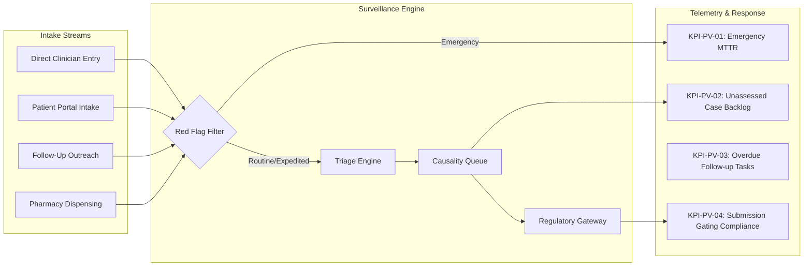

# ZAYVORA MATAB OS — Pharmacovigilance Operational Runbook & Compliance Checklist

**Document Type:** Standard Operating Procedures (SOP) & Compliance Verification Checklist  
**Phase:** 27 — Clinical Safety Surveillance, Adverse Event Management & Pharmacovigilance Workflow  
**Product:** ZAYVORA MATAB OS (Standalone Clinic/Hospital Operating System)  
**Status:** Active / Governed  
**Date:** October 2026  

---

## 1. Operational Telemetry & Monitoring KPIs

The Pharmacovigilance Operational Console tracks key safety surveillance metrics to maintain clinical vigilance and prevent regulatory non-compliance:

| Metric Identifier | KPI Name | Operational Target | Warning Threshold | Critical Escalation Threshold | Action on Breach |
|---|---|---|---|---|---|
| **`KPI-PV-01`** | **Emergency Escalation MTTR** | $< 15$ minutes | $> 30$ minutes | $> 60$ minutes | Page Clinical Director; transfer patient to acute care unit. |
| **`KPI-PV-02`** | **Causality Review Backlog** | $< 5$ cases $> 72$ hours | $> 10$ cases | $> 25$ cases | Reassign clinical reviewers; escalate to Lead Hakeem. |
| **`KPI-PV-03`** | **Overdue Follow-Up Tasks** | $0$ tasks $> 14$ days | $> 5$ tasks | $> 12$ tasks | Deploy Community Outreach Nurse; attempt phone reconciliation. |
| **`KPI-PV-04`** | **Regulatory Profile Verification** | $100\%$ verified before dispatch | Any unverified profile active | Unauthorized dispatch attempted | Fail-closed gate blocks transmission; log security alert. |
| **`KPI-PV-05`** | **Duplicate Candidate Age** | $< 48$ hours unreviewed | $> 72$ hours | $> 7$ days | Front desk supervisor review required before patient checkout. |

---

## 2. Standard Operating Procedures (SOPs)

### SOP-PV-01: Emergency Red Flag Intake & Clinical Escalation
- **Trigger:** Reporter narrative or event description contains emergency keywords (`anaphylaxis`, `angioedema`, `stevens-johnson`, `shock`, `unconscious`, `coma`, `respiratory arrest`, `acute liver failure`).
- **Immediate System Action:**
  1. Sets `urgency_level = 'EMERGENCY'`.
  2. Flags `emergency_escalated = 1` and timestamps `emergency_escalated_at`.
  3. Displays high-visibility red banner on the clinician consultation workstation.
- **Clinical Action Required:**
  1. Triage Nurse immediately notifies attending clinician.
  2. Implement emergency life-support measures if patient is on-site (intravenous access, airway maintenance, emergency antihistamines/epinephrine if indicated).
  3. Formally record clinical triage note within 15 minutes.

### SOP-PV-02: Executing Causality Assessment for Unani Formulations
- **Objective:** Evaluate the likelihood that a suspected formulation or herb caused the reported reaction without leaping to ungrounded conclusions.
- **Required Steps:**
  1. Open the case in the **Pharmacovigilance Console** (`knowledge_admin.js`).
  2. Verify chronological sequence: Did exposure strictly precede the onset of symptoms?
  3. Check dechallenge response: Did symptoms improve or abate after discontinuing the formulation?
  4. Evaluate Mudabbar processing: If the formulation contains toxic classical ingredients (e.g., Azaraqi/Strychnos nux-vomica, Samm-ul-Far), inspect pharmacy batch logs for proof of complete Shodhan/Tadbeer purification.
  5. Check Mizaji context: Did the patient exhibit preexisting Su-e-Mizaj Har that predisposed them to hyper-reactivity to Har ingredients?
  6. Select assessment method (`WHO-UMC Causality Assessment` or `Naranjo ADR Probability Scale`).
  7. Assign value (`CERTAIN`, `PROBABLE`, `POSSIBLE`, `UNLIKELY`, `CONDITIONAL_UNCLASSIFIED`, `UNASSESSABLE_UNCLASSIFIABLE`).
  8. **Document mandatory clinical rationale** detailing dechallenge observations, alternative diagnoses, and formulation specifics.
  9. Submit assessment.

### SOP-PV-03: Compliance Verification of Regulatory Report Profiles
- **Objective:** Prevent illegal or unverified transmissions to external regulatory bodies.
- **Requirement:** Profiles (`PVPI_AYUSH_ASU`, `DRAP_PV_CENTRE`, `WHO_VIGIBASE_E2B`) are initialized with `is_active = 0`.
- **Verification Procedure:**
  1. Designated Compliance Officer reviews current official gazette notifications, pharmacovigilance portal guidelines, and electronic transmission schemas.
  2. Verify that local clinic credentials, reporter identification numbers, and mandatory field definitions match current statutory requirements.
  3. Execute `POST /api/v1/safety/regulatory-profiles/{id}/verify` supplying authenticated Compliance Reviewer ID and date.
  4. System transitions profile to `is_active = 1`.

### SOP-PV-04: Governed Preparation & Authorized Transmission of Regulatory Reports
- **Requirement:** Zero automated or single-click regulatory dispatches.
- **Procedure:**
  1. Pharmacovigilance Officer initiates `POST /api/v1/safety/cases/{id}/report-package` selecting an active, verified profile.
  2. System generates standardized payload and computes SHA-256 manifest hash.
  3. If profile is inactive (`is_active = 0`), system raises `ValidationError` and terminates.
  4. If mandatory regulatory fields are missing, system returns `validation_status = 'INVALID'` with specific error items.
  5. A second authorized clinician/compliance officer reviews the rendered report package and executes `POST /api/v1/safety/submissions/{id}/authorize`.
  6. Once authorized, the designated transmission gateway transmits the payload via `POST /api/v1/safety/submissions/{id}/dispatch`.
  7. Verifiable transaction reference, authority acknowledgement timestamp, and receipt artifact are permanently committed to the ledger.

### SOP-PV-05: Resolving Potential Duplicate Safety Cases
- **Procedure:**
  1. System flags cases sharing patient MRN, identical formulation names, and overlapping onset dates as `POTENTIAL_DUPLICATES_IDENTIFIED`.
  2. Safety Officer reviews both cases side by side.
  3. If confirmed as genuine duplicate:
     - Execute `POST /api/v1/safety/cases/{id}/links` with `relationship_type = 'CONFIRMED_DUPLICATE'`.
     - System preserves both records independently, cross-linking them without destructive database overwrites.
  4. If the newer report provides additional temporal or clinical details:
     - Link as `relationship_type = 'FOLLOW_UP_REPORT'`.

---

## 3. Daily, Weekly & Monthly Compliance Verification Checklists

### 3.1 Daily Morning Clinical Safety Sweep
- [ ] Inspect all new cases in `safety_cases` received in last 24 hours.
- [ ] Confirm zero unacknowledged `EMERGENCY` triage escalations.
- [ ] Verify that all reporter contact records in public views are appropriately masked.
- [ ] Ensure all new adverse reaction entries have linked suspected exposures.

### 3.2 Weekly Pharmacovigilance Audit
- [ ] Audit all causality evaluations in `safety_assessments`; ensure 100% include documented clinical rationale.
- [ ] Review overdue follow-up tasks in `safety_follow_up_tasks`.
- [ ] Review candidate safety signals with $\ge 2$ cases; confirm investigation status is up to date.
- [ ] Audit regulatory submission ledger for pending authorizations.

### 3.3 Monthly Statutory Compliance & Regulatory Review
- [ ] Cross-reference active regulatory profiles with Ministry of Ayush (PvPI) and DRAP official portal advisories.
- [ ] Verify tamper-evident cryptographic hash integrity on all dispatched submissions.
- [ ] Confirm no clinical knowledge rules in the Safety Firewall were modified without Phase 28 governance approval.
