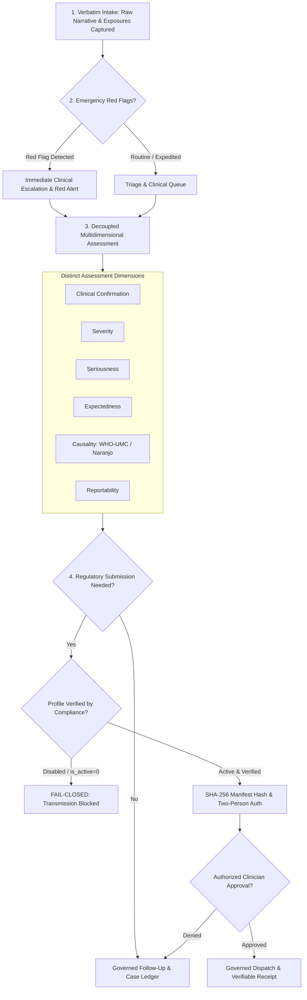

# ZAYVORA MATAB OS — Clinical Safety Surveillance & Pharmacovigilance Governance Specification

**Document Type:** Clinical Safety Architecture & Pharmacovigilance Specification  
**Phase:** 27 — Safety-Event Capture, Triage Workflow, Causality Review, Follow-Up, and Governed Reporting  
**Product:** ZAYVORA MATAB OS (Standalone Clinic/Hospital Operating System)  
**Status:** Governed / Active  
**Date:** October 2026  

---

## 1. Executive Summary & Regulatory Foundations

In an integrative clinical setting where classical Unani herbal-mineral formulations (Mufradat, Murakkabat, Mudabbar-processed substances) operate alongside modern pharmacotherapy and dietary supplements, **pharmacovigilance is an indispensable clinical safety discipline**.

Adverse event surveillance in traditional medicine presents unique challenges:
1. **Multi-Constituent Formulations:** Formulations such as Jawarish, Majun, or Khamira contain multiple botanical and mineral ingredients. Attributing an adverse effect requires meticulous dechallenge, rechallenge, batch identification, and concomitant exposure analysis.
2. **Mudabbar Detoxification Protocols:** Certain classical ingredients (e.g., Azaraqi/Strychnos nux-vomica, Samm-ul-Far/Arsenic trioxide, Hilteet/Asafoetida) require strict Mudabbar purification. Adverse reactions may indicate detoxification lapses, adulteration, or inappropriate posology.
3. **Mizaji Incompatibility (Su-e-Mizaj):** An adverse reaction may represent constitutional incompatibility (e.g., highly heating Har substances prescribed to a Safrawi bilious patient) rather than intrinsic chemical toxicity.
4. **Non-Negotiable Regulatory Gates:** Submissions to statutory pharmacovigilance programs (such as the Pharmacovigilance Programme for ASU Drugs - PvPI under the Ministry of Ayush in India, or the DRAP National Pharmacovigilance Centre in Pakistan) must never be automated without authorized human compliance approval.

ZAYVORA MATAB OS enforces a strict **fail-closed, human-attested pharmacovigilance workflow** that guarantees zero fabricated safety data, separates reported facts from clinical causality, preserves verbatim patient narratives, and locks regulatory reporting profiles until verified.

---

## 2. Strict Core Invariants (Non-Negotiables)

1. **Never Fabricate Safety Events or Outcomes:** No synthetic symptoms, unrecorded onset dates, false product batches, or fabricated lab results may ever be introduced.
2. **Record Reports Prior to Judging Causality:** Intake is strictly independent of causality. An adverse event report is accepted and persisted even when the clinician initially suspects no causal relationship.
3. **Temporal Association $\neq$ Causation:** The mere chronological succession of drug intake and symptom appearance does not establish clinical causality. Causality is an independently evaluated dimension requiring documented clinical rationale.
4. **Strict Separation of Assessment Dimensions:** The engine prohibits composite pseudo-scores. Clinical confirmation, severity, regulatory seriousness, expectedness, causality, and reportability are distinct data fields with individual ownership.
5. **No Autonomous Treatment Modification:** The pharmacovigilance engine surfaces advisory alerts and candidate signals; it does not autonomously alter, suspend, or cancel active prescriptions or care plans.
6. **Verbatim Preservation of Reporter Narrative:** Original statements in native scripts (Urdu, Arabic, Hindi, English) are preserved unedited alongside normalized clinical summaries.
7. **Privacy-Protective Masking:** Reporter phone numbers, email addresses, and physical addresses are masked in standard views and serialized only to authorized safety administrators.
8. **Disabled-by-Default Regulatory Profiles:** Jurisdictional profiles remain inactive (`is_active = 0`) until official endpoints, form schemas, and statutory rules are attested by compliance personnel.
9. **Two-Person Human Gate for Submissions:** Regulatory packages require cryptographic SHA-256 payload hashing and explicit authorized human sign-off before transmission.

---

## 3. Case Lifecycle and State Machine

| State Code | Phase Definition | Permitted Roles | Transition Prerequisites |
|---|---|---|---|
| `DRAFT` | Initial intake draft being prepared. | Triage Nurse, Hakeem, Pharmacist | Mandatory original narrative, reporter type, facility ID. |
| `INTAKE_COMPLETE` | Report formally received and persisted. | Triage Nurse, Hakeem, Front Desk | Red flags scanned, contact masked, sequential `case_number` assigned. |
| `TRIAGED` | Urgency assigned, initial routing confirmed. | Triage Nurse, Attending Clinician | Emergency escalation completed if red flags triggered. |
| `UNDER_CLINICAL_REVIEW` | Active physical exam and diagnostic workup. | Attending Hakeem, Physician | At least one suspected exposure and clinical event linked. |
| `CAUSALITY_EVALUATED` | Formal causality evaluation documented. | Senior Clinician, Pharmacovigilance Officer | Valid causality method (e.g. WHO-UMC) and mandatory clinical rationale. |
| `READY_FOR_SUBMISSION_REVIEW` | Case assessed as potentially reportable. | Pharmacovigilance Officer | Seriousness, expectedness, and reportability dimensions completed. |
| `SUBMISSION_PENDING` | Package drafted, awaiting human authorization. | Compliance Officer | SHA-256 manifest hash generated against verified active profile. |
| `SUBMITTED` | Formally dispatched to regulatory portal. | Authorized Signatory | Verifiable transaction reference and timestamp recorded. |
| `CLOSED` | Investigation completed or resolved. | Safety Lead, Clinic Director | Documented closure rationale, follow-up tasks completed or cancelled. |

---

## 4. Multidimensional Assessment Architecture

To prevent dangerous conflation of distinct clinical and legal concepts, ZAYVORA decouples assessment into six independent dimensions:

### 4.1 Dimension 1: Clinical Confirmation (`CLINICAL_CONFIRMATION`)
- **Values:** `SUSPECTED_UNCONFIRMED`, `CLINICIAN_CONFIRMED`, `REFUTED`, `INDETERMINATE`.
- **Purpose:** Distinguishes patient self-report from objective clinical examination and laboratory findings.

### 4.2 Dimension 2: Clinical Severity (`SEVERITY`)
- **Values:** `MILD`, `MODERATE`, `SEVERE`, `LIFE_THREATENING`.
- **Scale:** Common Terminology Criteria for Adverse Events (CTCAE) or Hartwig Severity Scale.
- **Purpose:** Measures the biological intensity and symptom impairment experienced by the patient.

### 4.3 Dimension 3: Regulatory Seriousness (`SERIOUSNESS`)
- **Values:**
  - `SERIOUS_DEATH`: Results in patient fatality.
  - `SERIOUS_LIFE_THREATENING`: Immediate risk of death at time of event.
  - `SERIOUS_HOSPITALIZATION`: Inpatient hospitalization or prolongation of existing hospitalization.
  - `SERIOUS_DISABILITY`: Significant, persistent, or permanent disability/incapacity.
  - `SERIOUS_CONGENITAL_ANOMALY`: Congenital anomaly or birth defect.
  - `SERIOUS_MEDICALLY_SIGNIFICANT`: Medically important event jeopardizing patient or requiring intervention.
  - `NON_SERIOUS`: Does not satisfy statutory seriousness criteria.
- **Standard:** ICH E2A / WHO International Drug Monitoring criteria.

### 4.4 Dimension 4: Listedness / Expectedness (`EXPECTEDNESS`)
- **Values:** `EXPECTED_LABELED`, `UNEXPECTED_UNLABELED`.
- **Reference:** National Formulary of Unani Medicine (NFUM), Unani Pharmacopoeia of India (UPI), or manufacturer Summary of Product Characteristics (SmPC).
- **Purpose:** Determines whether the event is an acknowledged adverse reaction or an unprecedented safety signal.

### 4.5 Dimension 5: Clinical Causality (`CAUSALITY`)
- **Values:** `CERTAIN`, `PROBABLE`, `POSSIBLE`, `UNLIKELY`, `CONDITIONAL_UNCLASSIFIED`, `UNASSESSABLE_UNCLASSIFIABLE`.
- **Governed Methods:**
  - **WHO-UMC Causality Assessment System:** Standard international criteria analyzing temporal relationship, dechallenge, rechallenge, and plausible alternative causes.
  - **Naranjo Adverse Drug Reaction Probability Scale:** Validated questionnaire scoring (scores: $\ge 9$ Certain, $5-8$ Probable, $1-4$ Possible, $\le 0$ Doubtful).
  - **Unani Mizaji Causality Context:** Evaluation of Su-e-Mizaj Mizaji incompatibility and Mudabbar processing integrity.

### 4.6 Dimension 6: Regulatory Reportability (`REPORTABILITY`)
- **Values:** `MANDATORY_EXPEDITED` (e.g. 15-day expedited reporting for serious unexpected reactions), `MANDATORY_PERIODIC` (included in periodic safety update reports), `VOLUNTARY`, `NON_REPORTABLE`.

---

## 5. Candidate Safety Signals and Aggregate Surveillance

Safety signals in ZAYVORA are managed under strict epistemic controls:
1. **Candidate Signals as Hypotheses:** Grouped reports for product-reaction pairs (e.g., *Jawarish Jalinoos + Epigastric Burning*) are designated as **investigative hypotheses**, not established clinical facts.
2. **Evaluation States:**
   - `DETECTED`: Automated cluster identified based on minimum threshold count ($\ge 2$ cases).
   - `UNDER_INVESTIGATION`: Safety officer or pharmacist conducting batch assays and clinical reviews.
   - `CONFIRMED_RISK`: Clinical governance board verifies genuine product risk.
   - `REFUTED`: Investigation attributes reactions to external confounders or improper storage.
   - `MONITORING`: Ongoing surveillance without active intervention.
3. **No Automatic Prescribing Changes:** A candidate signal **never** automatically modifies the Safety Firewall rules, blocks formulary items, or halts prescriptions without explicit Governance Committee sign-off (Phase 28).
