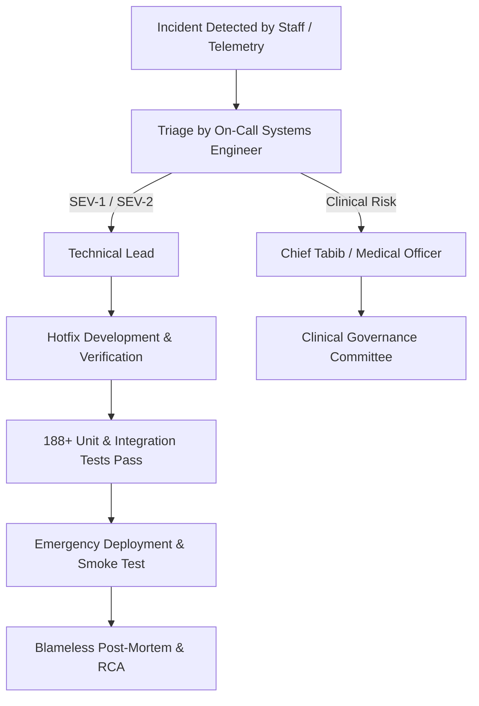

# ZAYVORA MATAB OS — Incident Response & Clinical Safety Runbook
**Document ID:** `INCIDENT-OPS-2026-10-13`  
**Classification:** Operational Runbook — Emergency Procedures & Incident Response  
**Scope:** Clinical Safety Alerts, Operational Downtime, Security Breaches  
**Status:** READY FOR OPERATIONAL ADOPTION  

---

## 1. Incident Classification Framework

In healthcare IT systems, technical incidents directly impact patient safety and clinical continuity. All incidents must be triaged according to the severity matrix below:

| Severity Level | Definition | Target Response (MTTA) | Target Resolution (MTTR) | Examples |
| :--- | :--- | :---: | :---: | :--- |
| **SEV-1 (CRITICAL)** | Clinical safety compromise, complete clinic outage, or data corruption halting care. | **< 15 minutes** | **< 2 hours** | Safety firewall fails open; database locked/corrupted; prescription signing blocked clinic-wide. |
| **SEV-2 (HIGH)** | Core operational bottleneck with clinical workaround available. | **< 30 minutes** | **< 4 hours** | Pharmacy dispensary queue frozen; IPD bed allocation deadlock; invoice generation failing. |
| **SEV-3 (MODERATE)** | Secondary feature failure or degraded non-blocking performance. | **< 2 hours** | **< 1 business day** | SMS/WhatsApp reminders delayed; external FHIR export latency; reporting dashboard slow. |
| **SEV-4 (LOW)** | Minor cosmetic or documentation issues without data loss. | **< 8 hours** | **< 3 business days** | UI layout misalignment; minor typo in classical botanical glossary; non-critical log warning. |

---

## 2. Emergency Clinical Fallback Protocol (SEV-1 Safety Event)

If any clinician or auditor identifies a scenario where the Clinical Safety Firewall fails to flag a hazardous interaction, Schedule E(1) toxin, or lethal overdose:

### Immediate Action Steps:
1. **Immediate Halt of Electronic Prescriptions:**
   - Chief Tabib / Administrator issues a clinical broadcast to all consultation rooms: *"HALT ELECTRONIC PRESCRIPTION SIGNING - ACTIVATE PAPER PROTOCOL."*
2. **Switch to Paper Triplicate Rx:**
   - Consultations continue using physical stamped prescription pads.
   - Dispensary requires physical dual-signature by prescribing Tabib and Senior Pharmacist.
3. **Quarantine System & Engage Engineering:**
   - Execute emergency containment command:
     ```bash
     sudo systemctl stop zayvora-api
     ```
   - Snapshot the database state immediately:
     ```bash
     sqlite3 /opt/zayvora/data/zayvora_matab.db "VACUUM INTO '/var/backups/zayvora_matab/quarantine_incident_$(date +%s).db';"
     ```
4. **Log Incident in Clinical Risk Register:**
   - Document incident ID, affected patient ID, proposed formulation, missed rule, and clinical outcome.

---

## 3. Incident Escalation & Response Team Matrix



### Escalation Contacts
- **Technical Lead / DevOps On-Call:** `sysadmin@zayvora.internal` | Priority Ring
- **Chief Clinical Officer (Unani):** `clinical-governance@zayvora.internal`
- **Data Protection Officer (DPO):** `dpo@zayvora.internal`

---

## 4. Operational Recovery Playbooks

### Playbook A: "Database Locked" / High Concurrency Contention
- **Symptom:** API returns `500 Internal Server Error: sqlite3.OperationalError: database is locked`.
- **Diagnosis:** Long-running report query or uncommitted transaction holding exclusive write lock.
- **Action:**
  1. Inspect active processes: `lsof /opt/zayvora/data/zayvora_matab.db`.
  2. Verify WAL checkpoint status:
     ```bash
     sqlite3 /opt/zayvora/data/zayvora_matab.db "PRAGMA wal_checkpoint(TRUNCATE);"
     ```
  3. Ensure busy timeout is active (`PRAGMA busy_timeout = 10000;`).
  4. Restart API service if blocked thread does not yield within 30 seconds.

### Playbook B: Clinician Locked Out (PIN Invalidation)
- **Symptom:** Tabib receives `401 Unauthorized: Invalid Signature PIN` repeatedly.
- **Action:**
  1. Verify user profile status in `practitioner_profiles`.
  2. Hospital Admin executes PIN reset protocol requiring two-party identity verification.
  3. Issue temporary one-time PIN (OTP) expiring in 15 minutes.
  4. Clinician sets new 6-digit PIN upon next consultation login.

---

## 5. Post-Incident Review & RCA Template

Every SEV-1 and SEV-2 incident requires a published Root Cause Analysis (RCA) document within 48 hours:
- **Incident Summary:** Date, duration, severity, impact.
- **Root Cause (5 Whys Analysis):** Exact technical failure and systemic gaps.
- **Clinical Impact Assessment:** Number of consultations affected; confirmation of zero patient harm.
- **Corrective & Preventive Actions (CAPA):**
  - Code fixes committed.
  - Regression unit tests added to test suite.
  - Monitoring alert thresholds adjusted.
