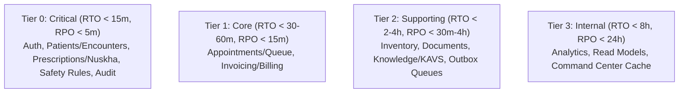
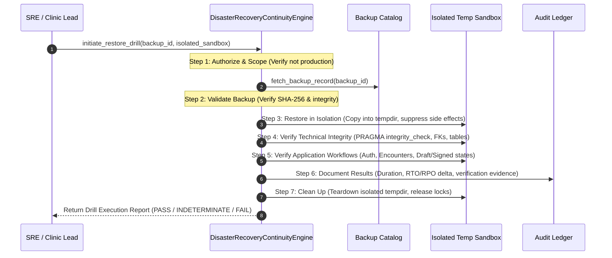

# ZAYVORA MATAB OS — DISASTER RECOVERY & BUSINESS CONTINUITY SPECIFICATION
## Resilience Engineering, Backup/Restore Verification & Downtime Reconciliation Architecture

- **Document ID:** `SPEC-DR-P40-2026-10-14`
- **Classification:** Production Reliability, Business Continuity & Clinical Safety Specification
- **System:** ZAYVORA MATAB OS — Standalone Unani Clinic & Hospital Operating System
- **Authors:** Principal Software Architect, SRE / Reliability Engineer, Database & Clinical Safety Governance Leads

---

## 1. Non-Negotiable Safety, Integrity and Privacy Invariants

1. **Zero Destructive Tests in Production:** Under no circumstances may an automated drill or routine test run destructive operations against the live production database (`zayvora_matab.db`), live clinic tables, or tenant records.
2. **Isolated Non-Production Sandboxes:** Restore drills must strictly execute inside isolated, disposable directories (`tempfile.mkdtemp()`) with isolated database connections, unique resource names, and zero network calls to external payment or SMS gateways.
3. **Hard Production Lockout:** Any restore drill request attempting to target the live database path or set `target_environment = 'production'` without multi-party emergency authorization must be rejected immediately (`ForbiddenError` / HTTP 403).
4. **Data Minimization & Zero Plaintext Secrets / PHI:**
   - Backup catalogs, drill logs, reconciliation payloads, and verification reports must never expose plaintext passwords, secret keys, session cookies, or unnecessary patient identifiers.
   - Clinical and billing downtime payloads must be sanitized (`[REDACTED_SECRET]`).
5. **Preservation of Provenance & Life Cycle Semantics:**
   - A restored database must preserve canonical lifecycle states (`draft`, `signed`, `cancelled`, `amended`). Restored records must never be modified to make them appear consistent.
   - Missing or conflicting records must be surfaced into an explicit review queue rather than silently normalized or guessed.
6. **Suppression of Outbound Side Effects During Drills:**
   - During restore drills, transactional outboxes (`outbox_events`, `integration_jobs`) must be placed into a suppressed mock state to guarantee that no real SMS messages, patient reminders, or external webhooks are dispatched.
7. **Clinical Safety Gates Remain Active:**
   - The clinical safety firewall, Schedule E(1) Mudabbar rules, clinician approvals, and PIN electronic signatures must remain operative post-restore. A restored clinical record does not bypass clinician governance.

---

## 2. Business Impact Analysis (BIA) & Criticality Catalog

The system defines 12 core clinical and operational data domains, categorized into 4 criticality tiers:

### 2.1 Criticality Schema
Stored in `dr_domain_criticality_catalog`:
- `domain_id`: Unique key (`auth_identity`, `patients_encounters`, `consultation_prescriptions`, `rules_governance`, `audit_ledger`, etc.)
- `domain_name`: Human-readable label.
- `tier`: `tier_0_critical`, `tier_1_core`, `tier_2_supporting`, `tier_3_internal`.
- `system_of_record_tables_json`: List of canonical tables.
- `business_owner`, `technical_owner`: Accountable roles.
- `approved_rto_minutes`: Approved Recovery Time Objective.
- `approved_rpo_minutes`: Approved Recovery Point Objective.
- `degraded_mode_policy`: Approved operational fallback procedure during outage.
- `reconciliation_protocol`: Required verification steps post-restoration.
- `last_drill_timestamp`: Timestamp of most recent verified isolated restore drill.
- `status`: `fully_protected`, `partially_protected`, `untested`, `at_risk`.

---

## 3. Backup Architecture & Verification

### 3.1 Non-Blocking Online Backup API
ZAYVORA MATAB OS implements live database backups using SQLite's native non-blocking backup API (`sqlite3.Connection.backup` with chunked page streaming) combined with `PRAGMA integrity_check`:
1. Opens an online read transaction in Write-Ahead Logging mode (`WAL`).
2. Streams database pages in chunks of 100 pages to avoid writer starvation.
3. Computes the cryptographic SHA-256 digest of the completed backup artifact.
4. Executes `PRAGMA integrity_check` and `PRAGMA foreign_key_check` against the backup file.
5. Records the backup entry into `dr_backup_catalog`.

### 3.2 Catalog Schema
Stored in `dr_backup_catalog`:
- `id`: Backup identifier (e.g. `bkp-20261014-001`).
- `organization_id`: Tenant context.
- `backup_type`: `full`, `incremental_wal`, `table_export`.
- `scope`: `database_all`, `database_tables`, `artifacts`.
- `source_database_path`: Sanitized source path.
- `backup_artifact_path`: Storage location of backup snapshot.
- `checksum_sha256`: Cryptographic digest.
- `size_bytes`: File size.
- `encryption_status`: `encrypted_aes256`, `unencrypted_isolated_dev`.
- `encryption_key_id`: Reference identifier for KMS/GPG key.
- `status`: `pending`, `completed`, `failed`, `corrupted`, `purged`.
- `integrity_check_status`: `unverified`, `passed`, `failed`.
- `integrity_check_output`: Detailed check output (e.g. `PRAGMA integrity_check -> ok`).
- `total_tables`: Table count in backup.
- `created_by`, `created_at`, `expires_at`.

---

## 4. 7-Step Restore Verification Pipeline

Restore drills test recovery safely without risking production data:

### Detailed Step Verification Invariants:
1. **Step 1: Authorize and Scope:** Ensure target is an isolated sandbox. Reject requests targeting production paths.
2. **Step 2: Validate Backup:** Re-verify SHA-256 digest against catalog record.
3. **Step 3: Restore in Isolation:** Instantiate disposable directory (`tempfile.mkdtemp()`). Copy backup file. Suppress all external side-effect dispatchers.
4. **Step 4: Verify Technical Integrity:**
   - Execute `PRAGMA integrity_check` (must return `ok`).
   - Execute `PRAGMA foreign_key_check` (must return 0 violations).
   - Assert all non-system tables match the expected catalog (186+ tables).
5. **Step 5: Verify Application & Workflow Behavior:**
   - Query users and verify RBAC session tables respond.
   - Assert canonical lifecycle states: draft encounters remain draft, finalized prescriptions remain signed with original author and SHA-256 hashes.
   - Verify clinical safety rules catalog is non-empty.
   - Confirm transactional outbox dispatch is paused.
6. **Step 6: Document Results:**
   - Calculate actual restore duration in seconds.
   - Compare observed recovery point against approved RTO/RPO targets.
   - Record pass/fail/indeterminate outcome in `dr_restore_drill_executions`.
7. **Step 7: Clean Up:**
   - Safely remove isolated sandbox directory.
   - Verify cleanup affects only the temporary drill directory.

---

## 5. Business Continuity, Downtime Runbooks & Reconciliation Queue

### 5.1 Downtime Playbooks
Stored in `dr_business_continuity_runbooks`:
1. `cb-app-offline`: Application service offline while database remains healthy.
2. `cb-db-outage`: Database storage failure / recovery drill in progress.
3. `cb-network-partition`: Clinic edge offline / lost internet connectivity.
4. `cb-payment-gateway-down`: Third-party payment settlement failure.

Each playbook specifies:
- Trigger conditions and operational lead.
- Permitted vs. prohibited actions (e.g., prohibited: generating automated prescription signatures without local clinician review).
- Offline paper form protocol (specifying mandatory fields: Patient MRN, Date, Clinician Name, Mizaj, Prescribed Formula, Dose, Physical Signature).
- Resumption and reconciliation protocol.

### 5.2 Offline Downtime Reconciliation Queue
Stored in `dr_downtime_reconciliation_records`:
- `id`: Unique record ID (e.g. `dtr-20261014-001`).
- `runbook_id`: Associated downtime runbook.
- `downtime_reference_code`: Physical paper ticket/card number (`DT-PAPER-20261014-042`).
- `domain`: `patient_encounter`, `vital_signs`, `prescription_order`, `billing_invoice`, `stock_dispensation`.
- `patient_identifier`: MRN or national identifier.
- `captured_by_name`, `captured_at`: Details from paper form.
- `recorded_payload_json`: Key-value pairs extracted from paper record.
- `status`: `pending_review`, `validated`, `reconciled`, `conflicted_duplicate`, `rejected`.
- `reconciled_by`, `reconciled_at`: Clinician/Admin who confirmed the record.
- `target_canonical_id`: ID of created/updated canonical record.
- `conflict_resolution_reason`: Explains manual reconciliation decisions.

---

## 6. Recovery Orchestration Dependency Order

When recovering the complete operating system from catastrophic disruption:
1. **Storage Subsystem:** Initialize SQLite WAL directory and file permissions.
2. **Identity & Access Governance:** Restore `users`, `roles`, and `permissions`.
3. **Patient & Encounter Master Index:** Restore `patients` and `encounters`.
4. **Knowledge Base & Clinical Safety Rules:** Restore `clinical_sources`, `clinical_rules`, and `mudabbar_purifications`.
5. **Prescriptions & Consultations:** Restore `prescriptions` and `formulations`.
6. **Operations & Billing:** Restore `appointments`, `queue_tokens`, `invoices`, and `inventory_batches`.
7. **Transactional Outbox (Paused):** Restore `integration_jobs` and `outbox_events` in paused mode to prevent duplicate external side-effects.
8. **Derived Analytics & Read Models:** Recompute materialized views from restored canonical records.
9. **Observability & Diagnostics:** Run `/api/v1/observability/diagnostics/deep` and verify all health probes return `healthy`.

---

## 7. REST API Endpoints & RBAC Permissions

All routes mounted under `/api/v1/dr/`:

| Method | Endpoint | Description | Permission |
| :--- | :--- | :--- | :--- |
| `GET` | `/domains` | List criticality catalog and RTO/RPO targets | `dr:read` |
| `PATCH` | `/domains/:id` | Update domain RTO/RPO or degraded mode policy | `dr:manage` |
| `POST` | `/backups` | Trigger live non-blocking database backup | `dr:backup` |
| `GET` | `/backups` | List backup catalog with checksums | `dr:read` |
| `POST` | `/drills` | Execute 7-step isolated restore drill | `dr:drill` |
| `GET` | `/drills` | List restore drill history and verification logs | `dr:read` |
| `GET` | `/drills/:id` | Get detailed drill execution report | `dr:read` |
| `POST` | `/drills/:id/sign-off` | Clinician/SRE sign-off on business resumption | `dr:manage` |
| `GET` | `/runbooks` | List downtime business continuity runbooks | `dr:read` |
| `POST` | `/reconciliation` | Ingest offline downtime paper record | `dr:reconcile` |
| `GET` | `/reconciliation` | List reconciliation queue | `dr:read` |
| `POST` | `/reconciliation/:id/resolve` | Clinician reconciles offline record to canonical | `dr:reconcile` |
| `GET` | `/pulse` | Real-time DR posture and RTO/RPO metrics | `dr:read` |
