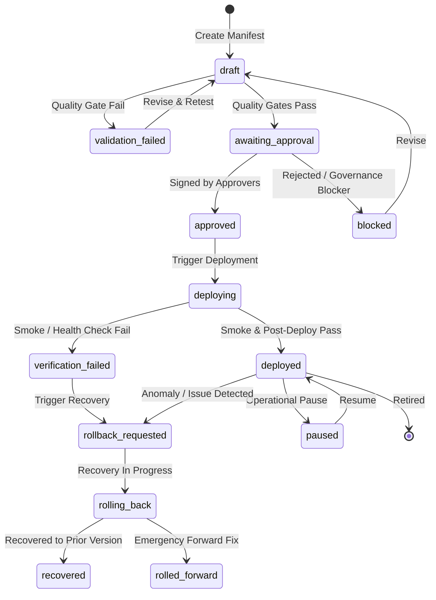

# ZAYVORA MATAB OS — Release Engineering & Feature Flag Specification
## Prompt 38 Technical Specification

---

## 1. Release Manifest Data Structure & State Machine

### 1.1 Lifecycle State Machine

### 1.2 Release Risk Classification Matrix
| Risk Level | Description | Required Approvers | Gate Requirements |
| :--- | :--- | :--- | :--- |
| **Low** | Non-functional styling, static docs, minor UI layout adjustments | `RELEASE_MANAGER` | Build + Unit Tests (100% pass) |
| **Moderate** | Operational administrative workflows, queue management, non-clinical exports | `RELEASE_MANAGER` + `ORG_ADMIN` | Build + Unit + Integration Tests + Smoke Checks |
| **High** | Auth/RBAC, schema migrations, patient data access, financial billing, integrations | `RELEASE_MANAGER` + `SECURITY_OFFICER` + `ORG_ADMIN` | Full Test Suite + Migration Compatibility + Security Scan |
| **Critical** | Clinical decision support, prescribing, dosing, botanical safety rules, unani assessments | `RELEASE_MANAGER` + `SECURITY_OFFICER` + `CLINICAL_SAFETY_OFFICER` | All Gates + Clinical Safety Sign-Off + Separation of Duties |

---

## 2. Feature Flag Governance & Targeting Architecture

### 2.1 Flag Evaluation Precedence
Flag evaluation executes server-side on every protected API call using the following deterministic evaluation algorithm:

1. **Emergency Disable Check:** If `is_emergency_disabled == 1`, return `false` immediately (logs emergency override).
2. **Environment Active Check:** Check `state_by_environment[env]`. If not enabled for current environment, return `false`.
3. **Cohort Rules Evaluation:**
   - **Tenant Scope:** If `targeting_rules.organizations` is specified and `user_ctx.organization_id` is NOT in the list, return `false`.
   - **Facility Scope:** If `targeting_rules.facilities` is specified and `user_ctx.facility_id` is NOT in the list, return `false`.
   - **Role Scope:** If `targeting_rules.roles` is specified and user does NOT possess at least one matching role, return `false`.
   - **User Scope:** If `targeting_rules.user_ids` is specified and `user_ctx.user_id` is NOT in the list, return `false`.
4. **Default Fallback:** If all cohort criteria pass (or are empty/unrestricted), return `true`.
5. **Fail-Closed Rule:** Any JSON parsing error, unhandled exception, or missing flag defaults strictly to `false`.

### 2.2 Consequential Clinical Safety Guardrail
Features involving:
- Clinical decision support (CDS) recommendations
- Autonomous or semi-automated nuskha compounding
- Dose calculations and schedule E1 alerts
- External prescription transmissions (ABDM/FHIR)

**MUST remain disabled (`false`) by default** in all production configurations until clinical governance approval is recorded in `feature_flag_audit`.

---

## 3. Rollback & Recovery Strategies

The platform supports four explicit recovery paths:

1. **`DISABLE_FEATURE` (Fastest, zero deployment required):**
   - Disables the specific feature flag via emergency toggle.
   - Retains current application code and schema.
   - Lowest risk for isolated new features.
2. **`ROLLBACK_ARTIFACT` (Redeploy prior known-good artifact):**
   - Redeploys previous immutable artifact digest.
   - Requires verified schema backward-compatibility.
3. **`ROLL_FORWARD` (Deploy hotfix build):**
   - Deploys new patched release tag when schema/data changes cannot be cleanly reverted.
4. **`CONTAIN` (Operational isolation):**
   - Pauses affected background queues, trips circuit breakers, or temporarily closes facility intake.

### Side-Effect Acknowledgement & Compensation
The recovery engine explicitly records:
- Outbound SMS/WhatsApp notifications cannot be recalled.
- Physically dispensed botanical medications cannot be reversed in the database alone.
- External ABDM Care Context linkings require compensatory cancellation messages.

All rollback executions generate a tamper-evident audit receipt.
