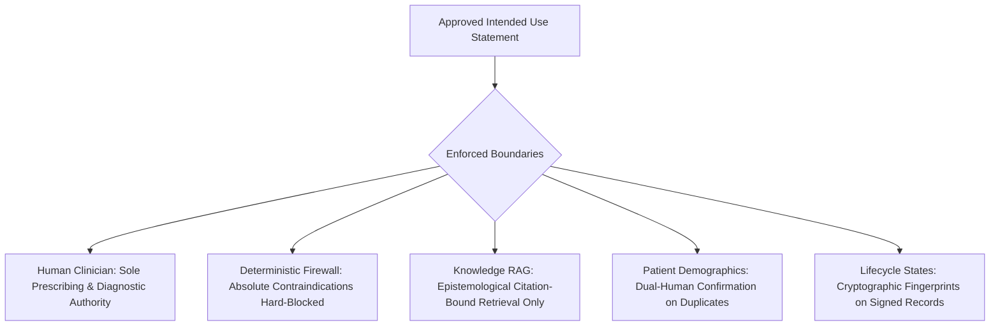
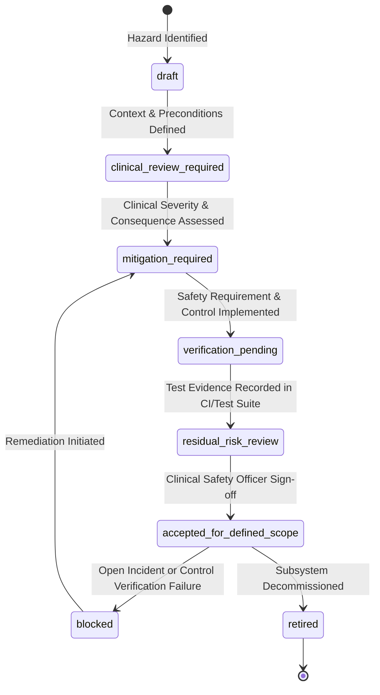

# ZAYVORA MATAB OS — CLINICAL SAFETY CASE, HAZARD ANALYSIS & SAFETY CONTROL SPECIFICATION
## Comprehensive Architecture for Clinical Safety Assurance, Hazard Lifecycle & Release Governance

**Document Version:** 1.0.0  
**Phase:** 48  
**Approved Framework:** Goal Structuring Notation (GSN) & Clinical Hazard Analysis (v2.1)  
**Safety Classification:** Clinical Safety Grade — Non-Negotiable Human Authority  

---

## 1. Intended Use Baseline & Scope Boundaries

Clinical safety claims in ZAYVORA MATAB OS are strictly bounded by an explicit **Intended Use Statement** approved by the Clinical Governance Committee.

### 1.1 Non-Negotiable Scope Boundaries:
- **No Autonomous Prescribing:** The system must never independently sign, modify, or dispense an active medical order without explicit human PIN attestation.
- **No Autonomous Clinical Diagnosis:** Algorithmic systems are restricted to structured data collection, reference retrieval, and deterministic safety checks.
- **Deterministic Hard Stops:** Absolute botanical contraindications (e.g. Schedule E(1) toxins without verified Mudabbar detoxification, documented life-threatening allergies) cannot be overridden by administrative roles or generative AI suggestions.
- **Explicit Missingness & Uncertainty:** Unknown vital signs, ambiguous botanical substances, or unverified laboratory values must remain visibly incomplete (`UNKNOWN` or `NOT_RECORDED`); silent statistical imputation is strictly prohibited.

---

## 2. Clinical Hazard Life Cycle & State Machine

Every identified clinical hazard is tracked through a governed lifecycle state machine requiring attributed clinical review.

### 2.1 Clinical Severity Tiers:
- **`CATASTROPHIC`**: Potential for patient death or permanent life-threatening injury (e.g., dispensing lethal dosage of Schedule E(1) toxin, severe unpurified botanical poisoning).
- **`CRITICAL`**: Severe injury, irreversible impairment, or profound medical emergency requiring acute hospitalization.
- **`SERIOUS`**: Moderate medical harm requiring clinical intervention, temporary discomfort, or significant treatment delay.
- **`MINOR`**: Inconvenience, temporary non-harmful symptoms, or self-limiting minor side effects.
- **`NEGLIGIBLE`**: Inconsequential typographical error without clinical or diagnostic impact.

---

## 3. Candidate Clinical Hazards & Enforced Controls Matrix

| Hazard Code | Title & Initiating Condition | Hazardous State | Potential Clinical Consequence | Enforced Safety Control & Code Path | Verification Test Reference |
| :--- | :--- | :--- | :--- | :--- | :--- |
| **HAZ-RX-001** | Admin or unauthenticated actor invokes prescription sign API without clinician PIN. | Prescription finalized without licensed clinical attestation. | Severe patient toxicity or lethal dosage errors from unverified medical order. | `apps.api.domains.cds_orchestrator.CDSOrchestratorEngine.sign_encounter` enforces PIN hash match and clinician role. | `tests.unit.test_cds_orchestrator.TestCDSOrchestrator.test_admin_cannot_sign_prescription` |
| **HAZ-RX-002** | Operator edits prescription items on an already signed clinical prescription. | Signed prescription silently modified downstream of clinician review. | Patient receives altered botanical formulation not authorized by prescribing Hakeem. | Immutable cryptographic snapshot; `prescriptions` table locks rows with SHA-256 signature hash. | `tests.unit.test_prescription_signing.TestPrescriptionSigning.test_immutable_signed_prescriptions` |
| **HAZ-TOX-001** | Formulation containing Schedule E(1) poison (Kuchla / Azaraqi) prescribed without Mudabbar detoxification. | Toxic unpurified substance ordered for oral dispensing. | Neurotoxic convulsions, strychnine toxicity, or patient death. | `apps.api.domains.safety_firewall.SafetyFirewallEngine.evaluate_prescription` raises hard non-overridable block. | `tests.unit.test_safety_firewall.TestSafetyFirewall.test_schedule_e1_poison_block` |
| **HAZ-ID-001** | Automated batch process merges two patients with similar demographic names. | Conflated medical records sharing history and allergies. | Clinician prescribes medication containing substance to which patient is severely allergic. | Automatic merges strictly disabled; `mdm_duplicate_candidate_reviews` requires dual-human confirmation. | `tests.unit.test_data_governance.TestDataGovernance.test_no_automatic_patient_merges` |
| **HAZ-RAG-001** | Ingested monograph text contains adversarial prompt attempting to alter dosage limits. | Clinical RAG assistant surfaces unverified, toxic botanical dosage recommendations. | Clinician misled into prescribing supra-therapeutic lethal dose. | Epistemological template constraints separate text from instructions; safety firewall re-validates dosage. | `tests.unit.test_clinical_rag.TestClinicalRAG.test_adversarial_prompt_isolation` |
| **HAZ-DATA-001** | Stale or unrecorded blood pressure / vitals treated as normal baseline. | Clinician assumes patient is normotensive when in hypertensive crisis. | Delayed diagnosis of hypertensive emergency or cardiovascular event. | Explicit missingness states (`NOT_RECORDED`, `STALE`); system displays warnings on unrecorded vitals. | `tests.unit.test_data_quality.TestDataQuality.test_explicit_missingness` |

---

## 4. Safety Requirements & Bidirectional Traceability

Every safety requirement is documented with strict bidirectional traceability:

$$\text{Intended Use} \longrightarrow \text{Hazard} \longrightarrow \text{Safety Requirement} \longrightarrow \text{Control} \longrightarrow \text{Code Path} \longrightarrow \text{Test Evidence} \longrightarrow \text{Release Gate}$$

### Traceability Rules:
1. **No Orphan Requirements:** Every safety requirement must trace to an identified hazard and an approved intended use scope.
2. **Observable Acceptance Criteria:** Requirements must specify concrete system behavior (e.g. "rejects transition with HTTP 403 Forbidden and records auditable failure event").
3. **No Unverified Claims:** A requirement cannot be marked `VERIFIED_IN_TEST` without a logged execution in `safety_control_verifications` from a recognized test runner.

---

## 5. Clinical Safety Case Structure (GSN-Compliant)

A **Clinical Safety Case** provides an evidence-based argument that a defined software scope is safe for its intended clinical use.

### Safety Case Format:
1. **Claim Statement:** A concise, release-specific claim (e.g. *"For Release v1.0.0, the Prescription Signing and Deterministic Drug Safety Firewall workflows reliably prevent unauthorized electronic signing and toxic substance dispensing."*)
2. **Context & Assumptions:** Intended clinical users, operating environment, and connectivity assumptions.
3. **Argument Narrative:** Logical breakdown demonstrating how preventive, detective, and mitigative controls mitigate all identified hazards.
4. **Evidence Pointers:** Traceable links to automated test suites, code inspections, and clinical governance approvals.
5. **Residual Risks, Exclusions & Limitations:** Explicit documentation of what is NOT supported (e.g. pediatric dosage calculation without human validation).
6. **Clinical Safety Officer Approval:** Formal sign-off with expiration timestamp ($\le 180$ days).

---

## 6. Pre-Deployment Safety Release Gate Evaluator

Before releasing safety-relevant code, the **Safety Release Gate** evaluates:
- **Safety Case Validity:** Subsystem must possess an approved safety case (`approval_status == 'APPROVED_FOR_SCOPE'`) with unexpired validity (`expires_at > CURRENT_TIMESTAMP`).
- **Control Verification Completeness:** All safety requirements mapped to active hazards under the workflow scope must be `VERIFIED_IN_TEST`.
- **Zero Unmitigated Critical Hazards:** No open hazards with `severity_tier IN ('CATASTROPHIC', 'CRITICAL')` in unmitigated statuses.
- **Gate Verdicts:** `PASS` (Release Authorized), `BLOCKED` (Deployment Prohibited), `CONDITIONAL_PASS` (Scoped Pilot Only), or `STALE_EVIDENCE` (Re-verification Required).

---

## 7. Closed-Loop Clinical Safety Incident & Near-Miss Feedback

When clinical near-misses, alert fatigue reports, or unexpected system holds occur in clinic operations:
1. An incident is logged in `clinical_safety_incidents` with sanitized context (zero PHI).
2. The incident links to the relevant hazard in `clinical_hazard_register`.
3. If an unmapped hazard is revealed, a new hazard record is drafted immediately.
4. Corrective actions follow a rigorous lifecycle: `REPORTED` $\to$ `TRIAGED` $\to$ `INVESTIGATING` $\to$ `CORRECTIVE_ACTION_PENDING` $\to$ `VERIFIED_CLOSED`.
5. Incident closure requires automated retest evidence proving the defect is eliminated.
