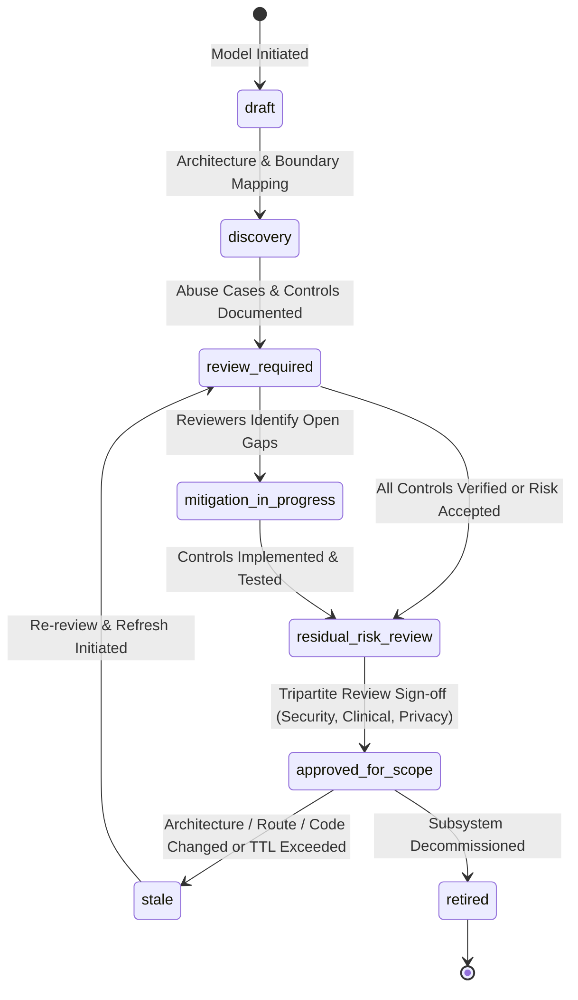
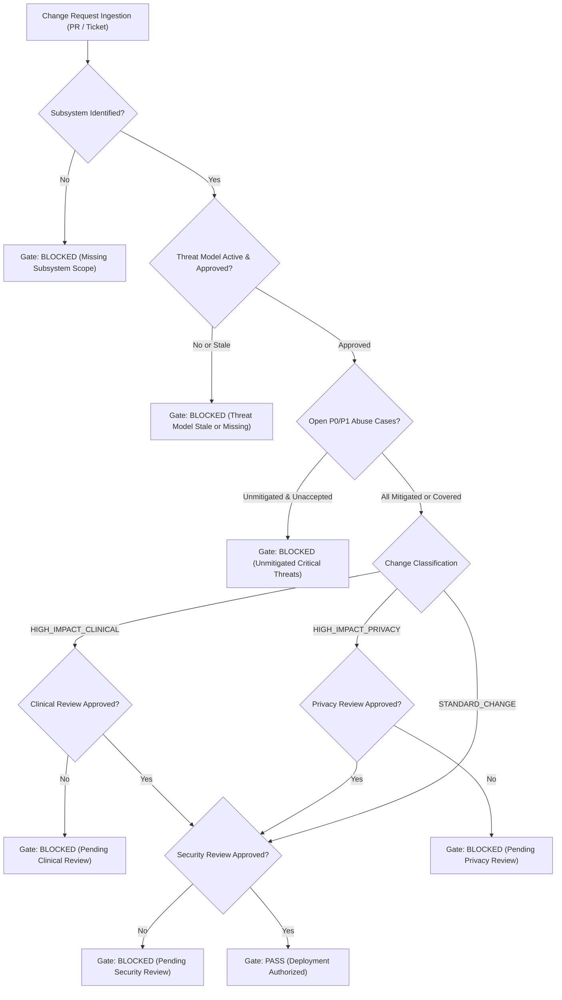

# ZAYVORA MATAB OS — THREAT MODELING, ABUSE-CASE ANALYSIS & SECURE SDLC SPECIFICATION
## Comprehensive Architectural Design for Threat-Informed Engineering & SDLC Governance

**Document Version:** 1.0.0  
**Phase:** 47  
**Approved Methodology:** STRIDE-Plus-Clinical-Hazard (v2.4)  
**Security Level:** Restricted — Internal Clinical Architecture  

---

## 1. Threat Model Lifecycle & State Machine

Every monitored subsystem within ZAYVORA MATAB OS is governed by a versioned threat model tracking its architecture, trust boundaries, entry points, abuse cases, and testable controls.

### Stale-Model Detection Criteria
A threat model transitions to `stale` (`is_stale = 1`) whenever:
1. **Repository Drift:** The repository commit hash for the target subsystem differs from `threat_models_registry.repository_revision`.
2. **Review Cadence Exceeded:** The current timestamp exceeds `threat_models_registry.next_review_due_at` (default 90 days for Tier 1 / Clinical subsystems, 180 days for operational subsystems).
3. **Control Invalidation:** An underlying testable control fails verification or is modified.
4. **New Material Entry Point:** An unmapped API route or public endpoint is added to the subsystem.

---

## 2. Trust Boundaries & Data Classification Framework

All data flows traversing trust boundaries are categorized by sensitivity tier and labeled with verifiable evidence status.

### 2.1 Protected Data Classification Tiers
- **TIER_1_CREDENTIALS:** Password hashes, PIN salt hashes, session tokens, cryptographic private keys, external API tokens.
- **TIER_2_PHI:** Patient MRN, demographic PII, clinical notes, Unani mizaj evaluations, prescriptions, laboratory reports.
- **TIER_3_KNOWLEDGE:** Governed classical Unani sources, botanical monographs, formulation recipes, drug safety rules, organ-axis mappings.
- **TIER_4_AUDIT:** Tamper-evident ledger events, cryptographic checkpoints, compliance exports, security scans, SDLC gate evaluations.
- **TIER_5_OPERATIONAL:** Facility scheduling, room allocations, token queues, inventory batch movements, public billing codes.

### 2.2 Evidence Classification Labels
- `verified_in_code`: Directly inspected and validated in active application code.
- `verified_in_config`: Validated in configuration registries or deployment manifests.
- `verified_in_test`: Verified by passing unit, integration, or end-to-end tests.
- `runtime_verified`: Confirmed through live telemetry or active runtime monitors.
- `inferred`: Relationship logically deduced from component interfaces; pending verification.
- `unknown`: Relationship or boundary property unverified; treated as unverified risk.

---

## 3. STRIDE + Clinical Safety Hazard Methodology

Threats are categorized using an extended STRIDE classification that elevates clinical safety hazards and supply chain compromises to first-class threat classes.

| Threat Class | Focus & Risk Definition | Clinical Impact Context |
| :--- | :--- | :--- |
| **SPOOFING** | Impersonation of human users, machine identities, or external gateways. | Unlicensed actor signing medical prescriptions or accessing patient EHRs. |
| **TAMPERING** | Unauthorized modification of code, database records, rules, or messages. | Altering drug dosages, patient allergies, or classical Unani botanical recipes. |
| **REPUDIATION** | Deniability of actions due to missing or mutable audit trails. | Clinician denying ordering a medication or administrator denying role escalation. |
| **INFO_DISCLOSURE** | Data leakage across tenants, roles, logs, errors, or external gateways. | Sensitive diagnostic narrative or HIV/psychiatric history exposed to front desk. |
| **DENIAL_OF_SERVICE** | Resource starvation or service disruption preventing access. | Front-desk OPD queue or emergency consultation workspace unavailable. |
| **ELEVATION_OF_PRIVILEGE**| Gaining unauthorized privileges or bypassing authorization barriers. | System administrator obtaining clinical prescription signing authority. |
| **CLINICAL_HAZARD** | Algorithmic hallucination, false reassurance, or workflow bypass. | AI CDS auto-prescribing toxic Schedule E(1) herb without Hakeem attestation. |
| **SUPPLY_CHAIN** | Vulnerable dependencies, compromised build images, or malicious code. | Malicious third-party Python package exfiltrating patient database credentials. |

---

## 4. Subsystem Abuse Cases & Testable Security Controls

### 4.1 Subsystem: Clinical CDS & Prescription Signing (`CLINICAL_CDS_AND_PRESCRIPTIONS`)
- **Abuse Case TAC-CDS-001 (Clinical Hazard / Privilege Escalation):**
  - *Scenario:* System administrator invokes API to finalize and electronically sign an encounter prescription using administrative Bearer token.
  - *Consequence:* Non-clinical actor authorizes legally binding medical orders, creating severe patient toxicity and regulatory liability.
  - *Enforced Control (CTL-CDS-001):* `apps.api.domains.cds_orchestrator.CDSOrchestratorEngine.sign_encounter` validates clinician role, active license credentials, and requires 6-digit electronic PIN hash match. Administrator roles are rejected with HTTP 403 Forbidden.
  - *Test Evidence:* `tests.unit.test_cds_orchestrator.TestCDSOrchestrator.test_admin_cannot_sign_prescription`.

- **Abuse Case TAC-CDS-002 (Tampering / Clinical Hazard):**
  - *Scenario:* Operator modifies an already-signed prescription to alter dosage or substitute botanical ingredients.
  - *Consequence:* Patient receives altered medication without clinician consent or audit record.
  - *Enforced Control (CTL-CDS-002):* Signed prescriptions in `prescriptions` are cryptographically locked with SHA-256 digital signature hashes. Edits fail with HTTP 409 Conflict; changes must follow formal amendment lifecycle.
  - *Test Evidence:* `tests.unit.test_prescription_signing.TestPrescriptionSigning.test_immutable_signed_prescriptions`.

### 4.2 Subsystem: Patient Identity & Registry (`PATIENT_IDENTITY_AND_REGISTRY`)
- **Abuse Case TAC-ID-001 (Info Disclosure / Multi-Tenant Injection):**
  - *Scenario:* Authenticated user belonging to Facility A passes Facility B's `patient_id` or injects `organization_id` in request query parameter.
  - *Consequence:* Cross-tenant patient record leakage violating privacy regulations.
  - *Enforced Control (CTL-ID-001):* Server-side tenancy derivation ignores user-supplied organization headers and queries `WHERE organization_id = session.org_id`. Foreign lookups return HTTP 404 NOT_FOUND.
  - *Test Evidence:* `tests.unit.test_data_governance.TestDataGovernance.test_cross_tenant_isolation`.

- **Abuse Case TAC-ID-002 (Tampering / Clinical Misrouting):**
  - *Scenario:* Background batch job automatically merges two patient records with similar names without clinical review.
  - *Consequence:* Patient medical histories conflated, leading to allergic contraindication blindness.
  - *Enforced Control (CTL-ID-002):* Automatic merges are strictly prohibited. The MDM engine flags duplicate candidates in `mdm_duplicate_candidate_reviews` requiring dual-human clinical confirmation.
  - *Test Evidence:* `tests.unit.test_data_governance.TestDataGovernance.test_no_automatic_patient_merges`.

### 4.3 Subsystem: Unani KAVS & RAG Assistant (`UNANI_KAVS_AND_RAG`)
- **Abuse Case TAC-RAG-001 (Clinical Hazard / Prompt Injection):**
  - *Scenario:* Ingested medical text contains adversarial instructions attempting to force the model to recommend dangerous botanical formulations without Musleh (corrective).
  - *Consequence:* RAG engine returns harmful, unpurified toxic formulations.
  - *Enforced Control (CTL-RAG-001):* Epistemological template separation separates untrusted content from system instructions. Output is passed through the deterministic safety firewall before clinician display.
  - *Test Evidence:* `tests.unit.test_clinical_rag.TestClinicalRAG.test_adversarial_prompt_isolation`.

---

## 5. Governed Residual Risk Acceptance Engine

When a threat cannot be immediately eliminated by code modification, it may enter a strictly governed **Residual Risk Acceptance** process.

### Non-Negotiable Risk Acceptance Constraints:
1. **Maximum Time-To-Live:** Risk acceptances cannot exceed **90 days**. Indefinite waivers are automatically rejected.
2. **Hard Clinical Firewalls:** No risk acceptance may waive or disable:
   - Patient consent checks (`consent_authority_records`).
   - Clinician electronic PIN signatures (`prescriptions.signed_at`).
   - Deterministic drug safety firewalls (Schedule E(1) toxicity, documented allergies).
   - Multi-tenant facility isolation (`organization_id` boundaries).
3. **Authorized Stakeholders:** Acceptances require sign-off by the appropriate accountable role (`Chief Information Security Officer`, `Clinical Safety Officer`, or `Privacy Officer`).
4. **Compensating Controls Required:** Every acceptance must specify verifiable compensating controls (e.g., enhanced monitoring, manual double-check).

---

## 6. Secure SDLC Change Review & Gate Evaluation Engine

Before any change request or pull request deploys to staging or production, it must pass the **SDLC Change Review Gate**.

---

## 7. Tamper-Evident Chained Audit Ledger

All threat model mutations, abuse-case findings, residual risk acceptances, and SDLC gate evaluations are appended to `threat_sdlc_audit_ledger` using cryptographic SHA-256 chaining:

$$H_i = \text{SHA-256}(C_i \parallel H_{i-1})$$

Where:
- $C_i$ is the canonical JSON payload of the event (event type, actor ID, target ID, action details, timestamp).
- $H_{i-1}$ is the entry hash of the immediately preceding audit event.
- For the genesis block, $H_0 = \text{SHA-256}(\text{"GENESIS_BLOCK_THREAT_SDLC_P47"})$.
