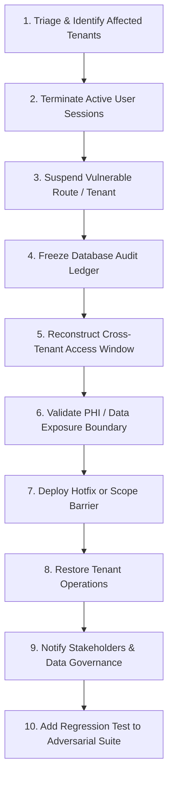

# ZAYVORA MATAB OS — Tenant Isolation Incident Response Runbook

**Document ID:** SEC-RUNBOOK-INCIDENT-001  
**Phase:** 8 — Platform Operations and Support Access  
**Date:** 2026-10-15  
**Author:** Principal Application Security Engineer & DevSecOps Lead  
**Status:** Approved  

---

## 1. Incident Severity Classification

| Severity Level | Definition | Example Scenario |
|---|---|---|
| **SEV-1 (CRITICAL)** | Confirmed cross-tenant data breach or unauthorized modification | A user in Organization B successfully reads or updates a prescription belonging to Organization A. |
| **SEV-2 (HIGH)** | Potential isolation vulnerability or unauthorized support impersonation | A break-glass session was initiated without valid reason code or ticketing approval. |
| **SEV-3 (MEDIUM)** | Denied cross-tenant attempt or anomalous API pattern | Repeated HTTP 403 Forbidden cross-tenant access attempts from an authenticated user. |

---

## 2. 10-Step Containment Procedure



### Detailed Execution Steps:
1. **Triage & Tenant Identification:** Extract `request_id`, client IP, user ID, and target organization ID from `audit_events` and error logs.
2. **Session Termination:** Invalidate active session tokens immediately:
   ```sql
   DELETE FROM sessions WHERE user_id = ? OR organization_id = ?;
   ```
3. **Tenant Suspension:** If widespread compromise is suspected, transition tenant to `SUSPENDED` using `TenantGovernanceEngine.transition_tenant_status(org_id, "SUSPENDED", "INCIDENT_CONTAINMENT")`.
4. **Audit Ledger Freezing:** Snapshot `saas_governance_audit_ledger` and `clinical_audit_ledger` to verify blockchain integrity.
5. **Reconstruct Access Logs:** Query `audit_events` for all events involving the suspected actor within the incident window.
6. **Data Exposure Assessment:** Differentiate between *attempted access* (HTTP 403 logged with `CROSS_TENANT_ACCESS_DENIED`) and *actual data exposure* (HTTP 200).
7. **Deploy Remediation:** Apply server-side query scoping or relation validation.
8. **Restoration:** Following review by the Security Lead, restore the tenant to `ACTIVE`.
9. **Notification:** Follow clinical data breach reporting requirements per National Health Data Management guidelines.
10. **Automated Regression Test:** Add the exact attack vector to `tests/unit/test_tenant_governance.py` or `tests/integration/test_tenant_governance_api.py`.

---

## 3. Support & Break-Glass Session Revocation

To immediately terminate an active break-glass support session:
```bash
POST /api/v1/tenant-governance/break-glass/{ticket_id}/revoke
```
This instantly revokes the ticket, invalidates the associated temporary session token, and records the revocation in `saas_governance_audit_ledger`.
