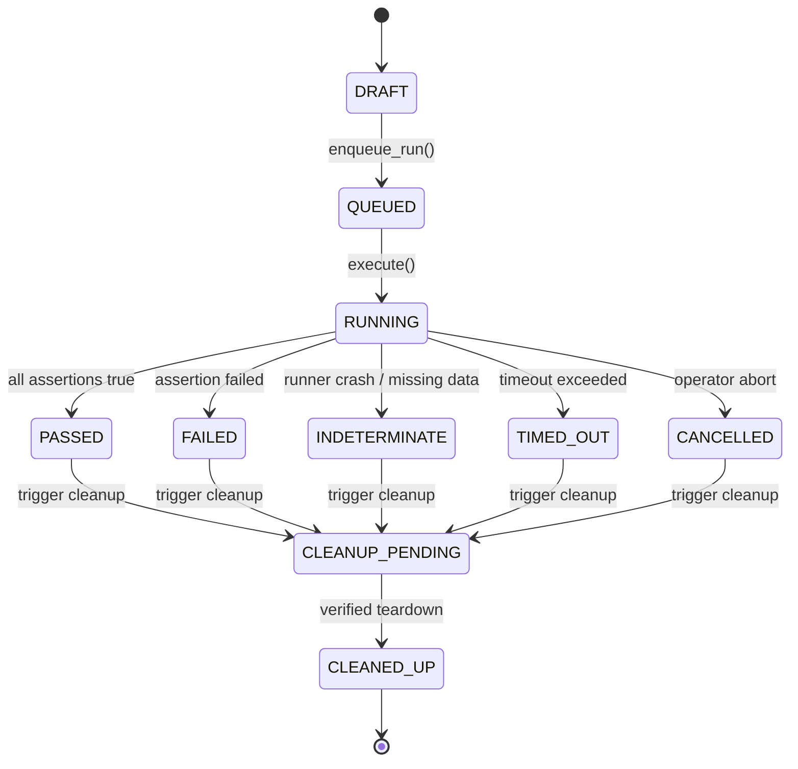

# SIMULATION, FAULT INJECTION & RELEASE GATE SPECIFICATION
## ZAYVORA MATAB OS — Enterprise Workflow Reliability Engine

**Document Type:** Technical Specification  
**Phase:** 37 — Enterprise Workflow Simulation, Failure Injection & Recovery Validation  
**Product:** ZAYVORA MATAB OS  

---

## 1. Scenario Schema & Model

Each simulation scenario is a versioned, reviewed definition stored in `simulation_scenarios`:

```json
{
  "scenario_key": "sim-scen-001-dup-event",
  "name": "Duplicate Intake Event Idempotency & Task Suppression",
  "purpose": "Verify duplicate patient intake events do not generate duplicate queue tokens or administrative work items.",
  "category": "duplicate_and_ordering",
  "risk_level": "low",
  "environment_allowlist": ["local", "dev", "sandbox", "ci"],
  "status": "APPROVED",
  "version": 1,
  "owner_role": "SYSTEM_ADMIN",
  "cleanup_policy": "automatic",
  "timeout_seconds": 60,
  "steps": [
    {
      "step_order": 1,
      "action_type": "INGEST_EVENT",
      "target_service": "workflow_automation",
      "payload": {"event_type": "PATIENT_CHECKED_IN", "patient_id": "sim-pat-001", "idempotency_key": "idemp-checkin-001"}
    },
    {
      "step_order": 2,
      "action_type": "INGEST_EVENT",
      "target_service": "workflow_automation",
      "fault": {"fault_type": "DUPLICATE_DELIVERY", "delay_ms": 100},
      "payload": {"event_type": "PATIENT_CHECKED_IN", "patient_id": "sim-pat-001", "idempotency_key": "idemp-checkin-001"}
    }
  ],
  "assertions": [
    {
      "assertion_key": "assert-single-event",
      "assertion_type": "EVENT_DEDUPLICATED",
      "expected_condition": "count == 1",
      "target_table": "automation_events",
      "filter_field": "idempotency_key",
      "filter_value": "idemp-checkin-001"
    },
    {
      "assertion_key": "assert-no-duplicate-task",
      "assertion_type": "RECORD_EXISTS",
      "expected_condition": "count == 1",
      "target_table": "workflow_planned_actions",
      "filter_field": "deduplication_key",
      "filter_value": "idemp-checkin-001"
    }
  ]
}
```

---

## 2. Controlled Fault-Injection Catalogue

Fault injection is strictly blocked in production environments (`ENVIRONMENT == 'production'`). Allowed non-production fault modes include:

1. `TIMEOUT`: Injects an artificial delay exceeding client HTTP or queue timeout (e.g. 10,000ms delay with 2,000ms deadline).
2. `CONNECTION_FAILURE`: Simulates a dropped socket or unreachable remote endpoint (`ECONNREFUSED`).
3. `DEPENDENCY_500`: Returns HTTP 500/503 from downstream webhook, notification gateway, or hospital endpoint.
4. `DELAYED_ACK`: Withholds delivery acknowledgement until downstream retry worker is triggered.
5. `DUPLICATE_DELIVERY`: Dispatches the same message or webhook payload twice in rapid succession.
6. `CORRUPT_PAYLOAD`: Mangles payload schema (e.g., malformed JSON or missing required fields) to test validation reject.
7. `AUTH_REVOKED`: Simulates token expiration or revoked role mid-workflow.
8. `CIRCUIT_TRIPPED`: Forces circuit breaker state to `OPEN` to verify traffic shielding and fallback.

---

## 3. Canonical Assertion Catalogue

Assertions inspect persisted relational records, audit ledgers, and adapter logs:

1. `STATE_EQUALS`: Verifies entity status (e.g. `workflow_exceptions.status == 'ACKNOWLEDGED'`).
2. `RECORD_EXISTS`: Verifies count of records matching criteria (e.g., exactly 1 record created).
3. `EVENT_DEDUPLICATED`: Confirms second event was recognized as duplicate and processed idempotently.
4. `RETRY_COUNT_BOUNDED`: Verifies attempt count did not exceed configured maximum retry budget (e.g. $\le 3$).
5. `PERMISSION_DENIED`: Asserts unauthorized request was blocked with 403 Forbidden.
6. `SIDE_EFFECT_SUPPRESSED`: Proves no real SMS/email/external API call was emitted to live networks.
7. `AUDIT_LOGGED`: Confirms an immutable audit ledger entry was written with valid SHA-256 hash.

---

## 4. Run State Model & Lifecycle



---

## 5. Release Gate Evaluation

The release gate aggregates scenario test runs for a target release commit/version:

- **PASS:** 100% of required scenarios in the release test plan have status `PASSED` and `CLEANED_UP`.
- **FAIL:** One or more required scenarios have status `FAILED`.
- **INDETERMINATE:** Any required scenario timed out, crashed, or yielded indeterminate evidence.
- **BLOCKED:** Required scenarios are missing approvals, unapproved versions, or fixtures cannot be provisioned.
- **NOT_RUN:** Required scenarios were not executed.

A release gate MUST NOT pass if any scenario has a non-`PASSED` outcome.
