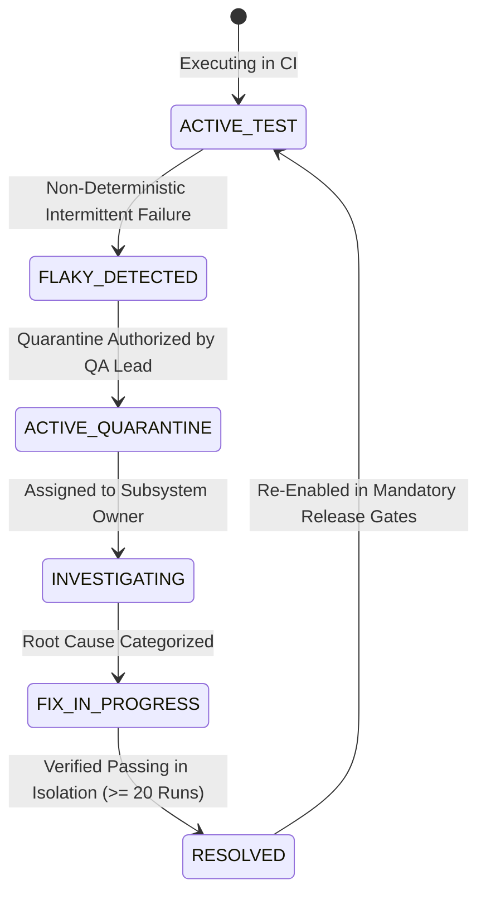

# ZAYVORA MATAB OS — PROMPT 49 SPECIFICATION
## End-to-End Test Automation, Regression Testing & Release Qualification Engine

**Version:** 1.0.0  
**Status:** Approved for Implementation  
**Standard Compliance:** DCB0129 / DCB0160 Clinical Risk Management, ISO 14971, ISO 25010 Software Quality

---

## 1. Architectural Vision & Core Principles

The **End-to-End Test Automation, Regression Testing & Release Qualification Engine** provides automated verification, regression governance, flakiness management, and cryptographic release qualification for the ZAYVORA MATAB OS platform.

### Core Non-Negotiable Invariants:
1. **Real Persistence Over Shallow Toasts:** Assertions must evaluate persisted database state, transaction rollback semantics, and row-level ownership. A 200 HTTP response or UI toast is insufficient evidence.
2. **Deterministic Isolation:** Automated tests must never reach live payment gateways, external SMS/WhatsApp networks, real patient records, or production analytics. Tests execute in isolated synthetic workspaces with time injection.
3. **No Fictitious Clinical Truth:** Clinical fixtures must trace strictly to pharmacopoeial monographs (NFUM/UPI) or approved Ayush clinical guidelines. Test engineers cannot invent botanicals, doses, or contraindications to force green tests.
4. **Governed Flakiness Quarantine:** Flaky or unstable tests must not be silently disabled or ignored. A quarantined test is logged with root-cause classification, strict 14-day resolution target date, and assigned engineering owner.
5. **Fail-Closed Release Qualification:** A release candidate cannot be qualified (`QUALIFIED`) if mandatory test suites fail, if unverified suites are skipped, or if open blocker/critical defects remain. Missing evidence evaluates to `BLOCKED` or `STALE_EVIDENCE`, never `PASS`.
6. **Defect-to-Safety Traceability:** Test defects involving posology, contraindications, Mudabbar detoxification, or clinician digital PIN signing link bidirectionally to the Clinical Hazard Register (Prompt 48) and Threat Models (Prompt 47).
7. **Tamper-Evident SHA-256 Audit Trail:** Every test run, quarantine transition, defect resolution, and release qualification evaluation is sealed in an append-only, SHA-256 hash-chained ledger.

---

## 2. Test Layer Taxonomy

The engine classifies all platform automated verification across 9 defined layers:

```
               [ ACCESSIBILITY / USABILITY ] (WCAG 2.1 AA, RTL Urdu, Screen-Reader)
             [ PERFORMANCE & LOAD ] (Latency, FEFO Lock Contention, Decimal Rounding)
           [ SECURITY & PENETRATION ] (SQLi, IDOR, Token Expiration, RBAC Bypass)
         [ MIGRATION & DATA INTEGRITY ] (DDL Upgrade, Rollback Idempotency, Constraints)
       [ CONTRACT & INTEROPERABILITY ] (FHIR R4 Bundles, ABDM Milestones, JSON Schema)
     [ END-TO-END WORKFLOW JOURNEYS ] (Full Encounter: Search -> Prescribe -> Sign -> Dispense)
   [ REST API & INTEGRATION SUITES ] (Route Handlers, Tenant Filters, Audit Logging)
 [ DOMAIN LOGIC & UNIT TEST SUITES ] (Mathematical Posology, GSN Logic, SLA Timers)
```

1. **`UNIT`**: In-memory domain calculations, state machines, and invariants.
2. **`COMPONENT`**: UI interaction states, accessible label bindings, and form validation.
3. **`API_INTEGRATION`**: Server-side routes executing through `ApiRouter.dispatch` verifying authorization, schema, and database transactions.
4. **`E2E_WORKFLOW`**: Complete cross-boundary journeys crossing patient search, encounter intake, Unani clinical diagnosis, prescription authoring, and electronic signature.
5. **`CONTRACT`**: Schema compatibility for ABDM / FHIR R4 resources, external webhooks, and asynchronous integration messages.
6. **`MIGRATION`**: Clean install, sequential schema upgrade (`001` through `048`), index verification, and constraint integrity.
7. **`SECURITY`**: Non-intrusive static and dynamic checks (SQL injection parameterization, secret leaks, token expiration, deny-by-default RBAC).
8. **`PERFORMANCE`**: Controlled benchmarks evaluating database query times, queue throughput, and posology validation latency.
9. **`ACCESSIBILITY`**: Automated checks for semantic HTML, focus states, and bidirectional layout integrity (Urdu/Hindi/English).

---

## 3. Flakiness Quarantine State Machine



### Root Cause Categories:
- `TIMING_RACE`: Asynchronous race condition or missing wait condition.
- `STATE_POLLUTION`: Shared global mutable state or uncleaned database fixture.
- `EXTERNAL_DEPENDENCY`: Flaky external network connection or sandbox mock delay.
- `RESOURCE_STARVATION`: Memory limits or CPU throttling on CI container.
- `UNKNOWN`: Unclassified failure undergoing root-cause analysis.

---

## 4. Release Qualification Profiles & Gate Decision Matrix

The engine supports 3 release qualification tiers:

| Profile Code | Target Tier | Min Pass Rate | Quarantined Allowed? | Max Critical Defects | Required Layers |
| :--- | :--- | :--- | :--- | :--- | :--- |
| **`PROF-DEV`** | Development Branch | 90.00% (9000 bp) | Yes (up to 5) | 2 | `UNIT`, `API_INTEGRATION` |
| **`PROF-STAGING`**| Pre-Production / Pilot | 98.00% (9800 bp) | Yes (up to 1, Non-Clinical) | 0 | `UNIT`, `API_INTEGRATION`, `E2E_WORKFLOW`, `MIGRATION` |
| **`PROF-PROD`** | Production Regulated | 100.00% (10000 bp)| **Strictly Zero** | **Zero** | `UNIT`, `API_INTEGRATION`, `E2E_WORKFLOW`, `CONTRACT`, `MIGRATION`, `SECURITY` |

### Gate Decision Logic:
- If any required suite in profile has status `FAILED` $\to$ **`BLOCKED`**.
- If any mandatory test layer is skipped or missing execution $\to$ **`BLOCKED`** (Reason: "Incomplete verification evidence").
- If test execution results are older than 24 hours $\to$ **`STALE_EVIDENCE`**.
- If profile forbids quarantined tests and active quarantines exist $\to$ **`BLOCKED`**.
- If open `BLOCKER` or `CRITICAL` test defects exist $\to$ **`BLOCKED`**.
- If all required suites ran, passed, met threshold, with zero open defects $\to$ **`QUALIFIED`**.

---

## 5. Database Schema Design (Migration 048)

1. `test_automation_suites_catalog`: Canonical registry of all executable suites with layer, command, and timeout.
2. `test_execution_runs`: Evidence ledger capturing test counts, duration, and status.
3. `test_flakiness_and_quarantine_register`: Governed quarantine register with 14-day SLA.
4. `release_qualification_profiles`: Tiered release qualification requirements.
5. `release_candidate_qualifications`: Formal release qualification verdicts with blocking reasons.
6. `test_automation_defect_register`: Structured defect catalog linked to clinical hazards and owners.
7. `test_qualification_audit_ledger`: SHA-256 tamper-evident cryptographic log.
